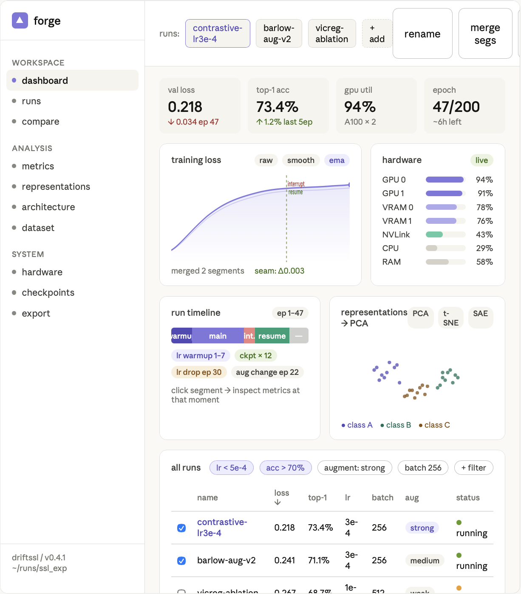
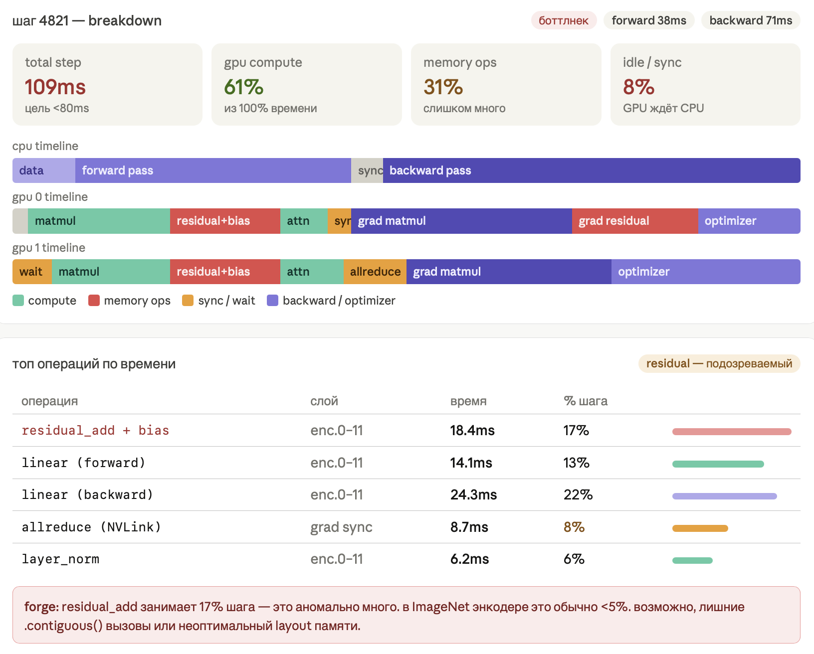
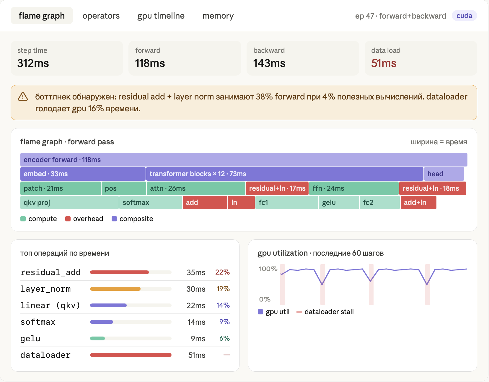

# Log

По сути в production коде и в research коде есть очень много вещей, куча всяких дополнений к тренировке, которые являются просто стандартными. Одно слово - стандартными. Они не добавляют ничего нового, они просто нужны для того, чтобы запустить всю эту штуку. Для этого есть функции в коде, но они требуют постоянно какого-то контроля, каких-то, я не знаю, assert, каких-то нескольких строк кода, конфигурации, когда для всего этого можно придумать один стандартный набор конфигураций, один стандартный интерфейс. Если вдруг что-то через toolkit, мы делаем теперь log, это toolkit, заходишь внутрь, это реализация этой функции, видишь стандартный, собственно, тот же синтекс, к которому ты привык, но к которому ты привык. В самом файле тренировки, а здесь он отдельно находится. Очень удобно. Также все видно, все реализуется, есть куча визуализаторов для любых типов данных. Хоть мы делаем распределенную тренировку, мы можем мониторить все, что угодно, хоть мы делаем какую-нибудь сложную тренировку с кучей чекпоинтов, у нас что-то прерывается, или там какие-то спайки, какие-то проблемы, мы все это видим. Если мы хотим что-то интерпретировать механистически, посмотреть, как что-то себя вело в процессе обучения, это все запоминается, это все логируется, это все очень удобно. Потому что постфактум можно посмотреть и разобрать, что вообще происходило, и особенно дать LLM с этим всем работать и анализировать.

Идеи для блогов и документации. В лог добавить документацию для агентов, документацию для новичков, которые описывают даже, включая, что такое декораторы в Python, и базовые техники работы PyTorch и так далее. И документацию для профессионалов, которая делает отсылки к другим сервисам типа MLflow, сравнивает их, например. Да, документация для языковых моделей со всеми точными описаниями того, как что делать. И также описание философии на описание кода, то есть каким образом, что код на самом деле делится на reusable компоненты идентичные и есть где проявляется вообще хоть какой-то креатив. Мы уменьшаем количество этих reusable компонентов, делая код реально понятным, чтобы даже человек без агента, без всяких проблем мог с ним разобраться, не теряясь в контексте. И, ну, иерархически по этому контексту двигался, если вдруг это нужно. Также, чтобы не было boilerplate кода и каждая строка имела реальное значение, высокоуровневое, которое реально человеку понятно воспринимать. Далее, диаграммы того, как вообще сделана вся система. Мы используем минимальные там какие-то приколы в анимациях и так далее. Но их делаем, потом тоже будем. Как раз таки для того, чтобы сохранить минималистичность архитектуры, во всяком случае, поначалу. И в основном просто доделываем в нем UI. Делаем так, что сервис выглядит красиво. Показываем схему всех элементов, показываем, что у нас новые фичи, каждая в папке находится новая. То есть, файловую структуру такую можно использовать. Файлы, их вложность отражает вложность фичей. Дальше показываем вообще философию работы софта. То есть, это как корень того, что любые данные, это, во-первых, читаемые файлы, которые читаемы в том числе и агентами. Это также Excel-евские, по сути, таблички. Вот эти вот, которые отображаются, отображают файлы. И таким образом можно наслапать их в визуализацию, как в Excel, любыми способами. И добавлять свои, в том числе через такой граничный API, который в своем стиле это делает, с помощью языковых моделей, буквально в самом коде. Или в окошке, в редакторе, в самом веб-интерфейсе. И возможность, конечно же, экспортировать с разными, всеми библиотеками в разных видах. С визуальными настройками. Возможность мерзжить таблички, делать с ними все, что угодно. Это тоже, как бы, понятно. И по-разному их, да, представлять. Дальше архитектура, вот помимо всех этих элементов, всех этих стейт-систем, всех этих универсальных блоков и так далее, добавляется сверху, накидывается архитектура оптимизаций. И накидываются слои, которые отвечают за систем дизайн, за взаимодействие с данными по сети и на самом устройстве. И дальше добавляются сверху все больше и больше разных абстракций для разных частей. Дальше гайды для того, чтобы дополнять сам open source клиент весь этот. Дополнять API, какие-то pull requests создавать, skill файлы для агентов. Четкое объяснение структуры того, как мы новые фичи добавляем. Проверка от этого всего. В визуализациях. И подобные вещи. Объяснение философии, что это именно tool kit для упрощения понимания кода, быстрых итераций и меньшей неопределенности, которые могут языковые модели вызвать. Также способ увидеть больше из данных. Так как все эти данные визуализируются, тебе не нужно отдельно думать над тем, что визуализировать, чтобы это увидеть. Таким образом ты получаешь автоматически больше инсайтов. Любых. Включая все статистические инсайты и какие-то такие базовые. Добавлены туда визуализации. Ну и также показываем, как Toolkit сокращает код, то есть мы видим огромный-огромный-огромный на несколько тысяч строк код, который там что-либо делает. Мы его сокращаем в разы просто, вот цветом подсвечивая, каким образом мы заменяем какие части кода, какими командами, как их можно потом каждую день накастомизировать, если нужно. И, например, вот те вещи, которые мы однажды объявили, что мы, например, работаем с кодой. Не надо где-либо еще нам писать в разных форматах, с разными названиями, с разными синтаксисами, что мы используем коду, что нужно оптимизировать под коду. Не нужно это делать. То есть все одной командой какой-то логически для человека, как бы обособленное действие. Все. Но при этом тренировочный цикл мы не заменяем. Мы его сокращаем просто. Сам цикл контролируется человеком тоже.

концепт сервиса по визуализации тренировок ии моделей типа clearml или mlflow: красивый ui, запускается локально, интерпретируемые для человека папочки с бд со всеми логами, интеграция с pytorch, логирование сырых чисел, а не сразу упакованных картинок с визуализациями, фильтрация и выбор по всем-всем пораметрам среди большого кол-ва прогонов, множественное умное переименовывание проектов, склеивание нескольких графиков продольно если прогон прервался, данные о загрузке железа с визуализациями по утилизации множественных gpu cpu и их linkов, консольные логи как уведомления, автоматическое сохранение и восстановление чекпоинтов стейта датасета и показ tdqm в консоли – автоматически из кода – то есть ui и поведение в коде связываются, таймлайн обучения модели с возможностью посмотреть значения в каждой её части в тот момент времени, визуализировать архитектуру и размерности данных, сами логирующиеся данные на ходу представлять можно разными графиками в зависимости от типа этих данных (даже самых продвинутых) и (!!) преобразовывать эти данные через автоматически встроенные pca, svd, sae для интерпретируемости моделей, то же самое с датасетом на входе – как хочешь крути-верти, автоматические метрики прогонов так же можно генерировать по данным, и даже запускать модель для ручного тестирования, и наконец, возможность сохранять финальные графики в высоком разрешении в любых стилях для экспорта для научных работ, так же создавать гифки и видео изменения графиков во времени
excel для ml
основной элемент – тензор. это и таблица прогонов, и каждый элемент модели, и элемент датасета. всё. каждый тенсор можно преобразовывать автоматически как в экселе и визуализировать параллельно как хочешь, в любом виде
для инспектинга моделей можно смотреть на pytorch computation graph – тоже даже отдельно для каждого тензора – и это соединение разных тензоров через стрелочки это отдельный ui
тензоры, так же как в экселе, можно собирать, фильтровать, сравнивать, редактировать вручную даже! или через вписывание своих данных, столбцов, или через манипуляцию на графиках (да, типа точки на графике соединить, присоединив два тензора и т д) – как это понятно теперь в интерфейс добавить? и как вообще это редактирование будет работать если это в коде всё прописывать надо же… наверное редачить не стоит, но было бы так весело занизить вручную какой-нибудь софтмакс на выходном слое ллмки во время генерации одного токена на тестовом инференсе…
возможно, некоторые фиксированные обозначения, например, «таймлайн» для обозначения шага обучения или «модель» для computation графа всей модели стоит и оставить, несмотря на то что в интерфейсе у них будет унифицированный вид…
вопрос остается один – в экселе просто все таблицы рядом находятся, в рандомном месте практически. у меня все иерархично: запуск в списке проектов, модель в запуске, слой в модели – как соединить и сравнить, составив новый временный тензор, например, первый вектор аттеншн-матрицы первого слоя и второй вектор – творого слоя? типа, не будет же C2:D3 или чего-то подобного – всё же иерархично…
И, СУКА, БЫСТРОЙ СКРОЛЛ ПО ГРАФИКАМ ИЗ СПИСКА ЧЕРЕЗ КЛАВИШИ СТРЕЛОЧЕК
Для этого сервиса по визуализации экспериментов по ML, короче, вместо того, чтобы выбирать между тем, чтобы строить какое-то дерево каких-то вычислений и дерево, или просто набор карточек, например, которые никак не связаны, сделать этот набор карточек, то есть вот этих вот блоков со всякими логами, там, например, которые просто в ряд, там, например, три штуки стоят, но их как бы иерархически соединить, то есть вверху там один блок самый главный, потом от него такие тоненькие-тоненькие такие геометрические стрелочки, которые ведут к следующим, ну, не стрелочки даже, а просто, наверное, какие-то кривые, ведут к следующим таким блокам, то есть мы вроде как добавляем иерархию, при этом это просто обычная лог-консоль, очень удобно.
Дальше можно говорить о мобильной версии для того, чтобы трекать эксперименты, об анимациях в интерфейсе, об инфицированном способе рендеринга всех деталей, чтобы в целом отзывчивость была высокая при перемещении между кучей графиков, например. Как-то вот, опять же, этот блок изменений сделать его более общим. Дальше всякие мелкие паттерны, типа там вот при наведении на какой-нибудь график ты видишь какое-то число в какой-то момент, и ты можешь, например, нажать, зафиксировать эту линию, вбить точное значение, увидеть точное значение в ней. Она будет, например, показывать числа в сотых делях, ты при наведении там будет уже раскрываться полностью все значение, что-нибудь такое. Такие приятные UI-мелочи. Дальше это трекинг инфраструктуры на системах с огромным количеством видеокарт, чтобы было понятно, где что утилизируется. Просто визуализация всяких логов, типа из NVIDIA всяких штук. Чтобы было понятно вообще, сколько куда данных подается, насколько это все, где все простое находятся, и насколько все эти данные не перемешиваются друг с другом и так далее. Чтобы тоже это можно было сделать. Все эти анализы, там, корреляции данных провести, и вот это все, это тоже, опять же, можно сделать уже в интерфейсе финальном. Просто проведя анализ, ну, какую-то операцию, выбрав из дроп-даун меню для, там, этого, для какой-то таблицы. А все, ну, соответственно, данные логи, они тоже в таблицы закидываются. Вот. Дальше можно сделать, чтобы много пользователей какая-то штука была, чтобы много людей к этому доступ получало, чтобы можно было видеть, что там и как. Можно добавить, там, опять же, обзор моделей, визуализацию, там, например, даже кода по тензорам, там, смотреть, как, что, куда идет и преобразуется. Вот. Чтобы точно ничего не набутать. Потому что очень много экспериментов, реально, в них есть куча ошибок, и происходят от малого понимания того, что на самом деле вообще внутри делается. И дальше MCP-сервер, к этому всему подрубить. И для больших компаний, как раз таки, вот, многопользовательский режим, и большое хранилище, доступ к нему для того, чтобы логировать все состояния модели во время тренировки. И также логировать как раз таки состояние, вот, параллельность, там, обучения. Те же самые RL, например, те же векторизированные среды, все эти системы подачи данных в модель, это все, типа, ну, короче, там надо трекать. Вот. И шрифт от студии Артемия лебедева. Все-таки очень бы хотелось сделать какой-нибудь PyTorch Visual, чтобы все-таки видеть, как все происходит внутри. И из интерфейса менять все-таки состояние системы. Например, когда ты хочешь через Sparse Autoencoder посмотреть, как модель себя ведет и может быть что-то поменять в ней. Например, во время обучения посмотреть, какие убираются факты, например, и так далее. loss landscape visualizations as well!!

Как вообще писать приложения, которые масштабируются и легко понимаются? То есть я знаю про архитектуру, я знаю архитектурные паттерны, я знаю сетевые паттерны типа System Design. Я понимаю, как на уровне папок программы делаются в основном классы и так далее, объектно-ориентированное программирование, архитектура, MVVM и подобные все штуки. Но конкретно, типа, когда у тебя сложный интерфейс, ты делаешь свои какие-то кастомные там анимации, как их конкретно реализовывать, что в виде чего представлять, что из этого должно быть объектом, что из этого должно быть функцией. Функция она делает только бизнес-логику или она еще может делать какой-то, ну типа какой-то визуал, как делать какие-то, типа там, не знаю, переменные, базу данных в приложении, как это все взаимодействует и работает, как бы как это сделать так, чтобы соот был настолько модульным и без багов, я не знаю, чтобы вот все было классно. Типа, ну, есть ли какие-то типа гайды, какие-то влоги на эту тему очень хорошие, прям, которые ты вот из памяти можешь найти, которые это все бы объясняли именно для реальных приложений, а не просто абстрактных программ. И что ты сам можешь мне посоветовать?  
  
**Разделяй то, что меняется по разным причинам.**  
Анимация меняется когда дизайнер говорит "сделай помягче". Бизнес-логика меняется когда продукт говорит "теперь кнопка активна только если есть интернет". База данных меняется когда ты мигрируешь с CoreData на SwiftData. Если всё это в одном месте — один маленький правок ломает три несвязанные вещи.  
  
**Конкретно про UI и анимации**  
Анимации — это **не бизнес-логика и не состояние**. Это реакция на изменение состояния. Поэтому:  
// Плохо: логика и анимация вместе  
func didTapButton() {  
    isLoading = true  
    fetchData()   
    UIView.animate(...) { self.button.alpha = 0 }  
}  
// Хорошо: View наблюдает за состоянием, сама решает как анимировать  
// ViewModel меняет isLoading  
// View через .onChange или didSet запускает анимацию  
  
Анимация живёт в View-слое и точка. ViewModel вообще не знает что есть какой-то UIView.animate.  
Кастомные анимации лучше выносить в отдельные объекты или extension:  
extension UIView {  
    func animateIn() { ... }  
    func animateOut() { ... }  
}  
// или отдельный AnimationCoordinator для сложных сценариев  
  
**Что делать объектом, что функцией**  
Простое правило: **объект — если у него есть состояние, функция — если нет**.  
* func formatDate(_ date: Date) -> String — нет состояния, функция  
* class ImageLoader — есть кэш, есть очередь загрузок, это объект  
* func validate(email: String) -> Bool — функция  
* class FormValidator — если правила валидации конфигурируются и переиспользуются, объект  
  
**База данных и UI**  
Классическая схема которая не ломается:  
  
Repository (только CRUD, не знает про UI)  
    ↓  
ViewModel (бизнес-логика, @Published переменные)  
    ↓  
View (наблюдает, рендерит)  
Repository не должен знать что такое @Published. ViewModel не должна знать что такое UITableView. Тогда каждый слой можно тестировать отдельно и менять независимо.  
  
**Про модульность без багов**  
Один практический приём — **feature folders вместо type folders**:  
// Плохо  
/Models/User.swift  
/ViewModels/ProfileViewModel.swift    
/Views/ProfileView.swift  
  
// Хорошо  
/Features/Profile/  
    ProfileView.swift  
    ProfileViewModel.swift  
    ProfileRepository.swift  
    User.swift  // если используется только здесь  
Когда удаляешь фичу — удаляешь папку. Всё.  
  
**Почему чистый OOP не работает**  
Потому что OOP хорош для моделирования **существительных** — объектов у которых есть идентичность и жизненный цикл. Но большая часть UI — это **глаголы**: трансформации данных, реакции на события. Когда ты всё упаковываешь в классы с методами — получаешь запутанные графы зависимостей.  
Рабочая идея: **Functional Core, Imperative Shell**.  
Чистые функции (никаких сайд-эффектов, никакого состояния)  
    State → State  (редьюсер)  
    State → View   (рендер)  
  
Грязная оболочка (где живут реальный мир, I/O, анимации)  
    Таймеры, сеть, база данных, UIKit-анимации  
  
UI как конечный автомат — это именно правильная модель. Вот скелет:  
enum ScreenState {  
    case idle  
    case loading  
    case scrolling(velocity: CGFloat, predictedTarget: Int)  
    case snapping(toIndex: Int)  
    case settled(index: Int)  
}  
  
enum Event {  
    case scrollBegan  
    case scrollChanged(delta: CGFloat)  
    case scrollWillEnd(velocity: CGFloat)  
    case snapCompleted  
}  
  
func reduce(state: ScreenState, event: Event) -> ScreenState {  
    switch (state, event) {  
    case (.idle, .scrollBegan):  
        return .scrolling(velocity: 0, predictedTarget: 0)  
    case (.scrolling, .scrollWillEnd(let v)):  
        let target = predictSnapTarget(velocity: v)  
        return .snapping(toIndex: target)  
    // ...  
    }  
}  
View наблюдает за ScreenState и запускает анимации. Никакой логики в View — только реакция на состояние.  
  
**Что такое "высоконагруженное" на практике**  
Три главных паттерна:  
**1. Horizontal scaling** — не один мощный сервер, а много слабых за load balancer. Для этого сервисы должны быть stateless — никакого состояния в памяти процесса, всё в Redis или БД.  
**2. Caching** — читать дорого, кэшировать дёшево. Стандартный паттерн: сначала смотришь в Redis, если нет — идёшь в PostgreSQL, результат кладёшь в Redis на N минут. Главная сложность — инвалидация кэша.  
**3. Async processing** — тяжёлые операции (отправка email, генерация изображения, ML inference) никогда не делаются синхронно в request/response цикле. Запрос приходит → кладётся в очередь → воркер обрабатывает → результат через WebSocket или polling.  
  
**Главная идея React** — UI как функция от состояния. UI = f(state). Ты описываешь как выглядит интерфейс при каждом состоянии, React сам разбирается как обновить DOM. Это очень близко к тому FSM-подходу который ты описывал для SwiftUI — та же идея.  
**Проблема с которой все спотыкаются** — управление состоянием. Где хранить данные, как их передавать между компонентами. Правило простое: состояние живёт как можно ближе к тому месту где используется. Глобальный стор нужен только для реально глобальных вещей (авторизация, тема, язык).  
  
**Про архитектуру фронта**  
Тот же принцип что на мобилке — разделяй по причинам изменения:  
/features/  
  /profile/  
    ProfilePage.tsx       // только рендер  
    useProfile.ts         // логика, запросы, состояние  
    profile.types.ts      // типы  
    profile.api.ts        // запросы к серверу  
Компоненты делятся на два вида — и это важно держать в голове:  
**UI компоненты** — не знают откуда данные, только принимают props и рендерят. Переиспользуются везде. Button, Card, Modal.  
**Feature компоненты** — знают про бизнес-логику, ходят в API, управляют состоянием. ProfilePage, CheckoutForm.  
  
**от формулировки задачи к формулировке системы**  
сначала не пишут код. сначала формулируют «модель предметной области» — это упорядоченное описание того, какие сущности есть в мире продукта и как они связаны. например, для заметок: «заметка», «папка», «пользователь», «устройство», «синхронизация», «доступ офлайн». рядом кладут «нефункциональные требования» — это свойства системы вроде «запускается за ≤ 400 мс», «не теряет данные при убийстве процесса», «обновление экрана всегда укладывается в 16,7 мс». эти числа — не украшения; они двигают архитектуру сильнее, чем любые вкусовые предпочтения по паттернам.  
после этого пишут короткий «архитектурный набросок». под «архитектурой» здесь понимаю не диаграммы коробочек, а распределение ответственности: какие подсистемы существуют и за что они отвечают. цель наброска — снять ключевые риски. для Apple это чаще всего: управление состоянием интерфейса, офлайн-хранилище, синхронизация и миграции данных, производительность рендера, безопасность (ключи, токены, шифрование), фоновые процессы и «живучесть» при ограничениях системы.  
  
**эволюция: как добавлять большое без слёз**  
большие фичи не «впрыгивают» в основной код. сначала делают «изолят» — микромодуль с чёткими границами и фиче-флагом. постепенно подводят зависимости, пишут миграции, включают для 1% пользователей, сравнивают метрики, раскатывают шире. параллельно ведут «ADR» — записи архитектурных решений. ADR — короткая заметка: контекст, решение, альтернативы, последствия. это защищает командную память и объясняет, «почему так».  
  
**управление состоянием: один источник правды**  
«состояние» — это снимок всего, что нужно экрану, чтобы отрисоваться: данные, флаги загрузки, ошибки, выбранные элементы. хороший стиль — держать одно «истинное» состояние на экран и производные вычислять из него. обновления делают атомарными, через явные «действия» (пользователь нажал, сеть ответила). зачем так строго: чтобы можно было воспроизвести баг и чтобы не возникало гонок, когда один поток пишет, а другой читает.  
  
Главная проблема: **ViewModel часто становится мусорным контейнером логики**. Туда начинают складывать всё: состояние экрана, форматирование текста, валидацию, сетевые запросы, навигацию, бизнес-правила, обработку ошибок. В итоге View стала тонкой, но ViewModel стала огромной и не менее запутанной.  
Второй минус — **слишком много boilerplate-кода**. Для простого экрана приходится делать View, ViewModel, state, events/actions, bindings, mappers, иногда отдельные use cases. Для CRUD-интерфейса это может быть тяжелее, чем сама задача.  
Третий минус — **сложнее понимать поток данных**. Пользователь нажал кнопку → View отправила action → ViewModel изменила state → View перерисовалась → где-то отдельно сработал эффект/навигация/alert. Это красиво на схеме, но в реальном проекте легко потерять, кто именно за что отвечает.  
Четвертый минус — **двусторонние биндинги могут скрывать причинность**. Особенно в классическом MVVM: значение “само обновилось”, UI “сам отреагировал”, observable “сам вызвался”. Когда что-то ломается, дебажить сложнее, чем в более явной архитектуре типа unidirectional data flow.  
  
**интерфейс: дизайн-система как код**  
большие приложения вводят «дизайн-систему» — набор компонентов и правил, зашитых в код, а не в Figma-картинки. это отдельный модуль UI-компонентов, токены (отступы, размеры, шрифты) и примитивы (кнопки, поля, списки). SwiftUI тут силён: компоненты — это чистые функции от состояния к виду. главное правило — компоненты «тупые»: они не знают, как загружать данные, они только рисуют и пробрасывают сигналы наверх.  
  
**маленький пример: как бы мы запускали заметки с офлайном и синком**  
формулируем домен: Заметка {id, текст, метки, версия}, Папка, Изменение {id, операция, версия, causality}. нефункционально: старт ≤ 400 мс, скролл без дропов, редактирование офлайн, конфликты решаются детерминированно. архитектура: домен в отдельном пакете, инфраструктура: SwiftData для локального снапшота + «журнал изменений» в SQLite, синк-адаптер к CloudKit с очередями и повторами. состояние экрана — MVVM: View читает «NoteViewState», отправляет «Action» (пользователь печатает). глобальный стор (единый объект состояния) принимает «Action», редьюсер в домене производит новый «State» и «Effect» (например, «положи изменение в очередь синка»). актор SyncService обрабатывает очередь, делает батчи, вешает бэкофф на ошибки. миграции — версионированные, при старте гоняются транзакционно. тесты: доменный редьюсер — через таблицы вход→выход, синк — интеграционные с фейковым сервером, UI — по «критическому пути» создания/редактирования/конфликта. CI: сборка на каждый PR, снапшот-тесты UI, метрики запуска. релиз: фича-флаг «умная сортировка», включение 1% → 10% → 100%. телеметрия: latency синка, частота конфликтов, частота откатов миграций. готово (ง •̀_•́)ง  
  
ок, без лекций и без «риторики». даю прямые определения, псевдокод и ascii. если термин новый — сначала определение.  
MVVM — это разложение экрана на три части. View — то, что рисуется. ViewModel — объект, который хранит состояние экрана и принимает события. Model — данные и операции домена: сущности, репозитории, юзкейсы. поток один: View читает состояние из ViewModel и отправляет события в ViewModel; ViewModel вызывает Model и меняет состояние; View автоматически перерисовывается.  
в терминах кнопки. кнопка создаёт событие tap. событие уходит в ViewModel. ViewModel решает, что делать: дернуть операцию из Model, обновить состояние, сообщить об ошибке.  
псевдокод экрана “плейер” с одной кнопкой play/pause. это не свифт-код, это схема.  
// --- Model (домен) ---  
type Track { id, title, url }  
  
interface PlaybackPort {  
  load(track: Track) -> Result  
  play() -> Result  
  pause() -> Result  
}  
  
interface TrackRepo {  
  all() -> [Track]  
}  
  
// --- ViewModel ---  
type PlayerState {  
  queue: [Track]  
  current: Track?      // выбранный трек  
  isPlaying: Bool  
  error: String?       // текст ошибки для показа  
}  
  
enum PlayerEvent { appear, select(Track), togglePlayPause, playbackFinished, failed(String) }  
  
class PlayerVM {  
  state: PlayerState  
  playback: PlaybackPort  
  tracks: TrackRepo  
  
  // главный вход: одна функция, которая принимает события и меняет state  
  handle(event: PlayerEvent):  
    match event:  
      case appear:  
        // сайд-эффект: загрузить список треков и положить в state  
        async let list = tracks.all()  
        state.queue = await list  
  
      case select(t):  
        state.current = t  
        if loadOk := playback.load(t) is ok:  
          playback.play()  
          state.isPlaying = true  
        else:  
          state.error = "can't load"  
  
      case togglePlayPause:  
        if state.isPlaying:  
          playback.pause()  
          state.isPlaying = false  
        else:  
          playback.play()  
          state.isPlaying = true  
  
      case playbackFinished:  
        state.isPlaying = false  
  
      case failed(msg):  
        state.error = msg  
        state.isPlaying = false  
}  
  
// --- View ---  
view NowPlaying(vm: PlayerVM):  
  text(vm.state.current?.title or "—")  
  button("Play/Pause", onTap: { vm.handle(togglePlayPause) })  
  list(vm.state.queue) { t =>  
    row(t.title, onTap: { vm.handle(select(t)) })  
  }  
  if vm.state.error:  
    banner(vm.state.error)  
это и есть ответ на «я одну функцию определяю?» — да. в MVVM удобно иметь одну публичную точку входа в ViewModel, которая принимает события экрана и управляет состоянием. место для «мяса» — внутри handle(event:), всё остальное подчинено этому потоку.  
ascii-диаграмма компонентов экрана и направлений вызовов.  
   +-------------+        events            +----------------+       calls        +------------------+  
   |    View     | ───────────────────────► |   ViewModel    | ────────────────► |      Model       |  
   | (SwiftUI)   |                          | (PlayerVM)     |                   | (Ports/Repos)    |  
   +-------------+ ◄─────────────────────── +----------------+ ◄──────────────── +------------------+  
         ▲               reads state()            updates state()                      results  
         └─────────────────────────────────────────────────────────────────────────────────────────  
uml-образная схема классов в ascii. стрелки — зависимость «знает о».  
+------------------+      uses       +------------------+  
|    PlayerVM      | --------------> |  PlaybackPort    |  
|  - state         |                 +------------------+  
|  - tracks        |      uses       +------------------+  
|  + handle(e)     | --------------> |   TrackRepo      |  
+------------------+                 +------------------+  
  
+-------------+  
|    View     | ---> binds ---> PlayerVM.state  
|  (SwiftUI)  | ---> sends ---> PlayerVM.handle(event)  
+-------------+  
как планируют заранее на уровне диаграмм. сначала рисуют контуры модулей и зависимостей, без деталей методов. цель — границы ответственности и односторонние зависимости. пример для приложения “Player”.  
App (composition root)  
│  
├─ Features/  
│   ├─ PlayerUI  ─────────────► Shared/PlayerVM ─────────────► Domain/PlaybackPort  
│   └─ LibraryUI ─────────────► Shared/LibraryVM ────────────► Domain/TrackRepo  
│  
├─ Domain/  
│   ├─ Entities (Track, Album, Playlist)  
│   ├─ Ports    (PlaybackPort, TrackRepo)  
│   └─ UseCases (PlayTrack, ListTracks)  
│  
└─ Infra/  
    ├─ Playback/AVAdapter     ─── implements ──► Domain/PlaybackPort  
    └─ Persistence/SQLiteRepo ─── implements ──► Domain/TrackRepo  
finite state machine — «конечный автомат». это способ явно перечислить состояния экрана и допустимые переходы между ними. в индустрии это используют, когда экранов сложных состояний много: загрузка, данные, пусто, ошибка, редактирование, подтверждение. MVVM и автомат не противоречат. автомат — внутренняя модель state, а handle(event:) проводит переходы.  
пример автомата для экрана списка треков.  
States:  
  Idle  
  Loading  
  Loaded(items)  
  Empty  
  Error(message)  
  
Events:  
  appear, reload, loaded(items), failed(msg)  
  
Transitions:  
  Idle --appear--> Loading  
  Loading --loaded([>0])--> Loaded  
  Loading --loaded([])----> Empty  
  Loading --failed(msg)--> Error  
  Error --reload--> Loading  
  Empty --reload--> Loading  
псевдокод автомата в ViewModel.  
enum ListState { idle, loading, loaded([Track]), empty, error(String) }  
  
handle(event):  
  match (state, event):  
    case (idle, appear):  
      state = loading  
      async let items = repo.all()  
      if await items.count > 0: state = loaded(items)  
      else: state = empty  
  
    case (loading, failed(msg)):  
      state = error(msg)  
  
    case (loading, loaded(items)):  
      state = items.isEmpty ? empty : loaded(items)  
  
    case (error(_), reload):  
      state = loading  
      // повтор загрузки...  
  
    // остальные пары — игнор  
как это интегрируется с View. View показывает разные поддеревья в зависимости от состояния автомата.  
view TrackList(vm):  
  switch vm.state:  
    case idle:        color(.clear) // ничего  
    case loading:     spinner()  
    case empty:       text("no tracks"); button("reload", { vm.handle(reload) })  
    case error(msg):  text(msg);     button("retry",  { vm.handle(reload) })  
    case loaded(xs):  list(xs) { t => row(t.title) }  
итог в двух предложениях. MVVM — это один источник состояния на экран и одна функция приёма событий, которая меняет это состояние и вызывает доменные операции. автомат состояний — удобная форма описания state внутри ViewModel, когда экранов много и переходов много; он хорошо сочетается с MVVM и делает поведение явным.  
если хочешь, перекину это в готовый skeleton-репо: один пакет с Domain/Ports, один с Shared/VM+FSM, один с Infra-заглушками и одна SwiftUI-вьюха, чтобы ты прогнал и увидел поток руками. ( ^_^ )  
  
ок, раскладываю по твоим вопросам, без лишней воды. даю определения, потом схемы и псевдокод.  
начнём с «где живут автоматы». конечный автомат — это форма описания «состояния экрана и допустимых переходов». его удобно держать внутри ViewModel. View только порождает события из пользовательских жестов и подписывается на state. View не знает таблицу переходов. ViewModel знает. поэтому events и transitions определяются во ViewModel, а View просто вызывает vm.handle(event) и рисует по vm.state. это делает поведение воспроизводимым и тестируемым.  
что такое Model. слово «Model» в MVVM часто путают. я разделяю два смысла. «UI-модель» — структура State, чисто для экрана (текущая вкладка, выбранная строка). «Доменная модель» — сущности предметной области, правила и интерфейсы доступа к данным и устройствам. база данных — это реализация интерфейсов, а не сама «модель». доменная модель определяет, «что такое трек и как его воспроизводить», а реализация в Infra уже решает, «как писать в SQLite» или «как дернуть AVFoundation».  
зачем PlaybackPort в «модели». PlaybackPort — это «порт» домена: чистый интерфейс с методами load/play/pause. он описывает потребность бизнеса «уметь воспроизводить звук», не привязываясь к AVFoundation. конкретный адаптер (AVPlayer) реализует этот порт в слое Infra. выгодно тем, что ViewModel и доменные use-case вызывают «воспроизведение» через абстракцию, а под капотом можно подменить движок, записать тестовый стаб или перенести реализацию на другой стек.  
как «классифицировать» классы. в экране проще держать одну ViewModel «на экран», а для сложных поддеревьев — дочерние ViewModel «на компонент». доменные классы не отражают страницы. они отражают предметные сущности и сервисы: Track, Playlist, PlaybackService, TrackRepository. интерфейсные классы (в SwiftUI это View) отражают визуальную композицию. навигация — отдельная штука: либо в самом View через состояние пути, либо выносится в Router/Coordinator, который держит стек экранов как данные.  
как сделать навигацию. в SwiftUI навигация делается через состояние, а не прямым вызовом «покажи экран». функция не «вызывает View», она меняет навигационное состояние, и SwiftUI отрисовывает нужный View. два распространённых варианта.  
вариант А: локальная навигация внутри конкретного дерева. View хранит path, ViewModel говорит «иду на экран X», View обновляет path.  
// навигационная модель для раздела  
enum Route { trackDetails(TrackID), settings }  
  
// ViewModel объявляет намерение навигации  
enum Event { appear, openDetails(TrackID), openSettings }  
  
// ViewModel не знает SwiftUI, он шлёт «намерение»  
class PlayerVM {  
  outbox: AsyncStream<RouteIntent>   // подписчик — View/Router  
  handle(e):  
    match e:  
      case openDetails(id): outbox.yield(.to(.trackDetails(id)))  
      case openSettings:    outbox.yield(.to(.settings))  
}  
  
// View владеет path и слушает outbox  
view PlayerView(vm):  
  state path: [Route] = []  
  onReceive(vm.outbox) { intent =>  
     if case .to(route) = intent { path.append(route) }  
  }  
  NavigationStack(path: $path) {  
    content()  
      .navigationDestination(for: Route) { r =>  
        switch r:  
          case trackDetails(id): TrackDetailsView(id)  
          case settings:         SettingsView()  
      }  
  }  
вариант Б: общий Router/Coordinator на всё приложение. весь навигационный стек — это отдельное состояние, за которое отвечает Router; разные ViewModel посылают «route intents», Router меняет единый путь, приложение перерисовывается.  
type AppRoute = home | player | details(TrackID) | settings  
type NavState = { stack: [AppRoute] }  
  
actor Router {  
  state: NavState  
  handle(intent):  
    case push(r): state.stack.append(r)  
    case pop:     state.stack.removeLast()  
}  
  
// любой VM может послать Router’у намерение  
vm.handle(openDetails(id)):  
  await router.handle(push(.details(id)))  
где держать FSM. внутри конкретной ViewModel экрана. это «внутренняя логика view-слоя», потому что автомат описывает визуально значимые статусы и переходы (loading, loaded, empty, error, editing). домену до этого дела нет. домен выдает данные и операции; ViewModel превращает их в «стадии показа».  
покажу всё сквозняком, с минимальным набором сущностей, в чистом псевдокоде без свифта.  
сущности и порты домена.  
// доменные сущности  
type Track { id, title, url }  
  
// порты (интерфейсы)  
interface PlaybackPort {  
  load(track: Track) -> Result  
  play() -> Result  
  pause() -> Result  
}  
  
interface TrackRepo {  
  list() -> [Track]  
}  
состояние экрана и автомат.  
// ui-состояние для списка и плеера  
enum ListState   { idle, loading, loaded([Track]), empty, error(msg) }  
enum PlayerState { stopped, buffering(Track), playing(Track), paused(Track), failed(msg) }  
  
// события от пользователя и системы  
enum Event {  
  appear, reload,  
  select(Track), togglePlayPause,  
  playbackFinished, playbackFailed(msg)  
}  
ViewModel: один вход handle(event), внутри — таблица переходов автоматов и вызовы портов.  
class PlayerVM {  
  list: ListState = idle  
  player: PlayerState = stopped  
  repo: TrackRepo  
  playback: PlaybackPort  
  router: Router   // для навигации  
  
  handle(e):  
    // автомат списка  
    match (list, e):  
      case (idle, appear):    list = loading; asyncLoadTracks()  
      case (loading, reload): /* игнор, уже грузим */  
      case (loading, loaded(xs)): list = xs.isEmpty ? empty : loaded(xs)  
      case (loading, failed(m)):  list = error(m)  
      case (empty, reload):   list = loading; asyncLoadTracks()  
      // прочее — без изменений  
  
    // автомат плеера  
    match (player, e):  
      case (_, select(t)):  
          player = buffering(t)  
          if playback.load(t) ok: player = playing(t); playback.play()  
          else: player = failed("load failed")  
      case (playing(t), togglePlayPause):  
          playback.pause(); player = paused(t)  
      case (paused(t), togglePlayPause):  
          playback.play();  player = playing(t)  
      case (playing(_), playbackFinished):  
          player = stopped  
      case (_, playbackFailed(m)):  
          player = failed(m)  
  
  asyncLoadTracks():  
    try xs = await repo.list()  
        emit Event.loaded(xs)  
    catch err:  
        emit Event.failed(err.message)  
}  
View: «тупая». она реагирует на vm.list и vm.player, порождает события, подписывается на навигационные намерения.  
view Screen(vm):  
  section "Library":  
    switch vm.list:  
      case idle:      empty()  
      case loading:   spinner()  
      case empty:     text("no tracks"); button("reload", { vm.handle(reload) })  
      case error(m):  errorBanner(m);    button("retry",  { vm.handle(reload) })  
      case loaded(xs): list(xs) { t => row(t.title, onTap: { vm.handle(select(t)) }) }  
  
  section "Player":  
    switch vm.player:  
      case stopped:    text("stopped")  
      case buffering(t): text("buffering " + t.title)  
      case playing(t):  text("▶ " + t.title); button("pause", { vm.handle(togglePlayPause) })  
      case paused(t):   text("⏸ " + t.title); button("play",  { vm.handle(togglePlayPause) })  
      case failed(m):   errorBanner(m)  
  
  // пример навигации: «в настройки»  
  button("settings", { router.handle(push(settings)) })  
куда класть навигацию. если это простая локальная навигация внутри фичи, храни path рядом с View и обновляй его по «намерениям» от VM. если нужно единое место, где логика маршрутов и deeplink’и, выноси в Router/Coordinator. правило простое: ViewModel не должна знать про реальные View; она выдает «намерение навигации», Router решает, «какой экран это означает».  
«функция вызывает View?» в декларативных UI функция меняет данные, данные выбирают View. прямой вызов «покажи View X» заменяется изменением состояния маршрута. если хочется явного сигнала, VM может эмитить RouteIntent.to(details(id)), а подписчик меняет путь.  
как выбирать «классы по страницам или по элементам». мысль такая: View — по дереву интерфейса (страницы и крупные компоненты). ViewModel — по экрану или смысловому компоненту, который имеет своё состояние и события. доменные классы — по предметной области и сервисам, без привязки к страницам. «репозиторий треков» нужен и в списке, и в деталях, его не дублируют.  
короткая схема всего потока, чтобы зафиксировать.  
[User tap] → View → vm.handle(event) → FSM переходы → (вызовы) Ports  
                                ↑                              │  
                           state updates  ◄───────── results ──┘  
                                │  
                           View перерисовка  
если хочешь, набросаю такой же каркас под твою конкретную идею экрана с десятью мелкими состояниями, распишу FSM табличкой переходов и выведу, где лучше держать навигацию — локально или через Router. (￣‿￣)  
  
коротко, по пунктам твоих вопросов, но без списка — цельная картина.  
«model» в MVVM — это предметная область. туда попадают вещи, которые существуют независимо от того, как мы их рисуем. в плеере это трек, альбом, пользователь, плейлист, права доступа, правила воспроизведения, интерфейсы к хранилищу и аудиодвижку. кнопки, ховеры, хайлайты туда не кладут, потому что кнопка — это способ взаимодействия с человеком, а не часть музыкального мира. простое правило: если объект можно описать словами и он имеет смысл без экрана, это кандидат в model. если он жил только в интерфейсе, его место в ui.  
почему у viewmodel есть и «бизнес», и «стейты». разграничим термины. «бизнес-логика» — правила предметного мира: что такое «можно проигрывать», как формируется очередь, когда трек «доступен». «презентационная логика» — способ представить это на экране: какой текст показать, какой экран открыть, где спиннер. в MVVM viewmodel — это презентационная модель экрана. она хранит ui-состояние, оркестрирует взаимодействия с доменом и трансформирует доменные объекты в удобные для показа структуры. тяжёлую «бизнес-логику» выносишь в use-cases/сервисы model-слоя, а vm вызывает их и подклеивает результат к экрану. если vm разрослась и там очевидно лежат правила предметной области — это сигнал вынести часть кода в домен.  
микровзаимодействия кнопок. у кнопки есть чисто ui-состояния вроде «нажата», «подсвечена», «анимируется». их держишь локально в view или в маленькой компонентной vm, чтобы не тащить мусор в общую vm экрана. домену и большой vm не нужно знать, что у конкретной кнопки сейчас «isPressed=true». это просто визуальный эффект.  
зачем отдельные переменные в viewmodel, если есть сущности в model. потому что ui требует проектировать «проекции» доменных данных и добавлять эфемерные поля. сущность Track не знает, что пользователь открыл мини-плеер и получил ошибку сети. экрану нужны isPlaying, errorMessage, selectedTrackID, searchQuery, isMiniPlayerExpanded. это не часть трека и не должно сохраняться в базу. vm хранит такие штуки как часть состояния экрана и пересобирает их из домена при каждом заходе.  
схема слоёв и направлений, чтобы зафиксировать границы.  
          View  ← читает/рисует ←  ViewModel  → вызывает →  UseCases/Services  →  Repos/Ports  →  DB/AVEngine  
        (UI код)                  (состояние экрана)       (доменная логика)       (интерфейсы)        (реализации)  
покажу на псевдокоде, где какая штука живёт и как течёт данные. начнём с домена: сущности и правила играют без экрана.  
// DOMAIN (Model)  
type Track { id, title, url }  
type Playlist { id, tracks: [Track] }  
  
service QueueService {  
  // бизнес-правило: как строим очередь  
  buildQueue(from playlist: Playlist, start: Track) -> [Track]  
}  
  
interface TrackRepo { list() -> [Track]; byID(id) -> Track? }  
interface PlaybackPort { load(Track) -> Result; play() -> Result; pause() -> Result }  
теперь viewmodel. это проекция домена в ui и оркестрация. никаких кнопок и анимаций, только данные для экрана.  
// PRESENTATION (ViewModel)  
enum ListState { idle, loading, loaded(rows:[TrackRow]), empty, error(msg) }  
enum PlayerState { stopped, buffering(TrackRow), playing(TrackRow), paused(TrackRow), failed(msg) }  
  
type TrackRow { id, title, subtitle, isSelected }   // удобный формат для списка  
  
class PlayerVM {  
  list:   ListState = idle  
  player: PlayerState = stopped  
  // эфемерные ui-поля:  
  selectedID: TrackID?  
  errorMessage: String?  
  
  // зависимости только на домен:  
  tracks: TrackRepo  
  queue: QueueService  
  audio: PlaybackPort  
  
  handle(event):  
    // грузим список — чистая ui-логика: показать спиннер, отобразить empty/error  
    if event == appear:  
      list = loading  
      try xs = await tracks.list()  
      rows = xs.map { TrackRow(id: .id, title: .title, subtitle: artistTitle(.id), isSelected: false) }  
      list = rows.isEmpty ? empty : loaded(rows)  
  
    // выбор трека — домен решает очередь, vm решает представление  
    if event == select(id):  
      let t = tracks.byID(id)  
      let q = queue.buildQueue(from: currentPlaylist(), start: t)  
      if audio.load(t) ok: audio.play()  
                            player = playing(mapToRow(t))  
                            selectedID = id  
                            list = markSelected(list, id)  
      else: player = failed("cannot load"); errorMessage = "…"  
  
    // пауза/плей — домен дергаем через порт, ui меняем локально  
    if event == togglePlayPause:  
      match player:  
        case playing(r): audio.pause();  player = paused(r)  
        case paused(r):  audio.play();   player = playing(r)  
локальные микростейты кнопок живут в view или маленьком компоненте. vm о них не знает.  
// UI  
component PlayButton {  
  state isPressed: Bool = false    // чисто визуальное  
  render:  
    button( onDown { isPressed = true },  
            onUp   { isPressed = false; vm.handle(togglePlayPause) } )  
}  
навигация в декларативном ui делается через состояние маршрута. функция ничего «не вызывает». она меняет «куда идём», а фрейм рисует нужный экран.  
// ROUTING  
enum Route { player, details(trackID), settings }  
state path: [Route] = []  
  
// vm выражает намерение  
if event == openDetails(id): emit RouteIntent.to(details(id))  
  
// view/router подписан и меняет путь  
onReceive(intent): if .to(r): path.append(r)  
ответы на твои «куда класть класс и что он «определяет». класс Track «определяет» сущность трек и её инварианты — это домен. класс PlaybackAVAdapter «определяет» способ обратиться к AVFoundation — это инфраструктура. класс PlayerVM «определяет» состояние и поведение одного экрана или крупного компонента — это презентация. класс TrackRowView «определяет» визуальное дерево конкретной ячейки — это ui. классы не обязаны совпадать со «страницами», но на уровне ui/ vm удобнее иметь по «экрану» один корневой vm и мелкие vm на сложные подкомпоненты. доменные классы собираются по смыслу, а не по страницам.  
еще один способ проверить границу. выключи весь ui и оставь домен с тестами. домен должен работать: строить очередь, проверять доступность треков, симулировать порт аудио. теперь выключи домен и оставь только ui: он должен собраться, показывать мок-данные, нажиматься и анимироваться. если так получается, разделение правильное.  
финальная визуализация, как течёт конкретное действие пользователя, чтобы у тебя это закрепилось.  
tap "▶︎"   
  → PlayButton меняет isPressed (локально, UI)  
  → отправляет vm.handle(togglePlayPause)   
  → PlayerVM проверяет PlayerState и шлёт вызов в PlaybackPort   
  → PlaybackPort (адаптер) дергает AVEngine  
  → успех/ошибка возвращается  
  → PlayerVM обновляет PlayerState (playing/paused/failed)  
  → View перечерчивается по новым данным  
если хочешь, могу собрать минимальный skeleton в псевдокоде под твой конкретный экран и вписать туда ещё один-два автомата для мелких состояний (например, «скачивается обложка», «сеть отвалилась»), чтобы было видно, что микростейты не захламляют vm целиком. (๑•̀ㅂ•́)و✧  
  
да, так реально пишут. идея — выразить экран как конечный автомат, а поведение — как «редьюсер»: одна функция принимает (state, event) и отдаёт новый state плюс побочные действия. в Swift это обычно switch по паре (state, event) с enum-состояниями и enum-событиями. это не игрушка — так легче воспроизводить баги, писать тесты и не ловить хаос при параллельных событиях (appear, reload, network, tap). (˘︶˘).｡*♡  
минимальный, «по-настоящему применимый» вариант на псевдо-Swift. обратите внимание: «игнор» — осознанное решение для недопустимого перехода.  
enum ListState {  
  case idle  
  case loading  
  case loaded([Track])  
  case empty  
  case error(String)  
}  
  
enum ListEvent {  
  case appear  
  case reload  
  case loaded([Track])  
  case failed(String)  
}  
  
struct ListReducer {  
  // эффект — асинхронная операция, которую запустит вызывающий код  
  typealias Effect = () async -> ListEvent?  
  
  static func reduce(_ state: inout ListState,  
                     _ event: ListEvent,  
                     load: @escaping () async throws -> [Track]) -> [Effect] {  
  
    switch (state, event) {  
  
    // Idle --appear--> Loading + эффект загрузки  
    case (.idle, .appear):  
      state = .loading  
      return [{ do { let xs = try await load(); return .loaded(xs) }  
               catch { return .failed("\(error)") } }]  
  
    // Loading --loaded(xs>0)--> Loaded; --loaded([])--> Empty  
    case (.loading, .loaded(let xs)):  
      state = xs.isEmpty ? .empty : .loaded(xs)  
      return []  
  
    // Loading --failed(msg)--> Error  
    case (.loading, .failed(let m)):  
      state = .error(m)  
      return []  
  
    // Empty/Error --reload--> Loading + эффект загрузки  
    case (.empty, .reload), (.error, .reload):  
      state = .loading  
      return [{ do { let xs = try await load(); return .loaded(xs) }  
               catch { return .failed("\(error)") } }]  
  
    // любое другое событие в текущем состоянии — игнорируем  
    default:  
      return []  
    }  
  }  
}  
как это встраивается в SwiftUI без магии. ViewModel держит state, прокидывает load и запускает вернувшиеся эффекты. View отправляет события и рисует по state.  
@MainActor  
final class ListVM: ObservableObject {  
  @Published private(set) var state: ListState = .idle  
  private let loadTracks: () async throws -> [Track]  
  
  init(load: @escaping () async throws -> [Track]) { self.loadTracks = load }  
  
  func send(_ event: ListEvent) {  
    let effects = ListReducer.reduce(&state, event, load: loadTracks)  
    for eff in effects {  
      Task {  
        if let followup = await eff() { self.send(followup) }  
      }  
    }  
  }  
}  
почему такой стиль встречается в «бою». экран становится детерминированным: на любой баг можно повесить «какой был state, какое пришло event», и тест повторит это один в один. асинхронность перестаёт разъезжаться, потому что loading не принимает второй reload, а idle не реагирует на loaded. масштабирование идёт через разбиение по фичам: у сложного экрана несколько маленьких автоматов — «список», «плеер», «диалог ошибки» — каждый со своим редьюсером, а не один гигант на всё.  
если хочется ещё компактнее, команды иногда раскладывают по «редьюсер на состояние» вместо пары (state, event), или используют роутер событий через таблицу переходов. суть та же: явные состояния, явные события, один узкий вход.  
  
концепт сервиса по визуализации тренировок ии моделей типа clearml или mlflow: красивый ui, запускается локально, интерпретируемые для человека папочки с бд со всеми логами, интеграция с pytorch, логирование сырых чисел, а не сразу упакованных картинок с визуализациями, фильтрация и выбор по всем-всем пораметрам среди большого кол-ва прогонов, множественное умное переименовывание проектов, склеивание нескольких графиков продольно если прогон прервался, данные о загрузке железа с визуализациями по утилизации множественных gpu cpu и их linkов, консольные логи как уведомления, автоматическое сохранение и восстановление чекпоинтов стейта датасета и показ tdqm в консоли – автоматически из кода – то есть ui и поведение в коде связываются, таймлайн обучения модели с возможностью посмотреть значения в каждой её части в тот момент времени, визуализировать архитектуру и размерности данных, сами логирующиеся данные на ходу представлять можно разными графиками в зависимости от типа этих данных (даже самых продвинутых) и (!!) преобразовывать эти данные через автоматически встроенные pca, svd, sae для интерпретируемости моделей, то же самое с датасетом на входе – как хочешь крути-верти, автоматические метрики прогонов так же можно генерировать по данным, и даже запускать модель для ручного тестирования, и наконец, возможность сохранять финальные графики в высоком разрешении в любых стилях для экспорта для научных работ, так же создавать гифки и видео изменения графиков во времени  
  
  
**уникальные фичи у тебя** которых нет нигде нормально: встроенные PCA/SAE над активациями на лету, таймлайн с инспекцией метрик в момент времени, склейка прерванных прогонов, экспорт для научных статей. Это не просто "ещё один логгер".  
  
**Ключевая философия:** всё хранится как человекочитаемые файлы. Никаких бинарных баз данных — структура папок типа runs/contrastive-lr3e-4/epoch_047/metrics.jsonl, checkpoints/ep47_loss0.218.pt, logs/console.txt. Можно открыть руками, положить в git, задифать.  
  
**Интеграция с кодом** работает через один декоратор и контекстный логгер:  
python  
import forge  
@forge.run(project="driftssl", tags=["contrastive", "aug:strong"])  
def train(cfg):  
    logger = forge.logger()  
    for epoch in ...:  
        logger.log("loss", loss.item())         # сырые числа  
        logger.log("embeddings", z.detach())    # тензор → forge крутит как хочет  
        logger.tqdm(loader, desc="ep")          # tqdm автоматом в UI  
        forge.checkpoint(model, optimizer)       # автосохранение  
  
UI и поведение связываются через это — forge сам решает как отображать данные в зависимости от их типа (скаляр, тензор NxD, граф вычислений, изображение).  
  
**Фичи по блокам:**  
**Runs & фильтрация.** Таблица со всеми прогонами, фильтрация по любым залогированным параметрам через query-builder (lr < 5e-4 AND acc > 70). Массовое умное переименование через паттерны — {arch}-{lr}-{date}. Склейка прерванных сегментов с автоматической оценкой шва (метрика непрерывности).  
**Визуализация данных.** Сырые числа хранятся как есть, а UI предлагает разные представления на лету: loss → линейный/log/smoothed, embedding матрица → PCA/t-SNE/UMAP/SAE, attention карты → heatmap/граф, градиенты → гистограмма/норма по слоям. Встроенные PCA/SVD/SAE для интерпретируемости — прямо над залогированными активациями.  
**Таймлайн.** Кликаешь на сегмент эпохи и видишь снапшот всех метрик именно в тот момент — включая архитектуру, размерности, состояние датасета.  
**Hardware.** Отдельная страница с историей утилизации GPU/CPU/VRAM/NVLink/PCIe — временные ряды, не просто текущий моментальный снимок. Можно коррелировать просадки утилизации с аномалиями в loss.  
**Архитектура.** forge парсит граф вычислений через torch.fx или хуки и рисует интерактивную схему с реальными размерностями тензоров на каждом слое — включая батч-размер.  
**Экспорт.** Финальные графики в любом разрешении, любые matplotlib/seaborn стили включая журнальные (Nature, IEEE), экспорт в PDF/SVG. Гифки и видео изменения графиков во времени — буквально forge.export.gif("loss", fps=10).  
  
**секрет хорошего кода** — один, и он не секрет: разделяй хранение данных, логику и отображение и не давай им перемешиваться. Для forge это значит: Python-логгер пишет jsonl файлы и ничего не знает про UI. FastAPI читает эти файлы и отдаёт JSON и ничего не знает про то как это рисуется. React получает данные и рисует. Всё. Если это правило держишь — код можно менять по частям не ломая остальное.  
  
а датасеты? есть способы как-то ими управлять классно, показывать на каком моменте какие точки данных использовались и прям показать эти данные? а если датасет стримится? а если он в .parquet файле? а если он на s3 или hadoop? может как-то хуками все это цеплять? чтоб прям когда на самый вход модели подается все – было видно что именно. и еще один их моих собственных запросов это помощь в отладке кода – то есть чтобы было видно на момент краша какой тензор с каким не смэтчился и т д... это кто-то когда-то как-то визуализировал?  кто-то когда-то как-то визуализировал архитектуры моделей автоматически для любых моделей из pytorch? все хочу знать и понимать  
  
**датасеты**  
хуки — правильная идея. в PyTorch DataLoader можно обернуть:  
class ForgeDataLoader(DataLoader):  
    def __iter__(self):  
        for batch_idx, batch in super().__iter__():  
            forge.log_batch(batch_idx, batch)  # пишет индексы + превью  
            yield batch  
  
логируешь не сами данные а *индексы* — потом по запросу из UI достаёшь конкретный сэмпл. это решает проблему памяти.  
  
для parquet — pyarrow читает lazy, можно стримить по строкам не загружая всё. для S3 — fsspec даёт единый интерфейс к S3/GCS/Hadoop/локальным файлам, одним and тем же кодом. стриминг датасет (IterableDataset) сложнее — там индексов нет, но можно логировать позицию в потоке и хэш батча для идентификации.  
показать "что именно подаётся на вход модели" — через forward hook на первый слой:  
model.encoder[0].register_forward_hook(forge.input_hook)  
это уже существующая механика PyTorch, forge просто перехватывает и визуализирует.  
  
**отладка тензоров**  
это реально незакрытая боль и никто не сделал хорошо. есть torchinfo который показывает размерности статически, но крэш во время обучения — никто не визуализирует нормально.  
идея: оборачиваешь backward через register_full_backward_hook и ловишь NaN/shape mismatch до того как питон упал. при крэше forge дампит граф вычислений с подсвеченным узлом где всё сломалось и размерностями всех входящих тензоров в этот момент. технически реализуемо через torch.autograd.set_detect_anomaly(True) + перехват исключения + парсинг traceback. это была бы убийственная фича которой реально нет нигде.  
  
сколько ж памяти понадобится, чтобы это все хранить в целом таймлайне в деталях... и вообще, я получается смываю границу между кодом и ui как будто...  
  
допустим скромная модель: 100M параметров, батч 256, каждый форвард создаёт активации суммарно ~500M float32 чисел. это 2GB **за один батч**. backward столько же. 1000 шагов в эпоху, 200 эпох — это петабайты. физически невозможно хранить.  
и даже если бы диск был бесконечный — IO стал бы боттлнеком страшнее всего остального, обучение замедлилось бы в десятки раз.  
  
поэтому все кто думал об этом приходят к одному выводу: **не хранить, а отвечать на вопросы**.  
то есть ты не пишешь всё на диск заранее, а говоришь forge "покажи активации слоя 7 на батче 4821" — и он в этот момент делает один форвард с этим батчем и показывает. это называется *on-demand recomputation*. чекпоинт есть, датасет детерминированный — любой момент воспроизводим.  
хранишь только скаляры и индексы. всё остальное — по запросу.  
это кстати именно так работает gradient checkpointing в pytorch — не хранит промежуточные активации, а пересчитывает при необходимости. та же идея.  
  
excel для ml  
основной элемент – тензор. это и таблица прогонов, и каждый элемент модели, и элемент датасета. всё. каждый тенсор можно преобразовывать автоматически как в экселе и визуализировать параллельно как хочешь, в любом виде для инспектинга моделей можно смотреть на pytorch computation graph – тоже даже отдельно для каждого тензора – и это соединение разных тензоров через стрелочки это отдельный ui тензоры, так же как в экселе, можно собирать, фильтровать, сравнивать, редактировать вручную даже! или через вписывание своих данных, столбцов, или через манипуляцию на графиках (да, типа точки на графике соединить, присоединив два тензора и т д) – как это понятно теперь в интерфейс добавить? и как вообще это редактирование будет работать если это в коде всё прописывать надо же… наверное редачить не стоит, но было бы так весело занизить вручную какой-нибудь софтмакс на выходном слое ллмки во время генерации одного токена на тестовом инференсе… возможно, некоторые фиксированные обозначения, например, «таймлайн» для обозначения шага обучения или «модель» для computation графа всей модели стоит и оставить, несмотря на то что в интерфейсе у них будет унифицированный вид… вопрос остается один – в экселе просто все таблицы рядом находятся, в рандомном месте практически. у меня все иерархично: запуск в списке проектов, модель в запуске, слой в модели – как соединить и сравнить, составив новый временный тензор, например, первый вектор аттеншн-матрицы первого слоя и второй вектор – творого слоя? типа, не будет же C2:D3 или чего-то подобного – всё же иерархично…  
  
Excel работает именно так — ты не "запускаешь программу которая считает", ты *находишься внутри данных*. меняешь ячейку — всё пересчиталось. хочешь посмотреть на столбец по-другому — выделил и выбрал график. хочешь понять почему значение такое — кликнул и видишь формулу. никакого черного ящика.  
forge это то же самое но для модели. обучение идёт — ты внутри него. хочешь посмотреть активации слоя 7 — кликнул. хочешь другую проекцию — переключил. модель упала — видишь где и почему.  
  
в Excel адресация плоская: Sheet1!C2:D3. у тебя иерархия: run/epoch/model/layer/tensor. нужен язык адресации для вложенной структуры.  
что-то вроде:  
contrastive-lr3e-4 :: ep47 :: encoder.layer1 :: attn_matrix[0, :]  
contrastive-lr3e-4 :: ep47 :: encoder.layer2 :: attn_matrix[1, :]  
и можно писать короче через wildcards и относительные ссылки:  
@current_run :: ep47 :: *.layer1 :: attn_matrix[0, :]  
это решаемо и не страшно — по сути путь в дереве вместо координаты в таблице.  
  
ну вообще я хотел как-то через ui это делать все же... мы же можем выбрать несколько запусков просто через мышь нажимая галочки, или протянув область выделения чтобы выбрать несколько, а когда все вложено? как ui это мог бы решить? вспомни все свои ux знания, давай  
**решение 1: breadcrumb-выделение**  
как файловый менеджер но с мультиселектом на каждом уровне. держишь Cmd и кликаешь в разных местах дерева — forge понимает что ты хочешь сравнить. визуально это полоска вверху "ты выбрал: run-A::layer1::attn + run-B::layer2::attn → сравнить?"  
**решение 2: pin & compare**  
у каждого тензора в любом месте UI есть иконка "📌 закрепить". кликнул — тензор появился в боковой панели "закреплённые". набрал там несколько штук из разных мест иерархии — нажал "сравнить" — forge открывает их рядом. это как вкладки в браузере но для тензоров.  
**решение 3: lens**  
отдельный режим "линза" — ты задаёшь путь с wildcards через UI, не текстом а через дропдауны: [любой запуск] → [ep 47] → [encoder.*] → [attn_matrix]. forge показывает все тензоры которые матчатся. это как find в файловом менеджере но визуальный.  
**решение 4: drag & drop на canvas**  
свободный холст как в Figma или Miro. перетащил тензор из дерева на холст — он там появился как карточка. перетащил второй рядом — появился. выделил оба рамкой — появилось меню "сравнить / склеить / вычесть". иерархия дерева слева, холст справа.  
  
**про унифицированный вид с фиксированными именами**  
да, правильно оставить. "таймлайн" и "модель" это *контекст интерпретации* тензора, не его тип. тензор один и тот же, но пользователь должен понимать откуда он. это как в Excel листы называются "январь" и "февраль" — данные одинаковые по структуре, но контекст разный.  
  
**Стек:**  
**D3** — github.com/d3/d3. тот же Mike Bostock сделал. это низкоуровневая библиотека для любой кастомной визуализации в браузере. на ней построено половина интерактивных графиков в интернете. крутая но многословная.  
**Recharts** — самая простая интеграция с React, графики как компоненты. для стандартного loss/accuracy достаточно.  
**Plotly.js** — богатый набор типов графиков включая 3D, heatmaps, parallel coordinates. есть Python обёртка plotlyкоторую все знают — это она и есть под капотом.  
**Three.js** — если нужна 3D визуализация тензоров или PCA в трёх измерениях.  
**Visx** — это D3 обёрнутый в React компоненты, от Airbnb. максимальный контроль с удобным API.  
  
ну блин, я же хотел чтобы разные штуки на лету считались... например у меня график weight_norm за весь прогон – но я захотел добавить std и ci на 95%... типа, и чо мне теперь делать? пользователя заранее предупреждать что нельзя для каких-то случаев это сделать..?  
  
нет, это решаемо — просто надо разделить два разных случая.  
**скаляры логируй всегда сырыми.** weight_norm это одно число за шаг — за 200 эпох по 1000 шагов это 200к чисел, пара мегабайт. std и CI считаются из этих же чисел в любой момент, данные уже есть. никакой проблемы.  
проблема только с **тензорами** — активации, веса, градиенты. вот их не хранишь целиком, и вот тут on-demand recomputation.  
**std weight_norm по времени** — это std от твоего скалярного ряда [0.81, 0.83, 0.82, ...]. все числа уже есть, считается тривиально.  
**std самих весов внутри одного шага** — это уже другое. нужна вся матрица весов в этот момент, а не только её норма. вот тут уже тензор, и его ты не хранил.  
  
и это на самом деле фундаментальный момент для forge — что именно логировать по умолчанию. хорошая стратегия: для каждого тензора автоматически логировать несколько агрегатов — norm, mean, std, min, max, sparsity. это всего 5-6 скаляров за шаг вместо одного, памяти почти не прибавляет, но потом в UI можно строить графики по любому из них без пересчёта. – типа, какие моменты статистик может… хз  
  
а вот... если я хочу для репрезентаций на каждом слое видеть траекторию движения каждой в одинаковом пространстве со временем, и еще считать насколько она суммарно "отодвинулась" от своей начальной позиции, и график этой отодвинутости сделать – надо все тогда снова логировать это раз. а второе: как вообще такое задать в dropdown меню выбора всяких статистик?  
  
**про хранение траекторий**  
да, тут нужны сами векторы — никуда не деться. но не все и не всегда. стратегия: логируешь не каждый сэмпл а фиксированный **probe set** — скажем 256 точек которые ты выбрал один раз в начале обучения и больше не меняешь. они всегда одни и те же, поэтому их репрезентации в разные моменты времени сравнимы и можно рисовать траектории.  
forge.register_probe_set(X_probe)  # один раз  
# дальше forge сам прогоняет их через модель каждые N шагов  
256 векторов × 768 dim × float32 × 1000 шагов = ~750MB. терпимо. и "отодвинутость" от начальной позиции — это просто L2 норма от первого чекпоинта, считается из этих же данных.  
  
**про UI для кастомных статистик**  
dropdown не справится — он покрывает только то что ты заранее придумал. а пользователь всегда хочет что-то чего ты не предусмотрел.  
правильное решение — **маленькое поле для выражений**. не полноценный код, а простые формулы:  
norm(x - x[t=0])          # отодвинутость от старта  
std(x, axis=0).mean()     # средняя std по всем измерениям  
cosine(x[t], x[t-100])    # угол между текущим и 100 шагов назад  
x это всегда текущий тензор, x[t=0] это он же в момент времени 0, t это шаг. набор примитивов небольшой — norm, std, mean, cosine, dot, pca — но из них складывается почти всё что нужно исследователю.  
это не страшно реализовать — парсишь строку, подставляешь numpy операции, считаешь. и рядом с полем библиотека готовых рецептов которые можно кликнуть и они вставляются — для тех кто не хочет писать руками.  
  
Ладно, значит смысл проекта будет в... не даже не в... Надо, короче, все-таки коду оставить тоже некоторую как бы автономность. То есть мы через код сохраняем чекпоинты, через код запускаем модель, потому что как иначе. То есть я понимаю, что мы можем через UI это делать, но как будто бы слишком дохуя честь, не знаю. Так можно вообще весь кодинг заменить на вот это вот. Просто лучше код делать более понятным. Просто, я не знаю, обычно в PiterChot столько всего надо прописать, что реально основная логика, она где-то вообще теряется просто. Но не суть. В коде сохраняем чекпоинты мы, разве что восстановить обучение, например, из него, да, то есть загрузить, синхронизировать датасет, синхронизировать там его random seed, вспомнить, синхронизировать там с прошлым графиком, синхронизировать вот шаг, который обучение был пройден, учитывая, что мы могли там, не знаю, batch size, например, поменять. Все это важно, и я не знаю, как конкретно к этому подойти, в плане того, что это просто работа кода, это не работа визуализатора, но это просто так долго и муторно, блядь, что хочется как-то попроще. И визуализировать можно просто вот, например, взять в коде прописать, что мы раз столько-то шагов делаем снэпшот модели, например. Все. Все остальное мы просто никак, ну, не логируем то, что мы в коде не писали, а в коде мы пишем и логируем с некоторой периодичностью. Соответственно, в целом несложно это реализовать, и просмотрщик моделей в целом не нужен особо, ну, разве что просмотрщик датасета. Опять же, с разными преобразованиями, это интересно, как это делать, лучше, не знаю, просто в ноутбуке писать. Не, ну на вход то, что подается, надо логировать всякие данные, которые там были, почему бы и нет. В общем, как-то вот так вот сделать, и уже смысл бы в том, что ты потом с этими данными все что угодно сможешь реализовывать, просто опять же я говорю, вот у нас там, я хочу, например, взять эмбеттинги, они двухмерные, я хочу в полярных координатах посчитать расстояние, там, угол, там, сколько один на другой повернулся. И так для каждого элемента, то есть как бы для каждого эмбеттинга во всем там, не знаю, во всем батче, например, и взять потом среднее. Вот как мне вот этой вот маленькой кастомной статистикой, которую в маленьком поле для выражений, как мне это записать? Я не знаю. Вот. То есть как бы, кстати, как-то придумали, что вот у них есть отдельный набор макросов и функций, которые почему-то, ну, должен всему вообще удовлетворять. Почему мы так не можем сделать? И то же самое для этого. Ну вот у нас, получается, создаются визуализации кастомные над данными какими-то. Вот. И в целом, ну, красивый UI. Вот. Тензоры, ну, понятно, к разным тензорам можно опять же получить доступ, если их логировать. В целом будет понятно, да, что можно менять визуализацию, будет экспортировать их профессионально. Типа такого. И иерархически как-то составлять, сопоставлять тоже.  
  
**про scope** — да, граница чёткая: код запускает и сохраняет, forge наблюдает и визуализирует. не надо делать "IDE для ML", надо делать "окно внутрь обучения".  
**про возобновление** — это реально больная тема и она почти нигде не решена нормально. forge мог бы хранить в чекпоинте не только веса но и весь контекст: шаг, random seed датасета, batch size, lr schedule позицию. одна функция forge.resume("ep47") и всё восстановилось. это была бы убийственная фича сама по себе.  
**про кастомные статистики** — ты сам нашёл проблему с маленьким полем. полярные координаты туда не влезут. правильное решение:  
@forge.metric("polar_drift")  
def polar_drift(embeddings):  
    r = torch.norm(embeddings, dim=-1)  
    theta = torch.atan2(embeddings[:, 1], embeddings[:, 0])  
    return {"r_mean": r.mean(), "theta_std": theta.std()}  
декоратор регистрирует функцию — forge вызывает её на каждом снэпшоте и логирует результат как обычные скаляры. полный питон, никаких ограничений. хочешь полярные координаты — пишешь полярные координаты.  
  
Ну вот дело в том, что если я забыл, что я хотел бы эту функцию использовать, вот это считать, но я же могу, получается, взять просто данные из логов, правильно я понимаю? Типа такого. Ну, в плане излогов, которые сохраняются в Forge.  
  
ты забыл зарегистрировать polar_drift до обучения — не страшно. обучение закончилось, у тебя в логах лежат сырые embeddings каждые N шагов. открываешь питон:  
import forge  
run = forge.load("contrastive-lr3e-4")  
embeddings = run.get_tensor("encoder.output")  # shape: [n_steps, batch, dim]  
  
# считаешь что хочешь постфактум  
r = torch.norm(embeddings, dim=-1)  
theta = torch.atan2(embeddings[..., 1], embeddings[..., 0])  
и это кстати означает что forge не просто визуализатор — это ещё и **архив данных с которым можно работать как с обычным питоном**. не надо переобучать модель чтобы посчитать метрику которую забыл залогировать. данные уже есть, просто раньше ты не знал что тебе это понадобится.  
единственное ограничение — только то что ты явно логировал. поэтому хорошая привычка: логировать embeddings на каждом слое с разумной периодичностью по умолчанию, даже если пока не знаешь зачем.  
  
> Почему омни-модели — это больше про инфраструктуру, чем про архитектуру  
> 
> Последние пару лет вся индустрия пытается склеить модели: текст с изображениями, речь с текстом, диффузию с трансформерами. Со стороны это выглядит как архитектурная задача. Берем несколько моделей, склеим друг с другом, учим на мультимодальных данных — готово.  
> 
> На практике все оказывается сильно сложнее. На примере собственного опыта это отлично показал Роман Исаченко в докладе. Роман отвечает за базовые технологии ART и VLM в Яндекс R&D, и вот что он рассказывает о том, как на самом деле обстоят дела с омни-моделями:  
> 
> Первый bottleneck на уровне предобучения — не архитектура, а инфраструктура мультимодального обучения. На тысячах GPU это превращается в сложную систему с несколькими видами параллелизмов. Любая неэффективность сразу стоит скорости. В докладе был хороший пример про картиночный энкодер: в нем половина времени уходит не на основные вычисления, а на операции типа резидуалов и сложения байесов. Такое ловится только через глубокий профайлинг.  
> 
> Вторый важный нюанс уже на уровне алайнмента. Здесь RL становится ключевой частью системы. Нужно проектировать реворды под разные модальности и следить, чтобы полученная система ревордов обладала свойством независимости, то есть отдельные реворды были нескорелированными между модальностями.  
> 
> Ну и куда же без данных. Смешивание данных для обучения — отдельная история, тут очень важны пропорции. Нельзя просто добавить картинки к тексту и надеяться, что все заработает. Это долгий путь экспериментов, где подбор правильной микстуры занимает огромное количество времени.  
> 
> Отсюда главный вывод: омни-модели — это не про новые архитектуры, а про умение обучать сложные системы. И именно на этом уровне сейчас происходит основной прогресс.  
  
вот! вот эту "потребность" я на самом деле и имел в виду  
  
"половина времени уходит на резидуалы и сложения байесов — ловится только через глубокий профайлинг" — это буквально то что forge должен делать из коробки, без того чтобы каждый раз писать кастомные хуки и профайлеры руками.  
"подбор правильной микстуры данных занимает огромное количество времени" — это задача для просмотрщика датасета с возможностью на лету менять пропорции и сразу видеть как меняются метрики.  
"следить чтобы реворды были нескоррелированными между модальностями" — это задача для визуализации корреляций между залогированными скалярами в реальном времени.  
и самое важное — всё это сейчас делается руками на каждом проекте заново. нет инструмента который говорит "вот твои боттлнеки по времени, вот корреляция твоих лоссов, вот как меняется распределение активаций когда ты меняешь микстуру данных". каждая команда в Яндексе, Сбере, OpenAI пишет свои одноразовые скрипты для этого.  
forge закрывает именно эту дыру — не "красивые графики для лосса" а **инструмент для понимания сложных обучающих систем**. и чем сложнее становятся модели — омни, мультиагенты, RL с несколькими реворд-моделями — тем острее эта потребность.  
  
как выглядит интерфейс профайлера? что сейчас в концепции forge не делает? насколько это сложно в распределенных системах?  
  
вот как выглядит профайлер — flame graph по операциям с автоматической диагностикой боттлнеков. именно такое Роман и описывал — residual+bias красным, потому что непропорционально много времени.  
  
**что forge сейчас не делает из этого**  
сейчас в концепции forge нет ничего на уровне CUDA операций. forge видит питоновый уровень — эпохи, батчи, тензоры. профайлер живёт на уровень ниже — микросекунды, ядра CUDA, memory bandwidth.  
  
  
**насколько это сложно**  
для одной машины — реализуемо. PyTorch уже имеет torch.profiler который собирает именно эти данные, нужно только красиво их показать. это несколько недель работы.  
для распределённых систем — принципиально сложнее, вот почему:  
у тебя 2 GPU — у них разные часы. чтобы нарисовать общий timeline надо синхронизировать эти часы с точностью до микросекунды. это нетривиально. плюс allreduce между GPU это отдельный поток событий поверх основного вычисления, и его надо совместить с обоими таймлайнами одновременно.  
на 1000 GPU (как у Яндекса) это уже отдельная инженерная задача — NVIDIA делает для этого Nsight Systems, и это огромный инструмент. forge туда не полезет.  
**вывод про scope**: профайлер на уровне torch.profiler для одной или нескольких GPU — да, в forge. распределённый профайлинг на сотнях GPU — нет, это отдельный продукт уровня NVIDIA.  
**где реально нетривиально**  
**синхронизация времени между процессами.** у тебя 2 GPU, каждый пишет свой лог со своим timestamp. они не совпадают — GPU 0 написал "step 47 done" в 14:23:07.412, GPU 1 написал то же самое в 14:23:07.431. это один и тот же шаг или разные? кажется очевидным, но когда у тебя 8 GPU и allreduce между ними — границы шагов размываются. без явной синхронизационной метки непонятно как склеивать.  
**стриминг без потерь при высокой частоте.** loss каждый батч это нормально. но если ты логируешь градиенты каждый шаг на большой модели — поток данных больше чем IO успевает писать. буфер растёт, обучение тормозит. надо асинхронную очередь с backpressure — это не сложно но надо думать.  
**on-demand recomputation.** "покажи активации слоя 7 на шаге 200" — forge должен взять чекпоинт, загрузить модель, прогнать один батч, вернуть данные. звучит просто. но: нужно точно воспроизвести тот батч (seed, состояние датасета), нужно не мешать текущему обучению если оно идёт, нужно держать GPU под это. это оркестрация, не просто чтение файла.  
**UI реактивность при живом обучении.** обучение пишет данные каждые 100ms, UI должен обновляться. если просто polling каждую секунду — ок. но если хочешь tqdm в реальном времени — нужен WebSocket и правильная буферизация чтобы браузер не захлёбывался обновлениями.  
**склейка прерванных прогонов.** два файла с логами, между ними пропасть в 3 часа, batch size мог поменяться. как выровнять оси? по шагам, по времени, по эпохам? каждый вариант даёт разный график. нужно решение которое не врёт.  