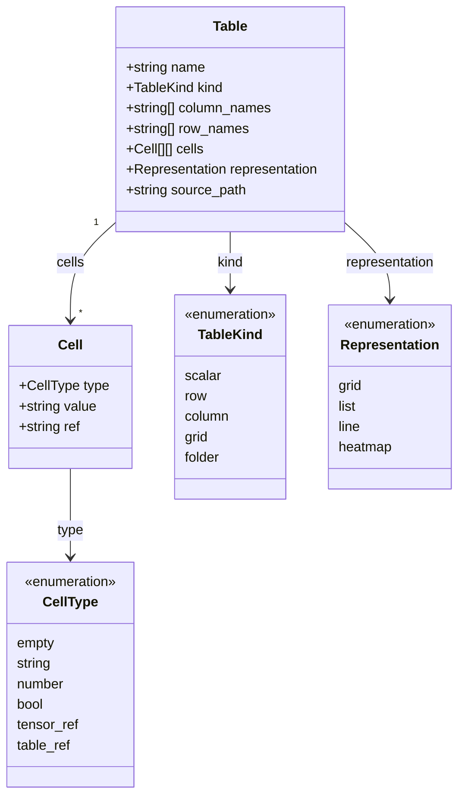
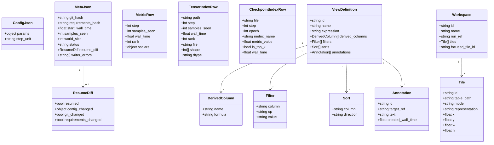
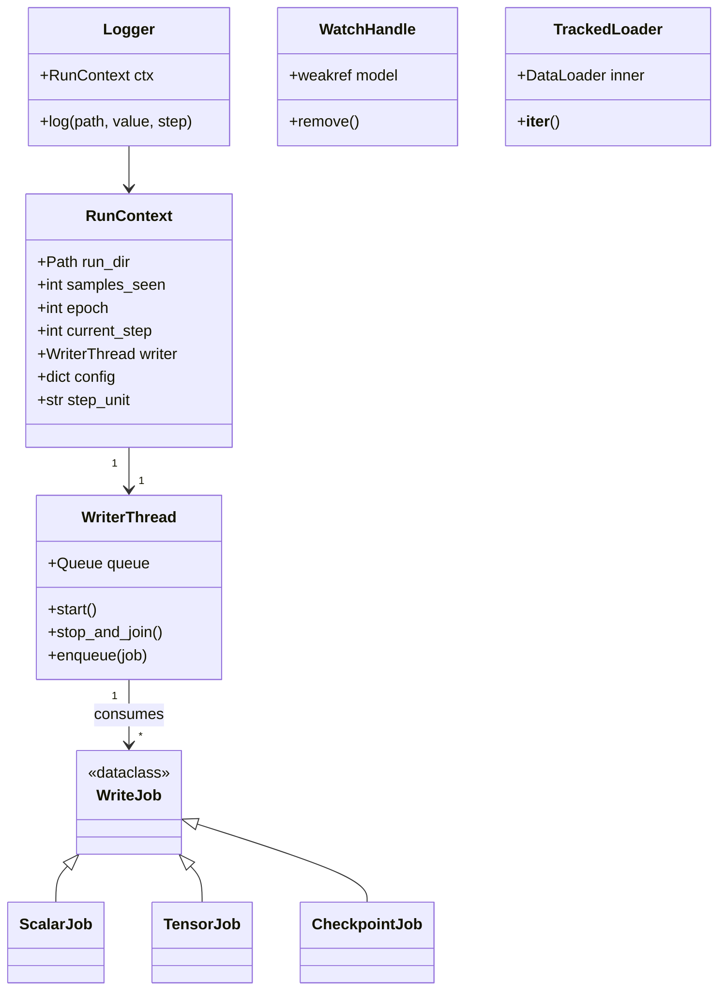
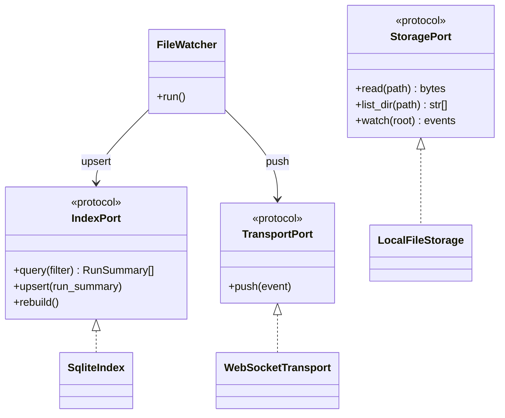
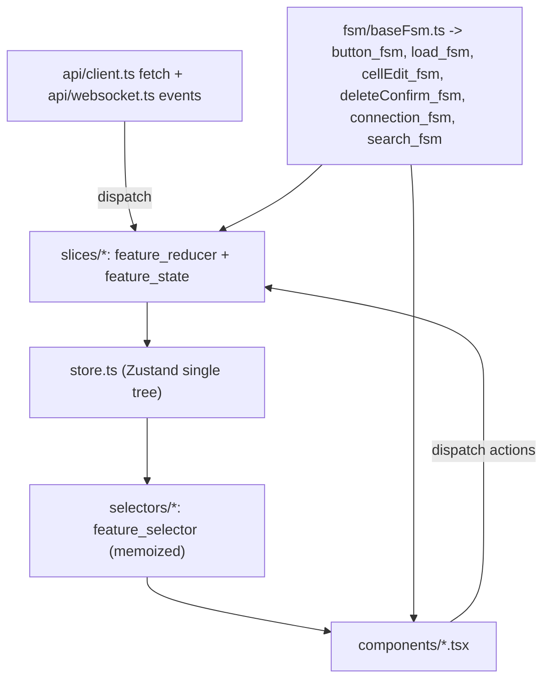
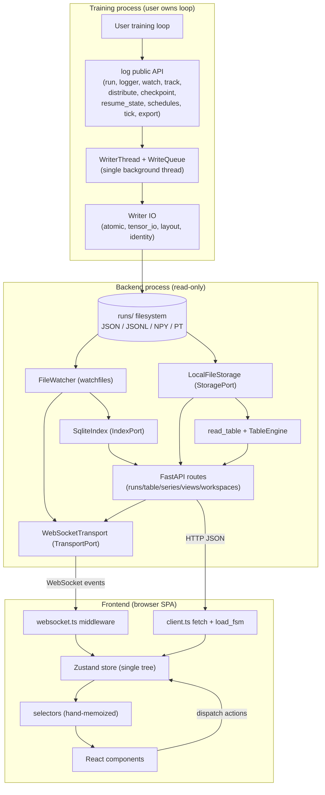
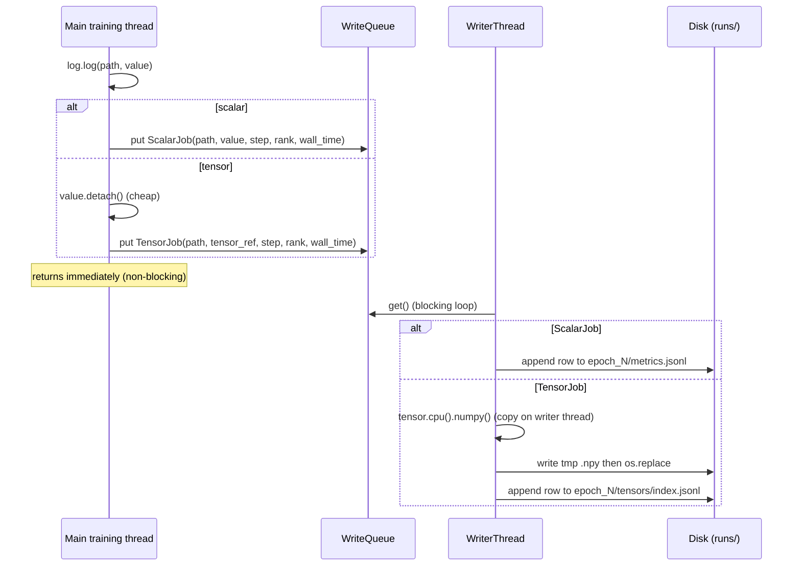
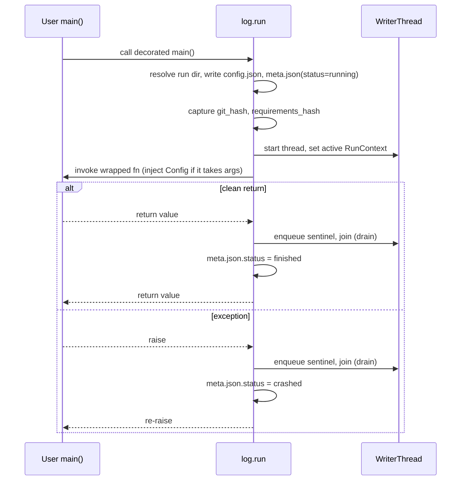
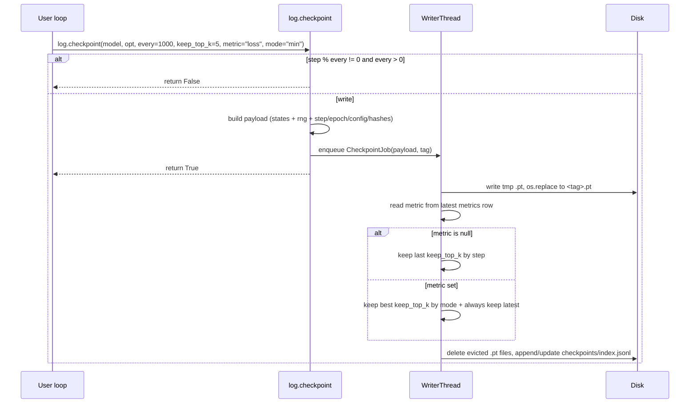
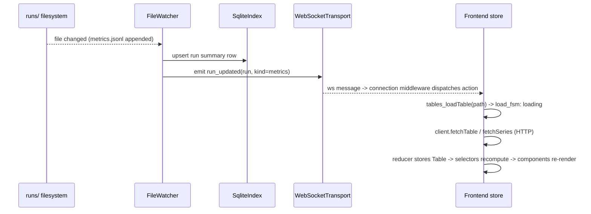

# SPEC.md

> Authoritative specification for **`log`**. Supersedes `DESIGN-NOTES.md` for everything it covers.
> Every statement is meant to be implementation-deterministic. Anything not stated here is out of scope and must not be built.
> Tier tags `[v0] [v1] [v2] [v3]` mark when each thing is built. `[v0]` is the walking skeleton: every module/file exists, the system runs end to end, logic is stubbed.

---

## 1. Problem

`log` is a local-first ML training toolkit for PyTorch used by a single researcher on their own machine. It does two things from one Python package imported as `import log`:

1. **Infrastructure as one-line calls** the researcher makes from inside their own hand-written training loop — checkpointing, distributed wrapping, LR schedules, step/sample tracking, resume, and a combined log-and-advance call — so loop boilerplate shrinks from hundreds of lines to roughly fifteen. `log` is a toolkit, not a framework: the user always owns `for batch in loader: ...`; `log` never inverts control, never owns the loop, never auto-computes during training.

2. **Observability** by writing human-readable files (`.json`, `.jsonl`, `.npy`, `.pt`) into a `runs/` directory that a local read-only web UI renders. In the UI **every piece of data — scalars, tensors, run comparisons, statistics, the run list itself — is one type: a `Table`.** A folder on disk is a `Table` that contains `Table`s, so the on-disk tree *is* the table tree. Every screen is one `Table` rendered in a chosen representation (grid of cells, list, line chart, heatmap); switching representation turns a list into a chart without changing the data. The UI is a single-page application (SPA): one HTML page, React swaps screens client-side via the router, the backend is a local read-only JSON + WebSocket server.

---

## 2. Constraints

Hard limits. "Must" / "Must not".

**Toolkit / writer side**
- Must be importable as `import log` (top-level Python package literally named `log`).
- Must target Python 3.11 or newer.
- Must depend on PyTorch as the only deep-learning runtime dependency.
- Must run fully offline. No network call to any external service, ever.
- Must never block the main training thread on disk I/O: every log write is enqueued to a single background writer thread.
- Must never auto-compute, downsample, or aggregate a logged value during training; the value written is exactly the value passed at exactly that step.
- Must never recompute logged data on demand (no on-demand activation recomputation — product philosophy, not a v1 limitation).
- Must write all run data as files under one `runs/` root; every file is human-readable or standard (`.json`, `.jsonl`, `.npy`, `.pt`).
- Must include `step`, `samples_seen`, `wall_time`, and `rank` (default `0`) on every row of every `.jsonl` metric/index file.
- Must use atomic write (temp file + `os.replace`) for every non-append file; append-only writes for every `.jsonl` file.
- Must not require the user to subclass, register callbacks, or hand control to `log`; every toolkit function is independently usable.
- Must not call `torch.distributed` collectives unless the user invoked `log.distribute` or a launcher set `WORLD_SIZE > 1`.

**Backend / UI side**
- Must never mutate a source data file from the UI; every UI edit produces derived state (a `views/<id>.json` or `workspaces/<id>.json` definition) only.
- Must communicate UI ↔ backend exclusively via HTTP/WebSocket messages with explicit JSON shape; the frontend must never read `runs/` files directly (so the same frontend works against a remote backend later).
- Must model **one root type, `Table`**, in code. Project, Run, Epoch, a logged tensor, a view, a comparison, a folder — each is a `Table` or composed of `Table`s. No privileged per-entity classes.
- Must use a single hierarchical path separator: `.` (a dot). Segment names may not contain `.`.
- Must model every stateful UI element — including a plain button and every loading state — as an explicit finite state machine (FSM) defined once as a base and derived, never re-invented per element.
- Must add no visual or layout decision the spec does not state: no CSS color, padding, margin, border, radius, shadow, gradient, animation, or extra DOM beyond what a section here names. The only motion allowed is `cursor: pointer` on hover over clickable elements.
- Must keep the dependency set minimal: a dependency is allowed only when the standard library, a few lines of our own code, or plain CSS cannot do the same job (Section 4 justifies each).

**Scope**
- Must not include authentication, multi-user, or any cross-machine networking in v1.

---

## 3. Feature tiers and out of scope

Each item is tagged with the tier that builds it. If a feature is not listed in Sections 4–13, it is out of scope regardless of appearing here.

### 3.1 v0 — walking skeleton

Goal: every module and file in Section 5 exists; the system starts end to end (training writes a file → backend reads it → frontend renders it); the logic inside each module is a stub returning a fixed value or a trivially-read value.

- The `Table` type exists in backend (`domain/models.py`) and frontend (`types/domain.ts`).
- `@log.run` + `log.log` write a real `config.json`, `meta.json`, and one `metrics.jsonl` row through the real writer thread (no stubs on the write path — it is the smallest real spine).
- Backend `read_table(path)` reads the `runs/` tree and returns a `Table`; `GET /api/table?path=` returns it; `GET /api/runs` lists run folders.
- Frontend boots, fetches one `Table`, renders it as a **grid of plain divs**, left-aligned, stacked in document order. No styling, no positioning.
- The grid supports the basic edit operations wired through the state/reducer/FSM pattern, against in-memory derived state (not persisted in v0): edit a cell, add/remove a row/column, select a cell, change representation. Each is the real reducer + FSM; the only stub is persistence.
- A `table_ref` cell renders its referenced `Table` **in place** as a small grid of plain divs (W&B-style preview) and stays clickable to drill in. In v0 the in-cell render is plain divs only (no chart), but it exists from v0 — not deferred.
- The other toolkit functions (`watch`, `track`, `distribute`, `checkpoint`, `resume_state`, schedules, `tick`, `export.figure`) exist as importable stubs with the exact Section 9 signatures, raising `NotImplementedError` in their body, so the public surface is complete and import-testable.

### 3.2 v1 — full toolkit, tables in files, representations in UI

*Toolkit (Python API), full behavior:* `@log.run`, `log.log`/`log.logger`, `log.watch`, `log.track`, `log.distribute`, `log.checkpoint`, `log.resume_state`, `log.warmup_cosine` / `warmup_linear` / `warmup_constant`, `log.tick`, `log.export.figure`. Signatures in Section 9.

*Observability:*
- Backend: read-only file storage, SQLite derived index, file watcher, WebSocket push, table engine (the `.`-path merge language), statistics.
- Frontend: run list, drill navigation (top nav bar = back/forward + breadcrumb), the full element inventory and operation set of Section 11. Representation is uniform across **every** table at every level (Section 11.1): the built-in catalog `grid / list / line / heatmap / histogram` (Section 11.2b) chosen via `applicable(table)`. The **dashboard** is a grid of freely-resizable tiles (Section 11.4); **editing** happens in the route-backed modal with the URL as state (Sections 11.2a/11.4). Workspace + view persistence, search. (`pie` / `scatter` / `box` and custom-Python representations and statistical `test`s are v2 — Sections 11.2b, 9.13.)
- Every UI edit creates derived columns / derived state in `views/<id>.json`; source files immutable.
- Publication export via `log.export.figure`.
- The three structural performance seams (Section 8, *Performance constraints*; ADR-016) ship here, since v1 is the first tier that handles real-scale data: memory-mapped `.npy` reads in `read_table`, server-side series downsampling, hand-rolled row windowing. (Hover prefetch is a later v1+ optimization, not part of this tier.)

### 3.3 v2 — connected tiles, control channel, dataset toolkit

`log.mix`, `log.combine_losses`, `log.eval_loop`, `log.batch_safe`, `@log.metric`, `log.poll_commands`, `log.sample_dataset`, the `log.dataset` module; UI → code control channel via `runs/<run>/_commands/`; hot-swap hyperparameters; on-demand checkpoint from UI; connected/node-graph tiles; in-cell rendering of a referenced `Table` as a mini *chart* (the v0 in-cell render is a plain-div grid; rendering it as a small line/heatmap inside the cell is v2); dataset viewer, dataset coverage, on-the-fly PCA/UMAP/SAE, viz-time auto-compute + `runs/<run>/_viz_cache/`; torch.profiler trace import + flamegraph; `dataset_sample.pt`, `dataset_coverage.jsonl`; gifs/videos of charts (`log.export.animate`); redo (Ctrl+Y); a real "duplicate table" action; a dedicated merge UI; remote SSH viewer.

### 3.4 v3 — scale, structure, cluster ops

Auto-FSDP by model size; multi-rank coordination; heartbeat/hang detection; cluster overview tile; per-rank timeline; NCCL ops timeline; memory-per-rank tile; hang alerts; checkpoint-save progress; architecture visualization via torch.fx (hierarchical grid); per-rank subdirectories `rank_<N>/`; environment/dependency snapshot files under `env/`; console capture `logs/console.txt`; system profiler `logs/system.jsonl`; n-dimensional tables; live playback / timeline scrubbing; RL-specific tiles.

### 3.5 Never built (philosophy)

Trainer-style API (`log.fit(model, data)`); auto-instrumentation of Lightning/Accelerate/HF Trainer; on-demand activation recomputation; streaming-dataset parsing (IterableDataset/S3/Parquet) inside `log`; crash-debugging NaN/shape viz; team collaboration, sharing, auth, multi-tenancy.

---

## 4. Tech stack

Dependencies are named, **not pinned to exact versions**. The repo commits a lockfile (`uv.lock` / `package-lock.json`) that captures the resolved versions at install time; the spec lists names + the one capability that justifies each. No version is written into this document, so "latest compatible at install" is the rule and the lockfile is the record.

For every dependency: one line on what it does and what specifically breaks or must be hand-written without it. If the standard library / a few lines / plain CSS suffice, the dependency is rejected.

### 4.1 Python package + backend

| Dependency | Why it earns its place (what breaks without it) |
|---|---|
| python (3.11+) | Runtime. Not a pip dep. |
| torch | Tensors, `state_dict`, `torch.distributed`, module hooks, `torch.save/load`. Hand-writing any of this is infeasible. |
| numpy | `.npy` read/write with a documented header and memory-mapped partial reads. Hand-rolling a binary array format is the thing ADR-004 rejects. |
| fastapi | Typed request/response models (matches the DTO-as-message constraint) + first-class WebSocket in one framework. Without it we hand-wire ASGI routing, validation, and WS handshakes. |
| uvicorn | ASGI server to run FastAPI (`--workers 1`). Without it, no server process. |
| pydantic | Request/response/DTO validation; pairs with FastAPI. Without it, hand-written JSON validation everywhere. |
| watchfiles | OS-level filesystem change events (inotify/FSEvents) for the watcher. Without it we poll `os.stat` in a loop — slower and higher latency. |
| matplotlib | Renders a `Table` to a publication-quality figure file (`.png`/`.pdf`/`.svg`) in `log.export.figure`. The de-facto scientific-paper plotting library; hand-rolling vector figure output is infeasible. |
| proplot | A thin styling layer over matplotlib that supplies journal/`"nature"` presets for `log.export.figure(renderer=...)`. Without it we hand-write the journal style dictionaries. |

Standard library only for: threading, queue, **sqlite3** (derived index — ADR-003), pathlib, os, **json** (no `orjson`; stdlib `json` is fast enough for single-user read responses), hashlib, subprocess (git hash), tempfile, dataclasses, math (LR schedules), fnmatch (glob paths), weakref (ADR-008).

Dropped vs the earlier draft: **orjson** (stdlib `json` suffices for one user's read responses; a few-ms serialization saving is not a justified dependency).

### 4.2 Frontend

| Dependency | Why it earns its place (what breaks without it) |
|---|---|
| node | Build/runtime toolchain. Not a pip dep. |
| typescript | Types mirror backend DTOs; catches shape drift at compile time. |
| react + react-dom | Component model + DOM renderer for the unidirectional-flow UI. |
| vite | Dev server + production static build. Without it, hand-configured bundler. |
| zustand | The single canonical state tree (one JS object in browser memory) with subscribe-by-slice. Lighter than Redux for one user, same store/selector/action model. Without it we hand-write a store + subscription. |
| react-router-dom | URL ↔ route state (URL is state). Without it we hand-parse `location` and manage history. |

Dropped vs the earlier draft, with the replacement named:
- **@tanstack/react-query** → replaced by our own `load_fsm` (a hand-written `idle → loading → loaded → error` FSM, ~30 lines) + `fetch`. We already require FSM-everywhere; a query library would be a second, redundant async-state system.
- **@visx/visx** → charts are hand-drawn SVG (`<svg><polyline/><rect/>`), since the only v1 charts are a line, a heatmap (grid of `<rect>`), and a histogram (bars). A D3 dependency to draw a polyline is not justified.
- **reselect** → selectors are hand-written memoized functions (close over last input/output). For a single-user tree the memo is a three-line helper.
- **framer-motion** → no animations exist (Constraint), so nothing to interpolate.

### 4.3 Conditional, only under measured v1+ performance pressure on large tables

Row windowing itself ships hand-rolled with v1 (Section 8, *Performance constraints*; ADR-016). These libraries are the **escape hatch** — added only if the hand-rolled version measurably drops frames on a real table, never in v0:
- **@tanstack/react-virtual** — windowing (render only visible rows/cols). MIT, headless: we still render our own divs.
- **@tanstack/react-table** — headless column/sort/group logic. MIT: it computes, we render our own divs.

Neither owns the data model or imposes styles; both are off by default.

### 4.4 Test stack

| Dependency | Purpose |
|---|---|
| pytest | Python unit/integration tests. Declared as the `dev` optional-dependency in `pyproject.toml`; pytest config sets `pythonpath = ["src"]` so `import log` / `import backend` resolve. |
| vitest | Frontend unit tests (reducers, selectors, FSMs). |
| @testing-library/react | Component render tests. |
| jsdom | The in-memory DOM that vitest runs component tests against (`test.environment = "jsdom"` in `vite.config.ts`). Without it `render(<Component/>)` throws `document is not defined`. |

---

## 5. File and folder structure

### 5.1 Naming conventions

- Python modules/packages: `snake_case`. Python classes: `PascalCase`. Functions/variables: `snake_case`.
- TypeScript: `camelCase.ts` for logic, `PascalCase.tsx` for React components.
- Per-feature function names (so modularity is checkable by eye): `<feature>_reducer`, `<feature>_state`, `<feature>_selector`, `<element>_fsm`. The same kind of function is shaped the same way every time.
- Test files: `test_*.py` (Python), `*.test.ts` / `*.test.tsx` (frontend).

### 5.2 Repository layout

```
log/
  pyproject.toml
  uv.lock
  README.md
  src/
    log/                          # the `import log` package (toolkit + writer)
      __init__.py                 # re-exports public API (Section 9.1)
      run.py                      # log.run decorator factory, RunContext
      logger.py                   # log.logger(), Logger class, log.log shortcut
      watch.py                    # log.watch(model), hook registration, WatchHandle
      track.py                    # log.track(loader), TrackedLoader
      distribute.py               # log.distribute(model)
      checkpoint.py               # log.checkpoint(...)
      resume.py                   # log.resume_state(...)
      schedules.py                # log.warmup_cosine/linear/constant
      tick.py                     # log.tick(...)
      export.py                   # log.export.figure(...)
      writer/
        __init__.py
        queue_writer.py           # background WriterThread + WriteJob dataclasses
        layout.py                 # `.`-path -> on-disk path resolution (run dir layout)
        atomic.py                 # atomic_write_bytes, append_jsonl
        tensor_io.py              # write_npy, read_npy
        identity.py               # git_hash, requirements_hash, rng_state capture
      ports/
        __init__.py
        storage.py                # StoragePort protocol (training-side write)
      errors.py                   # all log-side exception classes (Section 12)
    backend/                      # read-only observability server
      __init__.py
      main.py                     # FastAPI app, route registration, uvicorn entry
      config.py                   # runs_root resolution, settings
      ports/
        __init__.py
        storage_port.py           # StoragePort protocol (read/watch)
        index_port.py             # IndexPort protocol (query runs)
        transport_port.py         # TransportPort protocol (push events)
      adapters/
        __init__.py
        local_file_storage.py     # LocalFileStorage implements StoragePort
        sqlite_index.py           # SqliteIndex implements IndexPort
        websocket_transport.py    # WebSocketTransport implements TransportPort
        file_watcher.py           # FileWatcher (watchfiles) -> events
      domain/
        __init__.py
        models.py                 # Table, Cell, CellType, TableKind, Representation + on-disk record DTOs
        read_table.py             # read_table(path) -> Table  (physical files -> Table)
        table_engine.py           # `.`-path merge language evaluator (Section 9.13)
      api/
        __init__.py
        runs.py                   # /api/runs endpoints
        tables.py                 # /api/table, /api/tables/eval endpoints
        series.py                 # /api/series endpoints (scalar/tensor reads)
        workspaces.py             # /api/workspaces endpoints
        views.py                  # /api/views endpoints
        ws.py                     # /ws websocket handler
      tests/
        test_read_table.py
        test_table_engine.py
        test_local_file_storage.py
        test_sqlite_index.py
        test_api_runs.py
        test_workspaces.py        # workspace save / list / delete
        test_views.py             # view save / list / delete
        test_series.py            # scalar/tensor series + downsampling
        test_toolkit.py           # schedules/tick/track/distribute/watch/checkpoint/resume/export
        test_ws.py                # run-change grouping for live push
        test_smoke.py             # one end-to-end smoke test per stage (§14)
  frontend/
    package.json
    package-lock.json
    vite.config.ts                # vite + vitest config (test.environment = jsdom)
    tsconfig.json
    tsconfig.node.json            # tsconfig for vite.config.ts itself (Vite scaffold)
    index.html
    src/
      main.tsx                    # React root, router
      store/
        store.ts                  # Zustand store (single state tree)
        slices/
          tablesSlice.ts          # tables_state, tables_reducer (loaded Tables + edits)
          tilesSlice.ts           # tiles_state, tiles_reducer (representation per tile)
          searchSlice.ts          # search_state, search_reducer (query)
          focusSlice.ts           # focus_state, focus_reducer (focused path)
          connectionSlice.ts      # connection_state, connection_reducer (websocket FSM)
        selectors/
          tableSelectors.ts       # table_selector, isFocused, ...
          runSelectors.ts         # run_selector
          searchSelectors.ts      # search_selector (matching `.`-paths)
      api/
        client.ts                 # typed fetch wrappers
        websocket.ts              # ws middleware: events -> store actions
      fsm/
        baseFsm.ts                # makeFsm(states, transitions): the one FSM factory
        buttonFsm.ts              # button_fsm derived from baseFsm
        loadFsm.ts                # load_fsm (idle/loading/loaded/error) derived from baseFsm
        cellEditFsm.ts            # cellEdit_fsm derived from baseFsm
        deleteConfirmFsm.ts       # deleteConfirm_fsm derived from baseFsm
        connectionFsm.ts          # connection_fsm derived from baseFsm
        searchFsm.ts              # search_fsm derived from baseFsm
        resizeFsm.ts              # resize_fsm (idle/dragging) derived from baseFsm
      components/
        App.tsx                   # router outlet + nav bar
        NavBar.tsx                # back/forward + breadcrumb + search box
        Tile.tsx                  # one table: load_fsm fetch + switcher + expand + render
        Dashboard.tsx             # grid of pinned Tiles
        Modal.tsx                 # fullscreen route-backed tile (?modal=path)
        TableView.tsx             # grid-of-divs representation
        Cell.tsx                  # one cell (uses cellEdit_fsm)
        HeaderCell.tsx            # column/row name cell (edit + dot-menu)
        DotMenu.tsx               # corner ⋯ menu (uses deleteConfirm_fsm)
        AddControl.tsx            # the ＋ control (uses button_fsm)
        Toolbar.tsx               # thin action bar
        RepresentationSwitcher.tsx
        ResizeHandle.tsx          # drag-resize corner (resize_fsm)
        render.tsx                # render(table, representation) -> the one view component (Section 7.4)
        LineChartView.tsx         # hand-drawn SVG line
        HeatmapView.tsx           # hand-drawn SVG grid of rects
        HistogramView.tsx         # hand-drawn SVG bars (value distribution)
        ListView.tsx              # list representation
        Button.tsx                # base button component (uses button_fsm)
      types/
        domain.ts                 # TS mirrors of backend Table/Cell/enums + DTOs
      tests/
        setup.ts                  # vitest afterEach(cleanup)
        tableSelectors.test.ts
        cellEditFsm.test.ts
        TableView.test.tsx
        representations.test.tsx  # line / heatmap / list render components
        tilesSlice.test.ts        # pin / unpin / loadWorkspace / resize
        connectionSlice.test.ts   # live_bump + connection FSM
        modal.test.tsx            # route-backed modal open/close
        search.test.ts            # search_selector path filter
```

### 5.3 On-disk run data layout

`runs_root` defaults to `./runs` relative to the process CWD at run start; overridable via `log.run(runs_root=...)` or env `LOG_RUNS_ROOT`. One run:

```
runs/
  workspaces/                    # GLOBAL, cross-run dashboards (a workspace pins
    <workspace-id>.json          #   tiles from any run; Section 6.3). Not under a run.
  <project>/
    <run-name>/
      config.json                # hyperparameter snapshot at run start (Section 6.3)
      meta.json                  # run metadata (Section 6.3)
      epoch_<N>/                 # N zero-padded to 4 digits: epoch_0000
        metrics.jsonl            # one row per scalar log call (Section 6.3)
        tensors/
          index.jsonl            # one row per tensor write: path, step, file, shape, dtype
          <path>__step<S>.npy    # one tensor; <path> = dot-path with dots kept; S zero-padded 9 digits
      checkpoints/
        index.jsonl              # one row per checkpoint
        <tag>.pt                 # checkpoint payload (Section 10.3)
      views/
        <view-id>.json           # saved table query/transform definition (Section 6.3)
```

Workspaces live at `runs/workspaces/` (global), not under a run, because a workspace composes tiles from any run (cross-run dashboards). Views stay per-run (a view is a derived transform of one run's table). The backend writes only these derived JSON files (workspaces/views); it never mutates source training data (ADR-017 read-only stance applies to source only).

Rules:
- `<run-name>` defaults to `<timestamp>-<8-hex>` where timestamp is `YYYYMMDD-HHMMSS` (local time) and hex is `os.urandom(4).hex()`. Overridable via `log.run(name=...)`. On collision, append `-<8-hex>` until unique.
- `<project>` defaults to `"default"`.
- A tensor on-disk filename replaces filesystem-illegal characters in the dot-path (`/ \ : * ? " < > |`) with `_`; the original dot-path is preserved in `index.jsonl`.
- The SQLite index lives at `runs/.index.sqlite3` and is a derived cache only; deleting it is safe (backend rebuilds it from files on next scan).

---

## 6. Data models

There are two layers: (a) the **one code type** the whole UI and backend domain speak in — `Table`; and (b) the **on-disk records** the writer produces and `read_table` consumes. `read_table(path)` is the single function that turns any folder or file under `runs/` into a `Table`.

### 6.1 The root type: `Table`



Field rules:
- `column_names` / `row_names`: `null` when the table has none; a header row/column is rendered only when its names list is non-`null`.
- `kind`: `scalar` = no cells until grown (rendered as just the name); `row` = 1×N; `column` = N×1; `grid` = N×M (Excel); `folder` = a table whose cells are `table_ref`s to child tables. n-D is `[v3]` and not represented here.
- `representation`: default set by `read_table` per table role — folders, key/value tables, and tensor grids default to `grid` (rendered by `TableView`, which carries headers + drill); a scalar series defaults to `line`. The UI may switch it via `applicable(table)` (§11.1), which offers `list` as the flat alternative to `grid`.
- `source_path`: the `.`-path this table was read from (e.g. `default.run3.epoch_0000.loss`); `null` for a table that exists only as derived/in-memory state.
- `Cell.value`: in v0/v1 every value is stored as a **string**; `type` records the intended type for later typed display.
- `Cell.ref`: for `tensor_ref` and `table_ref`, the `.`-path of the target; `null` otherwise.

### 6.2 `read_table` mapping (physical → `Table`)

`read_table(path)` resolves a `.`-path against `runs/` and returns a `Table`:

| `.`-path resolves to | Returned `Table` |
|---|---|
| `runs/` root | `kind=folder`; one `table_ref` cell per `<project>` directory |
| `<project>` | `kind=folder`; one `table_ref` cell per `<run-name>` directory; columns = run meta (name, status, samples_seen) read from each `meta.json` |
| `<project>.<run>` | `kind=folder`; cells = `table_ref`s to `config`, `meta`, each `epoch_<N>`, `checkpoints` |
| `<project>.<run>.epoch_<N>` | `kind=folder`; cells = `table_ref`s to each scalar name in `metrics.jsonl` and each tensor path in `tensors/index.jsonl` |
| `<project>.<run>.epoch_<N>.<scalar>` | `kind=column`; `column_names=["step","samples_seen","wall_time","rank",<scalar>]`; one row per `metrics.jsonl` row containing that scalar |
| `<project>.<run>.epoch_<N>.<tensor-path>` (a `tensor_ref` cell) | drilling reads the `.npy` and returns `kind=grid` with the tensor's 2-D values (n-D flattened to 2-D in v1; n-D native is `[v3]`) |

`read_table` is pure and read-only. It never writes. A truncated final `.jsonl` line is parsed-and-skipped (ADR-007).

### 6.3 On-disk records (what the writer produces)

These are JSON shapes on disk, not domain classes. `read_table` maps them into `Table`s above.



Field-level rules:
- `ConfigJson.params`: arbitrary JSON object from `log.run(config=...)`. Non-JSON-serializable values raise `ConfigSerializationError`.
- `ConfigJson.step_unit`: one of `"samples_seen"` (default), `"batch"`, `"sample"`, `"generation"`, `"episode"`. Free strings rejected with `InvalidStepUnitError`.
- `MetaJson.status`: one of `"running"`, `"finished"`, `"crashed"`. `"running"` at start, `"finished"` on clean exit, `"crashed"` if the decorated function raised.
- `MetaJson.world_size`: integer ≥ 1; from env `WORLD_SIZE` or `1`.
- `MetaJson.writer_errors`: list of strings; the writer appends here when a job fails (a failed log never crashes training).
- `MetricRow.scalars`: object mapping scalar name → number. Each numeric `log.log(name, value)` merges into the row for that `(step, rank)`.
- `TensorIndexRow.dtype`: NumPy dtype string (e.g. `"float32"`).
- `Tile.mode`: one of `"table"`, `"visualization"` (Section 11.2a).
- `Tile.representation`: in table mode one of `"grid"`, `"list"`; in visualization mode one of `"line"`, `"heatmap"`, `"histogram"` (extends as chart types are added).
- `Filter.op`: one of `"eq"`, `"ne"`, `"gt"`, `"gte"`, `"lt"`, `"lte"`, `"contains"`.
- `Sort.direction`: one of `"asc"`, `"desc"`.

`config.json` example:
```json
{ "params": { "lr": 0.0001, "batch_size": 32 }, "step_unit": "samples_seen" }
```
`meta.json` example:
```json
{ "git_hash": "a1b2c3d", "requirements_hash": "sha256:9f86d0...", "start_wall_time": 1748534400.123, "samples_seen": 0, "world_size": 1, "status": "running", "resume_diff": null, "writer_errors": [] }
```
`metrics.jsonl` row example:
```json
{ "step": 1000, "samples_seen": 32000, "wall_time": 1748534512.5, "rank": 0, "scalars": { "loss": 2.31, "lr": 0.00009 } }
```

---

## 7. Code model

This is the shape of the *code*, separate from the data model. It states which things are classes (hold data/state fields with operations) and which are plain functions, what derives from or composes what, what calls what, and where each FSM hooks in. For every public function: input → output, and a one-line purpose. Function bodies are out of this spec; signatures + I/O + purpose are in.

Rule applied throughout: **a class only where there are data/state fields**; everything else is a plain function. The same kind of function is named and shaped the same way (Section 5.1 convention).

### 7.1 Training-side code (`src/log/`)



Classes (justified by held state):
- `RunContext` — holds the live run's counters + writer + config; one process-global instance set by `log.run`. Read by `log.log`, `log.tick`, `log.track`, `log.checkpoint`, `log.resume_state`.
- `WriterThread` — owns the background queue + thread; the only writer of files on the training side.
- `WriteJob` and its subclasses `ScalarJob` / `TensorJob` / `CheckpointJob` — dataclasses carrying one unit of work to the writer.
- `Logger` — thin object bound to `RunContext`; exists so `log.logger()` can return a handle, but `log.log` is the module-level shortcut.
- `WatchHandle` — holds the `weakref` + registered hook handles so `.remove()` can deregister.
- `TrackedLoader` — wraps a `DataLoader`, holds the epoch counter.

Plain functions (no state → not classes): everything in `writer/atomic.py`, `writer/tensor_io.py`, `writer/layout.py`, `writer/identity.py`, `schedules.py`, `distribute.py`, `resume.py`, `export.py`, and the public entry functions `run`, `log`, `watch`, `track`, `distribute`, `checkpoint`, `resume_state`, `tick`.

Per-function I/O and purpose (training side):

| Function | Input | Output | Purpose |
|---|---|---|---|
| `run(project, name, config, tags, step_unit, runs_root)` | run params | decorator | Set up the run dir + RunContext + writer; wrap the user fn. |
| `logger()` | — | `Logger` | Hand back a logger bound to the active run. |
| `log(path, value, step)` | path, scalar/tensor, step | `None` | Enqueue one scalar or tensor write; never blocks. |
| `watch(model, paths, log_activations, log_gradients)` | module + filters | `WatchHandle` | Register hooks that enqueue tensors per module. |
| `track(loader)` | DataLoader | `TrackedLoader` | Count samples, set distributed sampler/epoch. |
| `distribute(model, strategy, find_unused_parameters)` | module | module | Init process group + wrap DDP/FSDP if multi-rank. |
| `checkpoint(model, optimizer, scheduler, every, keep_top_k, metric, mode, tag)` | training state | `bool` | Decide cadence, build payload, enqueue write + rotation. |
| `resume_state(model, optimizer, scheduler, checkpoint)` | training state | `int` | Restore states + RNG; return the step to resume from. |
| `warmup_cosine/linear/constant(optimizer, ...)` | optimizer + schedule args | `LambdaLR` | Build the LR multiplier schedule. |
| `tick(samples, **scalars)` | optional samples + scalars | `None` | Advance samples_seen + log scalars in one call. |
| `export.figure(view_id, path, renderer)` | view id + out path | path str | Render a table to an image file. |
| `atomic_write_bytes(path, data)` | path, bytes | `None` | temp-write + `os.replace`. |
| `append_jsonl(path, row)` | path, dict | `None` | Append one JSON line + flush. |
| `write_npy(path, array)` / `read_npy(path)` | path, ndarray | `None` / ndarray | Tensor file I/O. |
| `resolve_run_dir(...)` (layout) | run params | `Path` | Compute the run directory path. |
| `git_hash()` / `requirements_hash()` / `capture_rng()` | — | str / str / dict | Identity + RNG snapshots. |

### 7.2 Backend code (`src/backend/`)



Classes (justified): `LocalFileStorage`, `SqliteIndex`, `WebSocketTransport` (each holds a handle — a root path, a db connection, a socket set), `FileWatcher` (holds the watch loop + debounce state). Ports are `typing.Protocol`s (no state).

Plain functions (no state): `read_table(path) -> Table`, the whole `table_engine.py` (`evaluate(expression) -> Table`, `parse(expression) -> Ast`), and every FastAPI route handler in `api/`.

There is no separate statistics module. The **one function registry** that backs the formula language (§9.13) lives in `table_engine.py` itself, next to the parser that uses it: a single dict `FUNCTIONS: dict[str, Function]`, where `Function` is a small dataclass record (its only justified class here) holding `kind` (`"aggregation"` = column→scalar, or `"transform"` = column→column) and the pure implementation `fn`. `evaluate(...)` resolves every name in `agg(...)` and `derive(...)` through this one dict; nothing else holds a list of statistics. Each entry has the identical shape and differs only by name, kind, and body (Lego). Adding a statistic = adding one `FUNCTIONS` entry.

| Function | Input | Output | Purpose |
|---|---|---|---|
| `read_table(path)` | `.`-path | `Table` | Map physical files/folders to a `Table` (Section 6.2). |
| `evaluate(expression)` | DSL string | `Table` | Run the merge language (Section 9.13); resolve names via `FUNCTIONS`. |
| `parse(expression)` | DSL string | `Ast` | Tokenize + parse the DSL; raise on bad token. |
| `FUNCTIONS[name].fn` (table_engine.py) | column (+ args) | scalar or column | One registry entry per statistic; `kind` picks scalar (aggregation) vs column (transform). |
| route handlers (Section 9.12) | request DTO | response DTO | Wire ports to HTTP/WS. |

### 7.3 Frontend code (`frontend/src/`)

The frontend is the unidirectional loop `DATA SOURCE → STATE STORE → VIEW`, with `ACTIONS` (reducers) updating the store and `selectors` deriving view data. No classes — React function components + plain functions + the one FSM factory.



The one FSM factory and its derivations:
- `makeFsm(states, transitions)` (`baseFsm.ts`) → returns `{ initial, next(state, event) }`. Input: a states list + a `(state,event)->state` transition table. Output: a pure FSM object. Invalid transitions return the current state unchanged.
- `button_fsm` = `makeFsm(["idle","hover","pressed","pending","done","error"], …)`. Every button and every `＋`/toolbar/representation control derives from this.
- `load_fsm` = `makeFsm(["idle","loading","loaded","error"], …)`. Replaces a query library: every async fetch tracks its state here.
- `cellEdit_fsm` = `makeFsm(["display","editing"], …)`. `display --dblclick--> editing`, `editing --enter/esc--> display`.
- `deleteConfirm_fsm` = `makeFsm(["idle","confirm"], …)`. First "delete" click → `confirm`; second → emits delete.
- `connection_fsm` = `makeFsm(["connected","reconnecting"], …)` with max backoff 30s.
- `search_fsm` = `makeFsm(["empty","typing","results","noResults"], …)`.

Per-feature function set (one row = one feature, all four shapes present where applicable):

| Feature | `_state` | `_reducer` | `_selector` | FSM | Component |
|---|---|---|---|---|---|
| route/drill | the URL itself (`react-router-dom`) — no store slice; `currentPath = location.pathname` | — | — | `NavBar` (`useNavigate` back/forward + breadcrumb), `App` (`useLocation` → `currentPath`), `Cell` (`useNavigate` to drill) |
| tables/edits | `tables_state` | `tables_reducer` | `table_selector` | `cellEdit_fsm`, `deleteConfirm_fsm` | `TableView`, `Cell`, `HeaderCell`, `DotMenu`, `AddControl` |
| tiles/representation | `tiles_state` | `tiles_reducer` | `tile_selector` | `button_fsm` | `RepresentationSwitcher` → `render` (§7.4) → `TableView`/`ListView`/`LineChartView`/`HeatmapView` |
| search | `search_state` | `search_reducer` | `search_selector` | `search_fsm` | `NavBar` search box |
| focus/scroll | `focus_state` | `focus_reducer` | `isFocused` | — | any focusable component |
| connection | `connection_state` | `connection_reducer` | — | `connection_fsm` | (status indicator) |

### 7.4 The renderer — one `Table` × one `Representation` → one component (the heart of the UI)

**In one breath:** the whole UI reduces to one function — hand it a `Table` and a `Representation`, it returns the component that draws that table that way. Every drawing component is the same Lego: identical signature `(props: { table: Table }) => JSX.Element`, differing only in *how* it draws. Switching representation is not new data and not new logic — it is one different entry in this single map. This is the most-reused Lego in the frontend, so it lives in one place.

`render(table, representation)` (`components/render.tsx`) is a pure, stateless dispatch — a single map from each `Representation` value to its component:

| `Representation` | Component | Draws |
|---|---|---|
| `grid` | `TableView` | editable grid of plain divs |
| `list` | `ListView` | one record per row, stacked |
| `line` | `LineChartView` | hand-drawn SVG polyline |
| `heatmap` | `HeatmapView` | hand-drawn SVG grid of `<rect>` |
| `histogram` *(added when histogram ships, §3.3)* | `HistogramView` | hand-drawn SVG bars |

Mechanically: `render` is `function render(table, representation) { const View = RENDERERS[representation]; return <View table={table} /> }`. Adding a representation is adding **one row** to `RENDERERS` plus one component file — nothing else in the app changes. Every component in the right column reads nothing but its `table` prop; none fetches, none touches the store directly.

Four call sites pass through this one function and differ *only* in which table and which representation they hand it: the main screen (§11.1), a tile (§11.2a), an in-cell `table_ref` preview (§3.1), and the fullscreen route-modal (§11.2a). The `RepresentationSwitcher` (table mode) and the chart-type dropdown (visualization mode, §11.2a) each do exactly one thing — dispatch a new `Representation` into this same map. That is why a list and a chart are provably "the same data drawn differently": they are the same `render` call with one argument changed.

---

## 8. Layer architecture



Ownership and forbidden imports:
- **Training layer (`src/log/`)** owns writing files via the writer thread. Forbidden to import `backend/` or `frontend/`; forbidden to read back its own written files (write-only); forbidden to make network calls.
- **Writer subpackage (`src/log/writer/`)** owns all training-side disk I/O — the only place `os.replace`, `open(..., "ab")`, and `numpy.save` are called on the training side. Public `log` functions enqueue jobs; they never write files directly.
- **Backend adapters (`backend/adapters/`)** are the only place the backend touches the filesystem, SQLite, or sockets. Forbidden to import `backend/api/` (dependency points inward).
- **Backend domain (`backend/domain/`)** is pure logic (`Table`, `read_table`, table engine + its function registry). Forbidden to import any adapter or FastAPI. Receives data through port protocols only.
- **Backend api (`backend/api/`)** wires ports to HTTP/WS. Forbidden to read files directly; goes through `StoragePort`/`IndexPort`.
- **Frontend store/selectors/reducers/FSMs** are pure. Forbidden to call `fetch` or touch the network (that lives in `api/`).
- **Frontend components** read state via selectors and dispatch actions. Forbidden to call `fetch` directly (use `api/client.ts`) and forbidden to read `runs/` files.

### Performance constraints (structural — build the seam, not the optimization)

**In one breath:** three of these change an interface, so they must be built into that interface the moment it ships real-scale data (v1, when tensors, series, and large tables first appear) — never retrofitted, or the system literally cannot open a big run. The fourth is a pure speed-up that bolts on later. The whole rule is one sentence: never load more than the screen can show.

| Technique | What it means mechanically | Why it is structural (can't be retrofitted) |
|---|---|---|
| **Memory-mapped tensor reads** | `read_table` opens a `.npy` tensor with `numpy.load(path, mmap_mode="r")`; a heatmap view reads only the slice it draws, the OS pages in the rest on demand. | A 4 GB tensor can't be pulled fully into RAM. When the tensor read path ships (v1), the seam is already in `read_table`. |
| **Series downsampling** | The `GET /api/series` response buckets a long scalar series to ~2000 points (min **and** max per bucket so spikes survive) before sending. | It changes the API response shape, so adding it later breaks callers. |
| **Row windowing** | The grid renderer mounts only the ~40 visible rows + a buffer, not all 100k — hand-rolled (~40 lines), the library in §4.3 only if that drops frames. | The grid component must be built around a windowed list, not a full `.map`. |
| **Hover prefetch** *(v1+ later)* | On breadcrumb/tile hover, fire the likely-next `read_table` fetch early so the click feels instant. | Pure optimization — changes no interface — so it is a safe later add. |

The first three ship with v1 (the version that first handles real-scale data); the fourth is a later optimization. See ADR-016. The v0 walking skeleton, which renders one trivial scalar table as plain divs, needs none of them.

---

## 9. API and interface contracts

### 9.1 Public Python API surface (`log/__init__.py` re-exports)

```
log.run            (decorator factory)
log.logger         (function -> Logger)
log.log            (function: shortcut to active logger)
log.watch          (function)
log.track          (function -> TrackedLoader)
log.distribute     (function)
log.checkpoint     (function)
log.resume_state   (function)
log.warmup_cosine  (function)
log.warmup_linear  (function)
log.warmup_constant(function)
log.tick           (function)
log.export         (namespace: log.export.figure)
```

Each toolkit function is independently callable and has defaults; none requires any other to have been called, **except** that `log.log`, `log.tick`, `log.checkpoint`, `log.watch`, and `log.track` require an active run created by `log.run` (else they raise `NoActiveRunError`, Section 12).

### 9.2 `log.run`

```
log.run(
    project: str = "default",
    name: str | None = None,
    config: dict | None = None,
    tags: list[str] = [],
    step_unit: str = "samples_seen",
    runs_root: str | None = None,
) -> Callable[[Callable[..., T]], Callable[..., T]]
```
- Decorator factory applied to the user's `main`/`train` function.
- On entry: resolves the run directory (Section 5.3), writes `config.json` and `meta.json` (status `"running"`), captures git/requirements hashes, starts the `WriterThread`, sets the process-global active `RunContext`.
- If the wrapped function declares ≥1 positional parameter, `log.run` injects a `Config` object (attribute access over `config` params) as the first argument; if zero parameters, calls it with none.
- On clean return: flushes the writer queue (blocks until drained), sets `meta.json.status = "finished"`, joins the writer thread, clears active context, returns the wrapped function's value.
- On exception: flushes queue, sets `status = "crashed"`, re-raises the original exception.
- Errors: `ConfigSerializationError`, `InvalidStepUnitError`, `RunDirectoryError`.

### 9.3 `log.logger` / `log.log`

```
log.logger() -> Logger
Logger.log(path: str, value: float | int | bool | torch.Tensor | numpy.ndarray, step: int | None = None) -> None
log.log(path, value, step=None) -> None
```
- `path`: dot-separated string. Non-empty; any characters allowed except a segment may not be empty. Only empty string is rejected (`InvalidPathError`).
- `value`: a Python scalar (`int`/`float`/`bool`) or 0-dim tensor/array → scalar into `metrics.jsonl` under key `path`; otherwise (n-dim) → detached, moved to CPU, converted to NumPy, written as `.npy` with a `TensorIndexRow` in `tensors/index.jsonl`.
- `step`: if `None`, uses the active run's current step (from `log.track`/`log.tick`); if no step source exists, an internal monotonic counter from 0.
- Never blocks: enqueues a `WriteJob`, returns immediately.
- `log.log` is the module-level shortcut for `log.logger().log(...)`.
- Errors: `NoActiveRunError`, `InvalidPathError`, `UnsupportedValueTypeError`.

### 9.4 `log.watch`

```
log.watch(
    model: torch.nn.Module,
    paths: list[str] | None = None,
    log_activations: bool = True,
    log_gradients: bool = False,
) -> WatchHandle
```
- Registers forward hooks (and full-backward hooks if `log_gradients`) on `model.named_modules()`.
- Path per module = its dotted name from `named_modules()` (root `""` becomes `"model"`).
- `paths`: optional `fnmatch` glob patterns (e.g. `"encoder.*"`); only matching module paths are hooked. `None` = all named modules with ≥1 parameter or that produce a tensor output.
- Reference semantics (ADR-008): `WatchHandle` holds a `weakref` to `model`; hooks capture each tensor by `.detach()` and enqueue the detached tensor object (not a deep copy); the writer thread performs the CPU/NumPy copy. One `.detach()` + one `queue.put()` per hooked module per step on the main thread.
- Returns `WatchHandle` with `.remove()`; hooks also auto-removed on run finish.
- Documented (not errors): functional ops not captured; tied modules fire multiple times and get a numeric suffix `path#2`; dynamically created modules need a new `log.watch`.
- Errors: `NoActiveRunError`, `InvalidPathError` (malformed glob).

### 9.5 `log.track`

```
log.track(loader: torch.utils.data.DataLoader) -> TrackedLoader
```
- Wraps a `DataLoader`. On each `__next__`, increments `samples_seen` by the batch's first-dim size (tensor → `batch.shape[0]`; tuple/list → first element's `shape[0]`; dict → first key's value `shape[0]`; else `loader.batch_size or 1`).
- If `WORLD_SIZE > 1` and the sampler is not already a `DistributedSampler`, wraps it using `RANK`/`WORLD_SIZE` from env.
- Calls `sampler.set_epoch(epoch)` at the start of each iteration when a `DistributedSampler` is present; `epoch` is an internal counter from 0, +1 per full `__iter__`.
- Sets the run's current step to `samples_seen`.
- Returns `TrackedLoader` (iterable proxy preserving `len()` and `batch_size`).
- Errors: `NoActiveRunError`, `NotADataLoaderError`.

### 9.6 `log.distribute`

```
log.distribute(model: torch.nn.Module, strategy: str = "auto", find_unused_parameters: bool = False) -> torch.nn.Module
```
- If `WORLD_SIZE` unset or `== 1`: returns `model` unchanged (no-op).
- Otherwise: if no process group, `init_process_group(backend="nccl")` (`"gloo"` if CUDA unavailable); set device from `LOCAL_RANK`; move model to device.
- `strategy`: `"ddp"` → `DistributedDataParallel`; `"fsdp"` → `FullyShardedDataParallel` default config; `"auto"` (v1) → `"ddp"` (size-based auto-FSDP is v3).
- Errors: `DistributedInitError`, `InvalidStrategyError`.

### 9.7 `log.checkpoint`

```
log.checkpoint(
    model: torch.nn.Module,
    optimizer: torch.optim.Optimizer | None = None,
    scheduler: object | None = None,
    every: int = 1000,
    keep_top_k: int = 5,
    metric: str | None = "loss",
    mode: str = "min",
    tag: str | None = None,
) -> bool
```
- Cadence: a checkpoint is written only when `current_step % every == 0`. If `every <= 0`, writes every call.
- Payload (`.pt` dict): `model_state` = `model.state_dict()`; `optimizer_state` if provided; `scheduler_state` if provided and it has `state_dict`; plus `rng_state` (torch, torch.cuda all devices, numpy, python `random`), `step`, `epoch`, `samples_seen`, `config` snapshot, `git_hash`, `requirements_hash`.
- Rotation: if `metric is None`, keep the last `keep_top_k` by step; if `metric` set, read it from the latest `metrics.jsonl` scalar named `metric`, keep `keep_top_k` best by `mode` (`"min"`/`"max"`), and always also keep the latest.
- Write is atomic (temp + `os.replace`) and async (enqueued); `index.jsonl` row appended after the `.pt` rename succeeds.
- `tag`: filename stem. Default `f"ep{epoch:04d}_step{step:09d}"`.
- Returns `True` if a checkpoint was written this call, `False` if cadence skipped it (synchronous cadence decision; disk write may complete later).
- Errors: `NoActiveRunError`, `CheckpointStateError`, `InvalidModeError`.

### 9.8 `log.resume_state`

```
log.resume_state(model, optimizer=None, scheduler=None, checkpoint: str | None = None) -> int
```
- If no checkpoint exists and `checkpoint` not given: returns `0` (no-op).
- Otherwise loads `checkpoint` if given, else the "last" checkpoint from `checkpoints/index.jsonl`.
- Restores: `model.load_state_dict`; optimizer/scheduler state if both the arg and saved state exist; all RNG states; sets the run's `samples_seen`, `epoch`, current step.
- Computes the identity diff (config params changed, git changed, requirements changed) and writes it to `meta.json.resume_diff`. Never blocks or warns; surfaced by the UI as a badge.
- Returns the integer `step` to resume from.
- Errors: `NoActiveRunError`, `CheckpointReadError`, `StateRestoreError`.

### 9.9 LR schedules

```
log.warmup_cosine(optimizer, warmup: int, total: int, min_lr_ratio: float = 0.0) -> LambdaLR
log.warmup_linear(optimizer, warmup: int, total: int, min_lr_ratio: float = 0.0) -> LambdaLR
log.warmup_constant(optimizer, warmup: int) -> LambdaLR
```
- All return a `LambdaLR`. Multiplier `m(s)` for global step `s` (0-indexed; `lr = base_lr * m`):
  - Warmup `s < warmup`: `m = (s + 1) / warmup`.
  - cosine, `s >= warmup`: `p = clamp((s - warmup) / max(1, total - warmup), 0, 1)`; `m = min_lr_ratio + (1 - min_lr_ratio) * 0.5 * (1 + cos(pi * p))`.
  - linear, `s >= warmup`: `m = min_lr_ratio + (1 - min_lr_ratio) * (1 - p)`.
  - constant, `s >= warmup`: `m = 1.0`.
- Errors: `InvalidScheduleArgsError` (`warmup < 0`, `total <= warmup` for cosine/linear, or `min_lr_ratio` not in `[0, 1]`).

### 9.10 `log.tick`

```
log.tick(samples: int | None = None, **scalars: float) -> None
```
- In order: (1) if `samples` given, increment `samples_seen` by `samples` and set current step to `samples_seen`; if `None`, leave `samples_seen` (relies on `log.track`). (2) For each `name=value`, enqueue a scalar log at the current step (same as `log.log(name, value)`).
- **v1: `log.tick` does NOT auto-checkpoint.** It only advances samples and logs scalars. Checkpointing is only ever via an explicit `log.checkpoint(...)` call. (Resolved 2026-05-30, "no magic".)
- Errors: `NoActiveRunError`.

### 9.11 `log.export.figure`

```
log.export.figure(view_id: str, path: str, renderer: str = "matplotlib") -> str
```
- Renders the table identified by `view_id` (via the running backend's table engine if reachable on `localhost`, else from files directly) to an image at `path`.
- `renderer`: `"matplotlib"` (default), `"proplot"`, `"nature"` (a fixed Nature-journal preset over proplot). matplotlib and proplot are core dependencies (Section 4.1) — export works out of the box, no extra install. `RendererUnavailableError` is retained only for a renderer name that maps to a library the environment somehow lacks.
- Returns the absolute path written.
- Errors: `ViewNotFoundError`, `RendererUnavailableError`.

### 9.12 Backend HTTP API

All responses are JSON. Base path `/api`. Errors return `{ "error": { "code": str, "message": str } }` with the noted HTTP status. Server settings a handler needs but the client never sends — `runs_root` above all — are passed in via FastAPI's `Depends(get_runs_root)`, not as query parameters (ADR-017); the only query parameters are the ones listed in the Request column.

| Method | Path | Request | Response 200 | Errors |
|---|---|---|---|---|
| GET | `/api/runs` | query `project?`, `status?`, `tag?` | `RunSummary[]` (meta + config, no series) | — |
| GET | `/api/runs/{project}/{run}` | — | full run as a folder `Table` | 404 `RUN_NOT_FOUND` |
| DELETE | `/api/runs/{project}/{run}` | — | `{ "deleted": true }` | 404 `RUN_NOT_FOUND` |
| POST | `/api/runs/rename` | `{ pattern: str, run_refs: str[] }` | `{ renamed: {old: new}[] }` | 400 `INVALID_PATTERN` |
| GET | `/api/table` | query `path` (`.`-path) | `Table` | 404 `TABLE_NOT_FOUND` |
| GET | `/api/paths` | — | `string[]` (every drillable `.`-path; for search) | — |
| POST | `/api/tables/eval` | `{ expression: str }` | `Table` | 400 `TABLE_EXPRESSION_ERROR` |
| GET | `/api/series/scalar` | `run`, `path`, `x?` | `{ x: number[], y: number[] }` | 404 `SERIES_NOT_FOUND` |
| GET | `/api/series/tensor` | `run`, `path`, `step` | `{ shape: int[], dtype: str, data: number[] }` | 404 `SERIES_NOT_FOUND` |
| GET | `/api/views` | `run?` | `ViewDefinition[]` | — |
| PUT | `/api/views/{id}` | `ViewDefinition` | `ViewDefinition` | 400 `INVALID_VIEW` |
| DELETE | `/api/views/{id}` | — | `{ deleted: true }` | 404 `VIEW_NOT_FOUND` |
| GET | `/api/workspaces` | — | `Workspace[]` (all global workspaces) | — |
| PUT | `/api/workspaces/{id}` | `Workspace` | `Workspace` | 400 `INVALID_WORKSPACE` |
| DELETE | `/api/workspaces/{id}` | — | `{ deleted: true }` | 404 `WORKSPACE_NOT_FOUND` |

WebSocket `/ws`:
- On connect, server sends `{ "type": "hello", "runs_root": str }`.
- On any filesystem change under `runs/`, server pushes `{ "type": "run_updated", "run": "<project>/<name>", "kind": "metrics"|"tensor"|"checkpoint"|"meta" }`.
- Server pushes `{ "type": "run_added", "run": "<project>/<name>" }` and `{ "type": "run_removed", "run": "<project>/<name>" }`.
- Client sends `{ "type": "subscribe", "run": "<project>/<name>" }` to scope updates; absent any subscribe, all run-level events are sent.

### 9.13 Merge / table language (v1)

**In one breath:** there is one Excel-like set of functions that operate on table columns, and everything — merges, statistics, derived metrics — is built from it. A statistic is not a separate feature; it is one function in this set, applied to a column. The engine evaluates a small path-expression DSL whose function names all come from the single **function registry** (§7.2, `table_engine.py` `FUNCTIONS`). **Single `.` separator** (was `::`).

```
expr        := source ( "|" op )*
source      := "table(" pathexpr ")"
pathexpr    := segment ( "." segment )*          ; e.g.  projA.run3.epoch_0003.encoder.attn
segment     := IDENT | GLOB                        ; GLOB allows '*' and '?'; segments may not be empty
op          := "select(" collist ")"
             | "filter(" col CMP value ")"
             | "sort(" col DIR ")"
             | "derive(" name "=" formula ")"
             | "join(" expr "," "on=" col ")"
             | "concat(" expr ")"
             | "agg(" func "," "by=" col ")"
             | "test(" func "," col "," col ")"     ; [v2] registry function of kind "test"
collist     := IDENT ("," IDENT)*
CMP         := "==" | "!=" | ">" | ">=" | "<" | "<="
DIR         := "asc" | "desc"
aggregate   := IDENT                               ; any registry function of kind "aggregation"
formula     := arithmetic over column refs, numeric literals, and registry
               functions of kind "transform", e.g. rolling_mean(col, window)
```

The single function registry (§7.2, `table_engine.py` `FUNCTIONS`). Every callable name above —
both the `aggregate` in `agg(...)` and the functions in a `derive(...)` formula —
resolves through one registry. Each entry has the same shape and one of two kinds,
distinguished only by output:

| Kind | Signature | Used by | Examples |
|---|---|---|---|
| `aggregation` | `column -> scalar` (collapses a column to a derived **row**) | `agg(name, by=col)` | `mean`, `sum`, `min`, `max`, `count`, `std` |
| `transform` | `column -> column` (a derived **column**, same length) | `derive(name=...formula...)` | `rolling_mean`, `zscore`, `abs`, `log`, `sqrt` |
| `test` | `columns -> result` (a small derived result table) | `test(name, a, b)` | `ttest`, `ks`, `pearson`, `mannwhitney`, `changepoint` `[v2]` |

Adding a statistic is adding **one registry entry** — its name then works in its
operator (`agg` / `derive` / `test`) with no grammar or engine change (the same "one
row added" uniformity as the renderer in §7.4). The `test` kind covers the
statistically non-trivial things real researchers need — comparing two runs'
distributions, correlations, change-points in training dynamics — returning a small
result table that is itself a `Table` (so it renders and drills like any other).

**The registry is user-extensible from Python.** A researcher registers a function (any
kind) or a renderer (Section 11.2b) under a name, in their own code, and it appears in
`agg`/`derive`/`test` and the visualization dropdown exactly like a built-in. This is
how complex domain-specific statistics (interpretability metrics, training-dynamics
measures) and unusual visualizations are added without touching the core — one
registration, not a fork. `[v2]`

The parser rejects a name absent from the registry with `TABLE_EXPRESSION_ERROR`.

Semantics:
- `table(pathexpr)` produces a `Table` whose columns are `step, samples_seen, wall_time, rank` plus one value column per matched leaf path; a `GLOB` matching multiple paths yields one column per match. Because `.` is now the only separator, a module path like `encoder.layer1` and a hierarchy level are addressed the same way; segments may not contain `.`.
- `join(other, on=step)` = side-by-side comparison joined on the named column (inner join). `concat(other)` = row-wise concatenation and adds a computed boolean column `continuity` (true where consecutive `step` values are non-decreasing across the seam).
- `agg(mean, by=step)` collapses rows grouped by `by`.
- `derive(z=zscore(loss, 100))` adds a derived column; `zscore > 3` over a rolling window is the loss-spike statistic.
- Evaluation is pure and read-only; never writes source files. Errors → `TABLE_EXPRESSION_ERROR` naming the failing token.

### 9.14 Frontend action / selector / FSM contracts

Actions are dispatched into the store; each is handled by exactly one `<feature>_reducer`. Signatures (TypeScript):

```
// drill navigation is react-router-dom, not a store action:
//   drill in: useNavigate()(`/${ref}`)   ·   back/forward: navigate(-1) / navigate(1)
//   currentPath = decodeURIComponent(useLocation().pathname.slice(1))  (URL is state)
tables_loadTable(path: string): void          // triggers load_fsm + client.fetchTable
tables_editCell(tableId, r, c, value): void
tables_addRow(tableId) / tables_addColumn(tableId): void
tables_removeRow(tableId, r) / tables_removeColumn(tableId, c): void
tables_editName(tableId, kind, index, name): void   // kind: "table"|"row"|"col"
tables_undo(): void
tiles_setRepresentation(tileId, rep: Representation): void
tiles_setMode(tileId, mode: "table"|"visualization"): void   // tile mode toggle (§11.2a)
tiles_pin(path: string) / tiles_unpin(path: string): void   // add/remove a dashboard tile
tiles_loadWorkspace(workspace): void          // restore pinned paths + per-tile representations + sizes
tiles_resize(tileId, dw: number, dh: number): void   // grow/shrink a tile by a delta (floored)
search_setQuery(q: string): void
focus_setTarget(path: string): void
connection_event(e: "open"|"close"|"retry"): void
```

Selectors (pure, hand-memoized): `table_selector(state, tableId) -> Table`, `run_selector(state) -> RunSummary[]`, `search_selector(state) -> string[]` (matching `.`-paths), `isFocused(state, path) -> boolean`, `tile_selector(state, tileId) -> {table, representation}`.

FSM hooks: every `Button` mounts a `button_fsm`; every `Cell` a `cellEdit_fsm`; every `DotMenu` a `deleteConfirm_fsm`; every async fetch a `load_fsm`; the websocket a `connection_fsm`; the search box a `search_fsm`; every `ResizeHandle` a `resize_fsm`. All derive from `makeFsm` (Section 7.3); none is re-invented.

---

## 10. Business logic

### 10.1 Async write path (every log call)

**In one breath:** every log call is the same two-step Lego — the training thread drops a job on a queue and returns instantly; one background thread does all the disk work. A scalar and a tensor differ only in which job they enqueue.



Rules:
- Queue is an unbounded `queue.Queue`. On `log.run` exit, a sentinel `None` is enqueued; the writer drains all real jobs then exits.
- If the writer raises while processing a job, it appends the error to `meta.json.writer_errors[]` and continues (a failed log must never crash training).
- Scalar rows for the same `(step, rank)` are merged: the writer keeps an in-memory dict of the current step's scalars and flushes one merged row when the step advances or on drain.

### 10.2 Run lifecycle

**In one breath:** `log.run` is the bracket around your training — on entry it creates the run dir and starts the writer; on exit it drains the queue and stamps the run `finished` or `crashed`. The clean and exception paths are identical except for that one status word.



### 10.3 Checkpoint cadence + rotation

**In one breath:** checkpoint is a cadence gate plus a rotation rule — write only on the right step, then keep the best *K* (or the latest *K*) and delete the rest. The three decision rules below say exactly which files survive.



Decision rules:
- If `every > 0` and `step % every != 0`: do not write; return `False`.
- If `metric is None`: eviction set = all but the `keep_top_k` highest-step checkpoints.
- If `metric` is set and the current row has no scalar named `metric`: treat the metric value as `+inf` for `mode="min"` (`-inf` for `mode="max"`) so it is unlikely to be top-K but still written and kept as "last".
- The single most-recent checkpoint is never evicted while the run status is `"running"`.

### 10.4 Resume

**In one breath:** resume is the mirror of checkpoint — no checkpoint means start at step 0; otherwise reload everything (weights, optimizer, RNG, step) and hand you back the step you left off at.

```mermaid
sequenceDiagram
    participant U as User loop
    participant RS as log.resume_state
    participant D as Disk
    U->>RS: resume_state(model, opt, sched)
    RS->>D: read checkpoints/index.jsonl
    alt no checkpoint and no explicit path
        RS-->>U: return 0
    else restore
        RS->>D: torch.load(last or given .pt)
        RS->>RS: model.load_state_dict; opt/sched if present; restore all RNG
        RS->>RS: set samples_seen, epoch, current step from payload
        RS->>D: compute + write meta.resume_diff
        RS-->>U: return saved step
    end
```

### 10.5 UI live update (live == replay)

**In one breath:** "live" is not a special path — a file change just triggers the exact same fetch-and-render that a user's click would. One flow serves both a running run and a finished one.


- The same `/api/table` + `/api/series/*` read path serves both a finished run and a running run; there is no separate "live" code path. "Live" is just a `run_updated` event triggering a refetch through the same `load_fsm`.

### 10.6 Multi-rank logging (v1 default)

**In one breath:** on multi-GPU runs only rank 0 writes, so there is nothing to merge; but every row still carries a `rank` field, so the day we let all ranks write, the schema already fits.

- If `WORLD_SIZE > 1`: by default only `RANK == 0` writes observability data (`metrics.jsonl`, tensors, checkpoints). Non-zero ranks no-op all `log.log`/`log.tick`/`log.checkpoint` (they still participate in `log.distribute`/`log.track`).
- Every written row still carries `rank` (always `0` in this default), preserving the v3-ready schema.

---

## 11. UI specification

The UI is a single-page application. One HTML page; `react-router-dom` swaps screens client-side; the backend is a local read-only JSON + WebSocket server. Everything here is **v1** unless tagged. v0 builds only the subset named in Section 3.1, laid out as plain left-aligned stacked divs with no styling.

### 11.1 Core model: a screen is a `Table` in a representation

"All projects", "the runs of a project", "a run's config", "the tables of a run", and "a single metric" are all `Table`s (Section 6.2), and this holds at **every** level — not just leaf metrics. Any of them can be rendered in any representation its shape supports: a list and a line chart are the same `Table` rendered two ways; switching representation calls a different render component (Section 7.4) over identical data, with no refetch. You can, literally, render the projects list as a histogram — the UI is **one renderer × many representations**, applied uniformly to any table on any level. There are no bespoke screens; there is one `render(table, representation)`.

**Applicable representations are a pure function of the table's shape:** `applicable(table) -> Representation[]`, derived from `kind` and column types — any table supports `grid`/`list`; a numeric column over an x column supports `line`; a 2-D numeric grid supports `heatmap`; one numeric/categorical column supports `histogram`/`pie`; two numeric columns support `scatter`. The visualization dropdown (Section 11.2a) offers exactly `applicable(table)` and nothing inapplicable. `applicable` is the one place that knows shape→representation; adding a representation adds it here and in `RENDERERS` (Section 7.4), nowhere else.

### 11.2 Navigation = drilling into a `Table`

Behaves like a normal experiment tracker: a **top nav bar** with back/forward arrows + a breadcrumb of the current drill-path. The user goes projects → a project → its runs → a run's tables, and drills back out. A `table_ref` cell holds a reference to a child `Table`; clicking it navigates into that table (`react-router-dom` `useNavigate` pushes the `.`-path as the URL pathname; `currentPath = useLocation().pathname` — the URL itself is the state, there is no route store slice). There is **no** free path-typing navigation between arbitrary tables; the `.`-path is used only inside the formula language's autocomplete. Where a new table is created determines where it sits on disk, so the folder tree mirrors the screen drill-path.

Opening a child table by clicking a `table_ref` cell **replaces the current view** (drill in; the breadcrumb grows). That is distinct from *expanding* a tile to fullscreen, below.

### 11.2a Tile, table/visualization toggle, fullscreen route-modal

A rendered `Table` lives inside a **tile** (a rectangle). The tile has a **mode toggle** with two modes:
- **Table mode** — shows the table itself. The table has selectable *table representations* (`grid`, `list`). `[v0]` toggle present; `[v1]` both representations.
- **Visualization mode** — shows a chart of the same `Table`. A **dropdown with sub-items** selects the chart type (`line`, `heatmap`, `histogram`, and more as added); the dropdown is nested because there are many possible charts. `[v1]`

Every tile — in either mode — has an **expand button** that opens the tile **fullscreen as a route-backed modal**: it covers the screen except a thin margin, looks like a modal, **and changes the URL** so the fullscreen view is addressable/shareable and the browser Back button closes it. A "route-backed modal" means the modal's open/closed state lives in the URL (a `?modal=<path>` search param, via `react-router-dom`'s `useSearchParams`), not a transient popup flag — so it is shareable and back-button-closable, which is why it does not have the focus-trap/disclosure problems of an ad-hoc modal. The expand button is on **both** the table tile and the chart tile. `[v1]`

Automatic statistics (rolling mean, z-score spike, min/max, etc.) are computed as **derived rows/columns on the `Table`** via the formula language (Section 9.13) and then shown in whichever mode is active — i.e. a statistic is added to the table as an aggregate row/column, and visualization mode charts it like any other column. (This keeps "everything is a `Table`": a statistic is a derived column, not a separate chart feature.) `[v1]`

Data-model note: this introduces a tile **mode** (`table` | `visualization`) alongside the existing `Representation` enum; the chart-type dropdown values extend `Representation` (currently `grid`/`list`/`line`/`heatmap`) with `histogram` and future types. `Tile` (Section 6.3) already carries `representation`; a `mode` field is added there.

### 11.2b Representation catalog

The `Representation` enum is the open vocabulary of view components, each a `(props:{table}) -> view` (Section 7.4). Adding one is one row in `RENDERERS` + one entry in `applicable` (Section 11.1) + one component — nothing else changes.

| Representation | Table shape it needs | Tier |
|---|---|---|
| `grid` | any | v0 |
| `list` | any | v1 |
| `line` | numeric column(s) over an x column | v1 |
| `heatmap` | 2-D numeric grid | v1 |
| `histogram` | one numeric or categorical column | v1 |
| `pie` | one categorical column with counts | v2 |
| `scatter` | two numeric columns | v2 |
| `box` / `violin`, parallel-coordinates, and other publication chart types | per type | v2+ |

**Custom representations via Python extensions.** Beyond the built-ins, a user registers a renderer in code — a Python function `(table) -> figure` built on matplotlib/proplot — under a name that then appears in the visualization dropdown like any built-in (the same registry idea as the function registry, Section 9.13). This is how unusual chart types from papers are added without touching the core, and is the same path `log.export.figure` already uses for publication output. `[v2]`

### 11.3 Element inventory (what exists on a table screen)

A `Table` rendered as a grid carries:

- **Table name** — plain text at the top of the table block. Editable by double-click (`cellEdit_fsm` on `HeaderCell`). `[v0]`
- **Table size** — small plain-text label (e.g. `128×128`) next to the name; metadata, near the name, never in the middle of the table. `[v1]`
- **Column-name header row** — rendered only if `column_names` is non-`null`; each name editable by double-click. `[v1]`
- **Row-name header column** — rendered only if `row_names` is non-`null`; each name editable by double-click. `[v1]`
- **Value cells** — a grid of divs; each shows its value. Numbers are rounded to fit; on hover the full value appears as an **overlay above the cell** (never by widening the cell). Double-click → the cell becomes a text input; Enter commits + deselects; Esc cancels + deselects. (`Cell` + `cellEdit_fsm`.) `[v0]` edit; `[v1]` hover-overlay + rounding.
- **Scalar table** — just the table name, no grid, until the user presses **＋**. No "1×1 frame". `[v1]`
- **＋ controls** — one on the right edge (add column) and one on the bottom edge (add row), Excel-like. (`AddControl` + `button_fsm`.) `[v0]`
- **Corner dot-menu (⋯)** on a row/column header — a tiny menu with "delete"; first click on "delete" relabels it to "confirm?"; second click deletes; Ctrl+Z restores. (`DotMenu` + `deleteConfirm_fsm`.) `[v1]`
- **Table-reference cell** — a table icon + the referenced table's name; click drills in. It also renders the referenced `Table` **in place** as a small grid of plain divs (W&B-style preview). `[v0]` clickable reference + plain-div in-cell preview; `[v2]` in-cell mini *chart*.
- **Tile mode toggle + representation switcher** — on the tile: a table/visualization mode toggle; in table mode a grid/list switch; in visualization mode a nested chart-type dropdown (line / heatmap / histogram / …). Same data, render component chosen by `mode` + `representation`. (`RepresentationSwitcher` + `button_fsm`; see Section 11.2a.) `[v0]` toggle present; `[v1]` all representations + chart dropdown.
- **Expand button** — on every tile (table or chart); opens the tile fullscreen as a route-backed modal (Section 11.2a). `[v1]`
- **Toolbar** — a thin bar with table-wide actions: new table, merge/formula, aggregate, search. Minimal. `[v1]`
- **Search box** — in the top bar; searches table names and `.`-paths; a result focuses + scrolls-to + highlights the matching table/cell. `[v1]`
- **Top nav bar** — back/forward arrows + breadcrumb of the drill-path; the only cross-screen navigation. `[v0]`

### 11.4 Two windows: viewer (dashboard) and editor (modal)

A table is **viewed** in the dashboard and **edited** in a modal — the same `Table`, two windows.

- **Viewer = a dashboard grid of tiles.** The normal window is a grid in which tiles are placed and **freely resized** by dragging a handle in any direction, like Android home-screen widgets: a tile can span the full width, a tall column, or a small cell, and tiles combine arbitrarily, so the user composes any arrangement of tables and charts. Each tile is one `render(table, representation)`; the arrangement (positions + sizes + each tile's mode/representation) is saved as a `workspaces/<id>.json` (Section 6.3). The dashboard is for *viewing and composing*, not editing. `[v1]`
- **Editor = the route-backed modal (Section 11.2a).** Expanding a tile opens it fullscreen as a modal that **changes the URL** (shareable, back-button-closable) and is where the table is *edited* — cells, columns, formulas, aggregations. Following a `table_ref` from **inside** the modal opens the next table as another route-backed modal (each push changes the URL), so a chain of linked tables is navigable and shareable. Plain viewing/composing happens in the dashboard; editing and link-following happen in the modal. `[v1]`

Every stateful element above is an explicit FSM named `<element>_fsm`, derived from `baseFsm` (Section 7.3). Buttons get `cursor: pointer` on hover; no other motion.

### 11.4 Exhaustive table operations (carry verbatim)

For a `Table` these are essentially all operations that exist:

1. Edit cell value (double-click → input; Enter = commit + deselect; Esc = cancel + deselect). `[v0]`
2. Edit column name / row name (double-click). `[v1]`
3. Add row (＋ bottom) / add column (＋ right). `[v0]`
4. Remove row / remove column (dot-menu → delete → confirm-on-second-click). `[v1]`
5. Resize column width / row height (drag the border) — Excel-like. `[v1]`
6. Zoom — Excel-like. `[v1]`
7. Select a cell / drag-select a range / select a whole row / a whole column. `[v0]` single-cell; `[v1]` range/row/column.
8. Copy / cut / paste cells, rows, columns (Excel-compatible TSV). `[v1]`
9. Aggregate a column / row / range → sum / mean / min / max / count; appears as a derived row/column. `[v1]`
10. Merge / combine tables via the formula language (hierarchical `.`-addressing, Section 9.13); merging several tables allowed. `[v1]`
11. Undo (Ctrl+Z). Redo (Ctrl+Y) is `[v2]`. `[v0]` undo.
12. Change representation (grid / line / list / heatmap). `[v0]` switch.
13. Drill into a table-reference cell (click → navigate). `[v0]`

All edits create derived state / derived columns; source files are never mutated (consistent with `views/<id>.json`). Every edit is recorded in a change history (the undo stack).

**No "copy whole table" button.** Copying a table = select-all (Ctrl+A) + copy, OR reference it by path in the formula language (`=projectA.run3.loss`), which already pastes the table by reference. A separate duplicate-table action is redundant because edits never mutate the source; revisit a real "duplicate table" only in v2 if a concrete need appears.

### 11.5 Cell value types

Every value is stored as a string in v0/v1; the `CellType` enum (`empty`, `string`, `number`, `bool`, `tensor_ref`, `table_ref`) is present in code from the start so the structure is correct. Typed display (tooltip/color by type) is out of scope now.

### 11.6 Three viewports

Every screen accounts for desktop, iPad, and mobile from the start (the layout adapts; no separate mobile app). v0 ignores layout entirely (stacked divs); responsive layout is `[v1]`.

---

## 12. Error handling

**In one breath:** this section is only about the **training-side toolkit calls** — the Python you write in your loop (`log.run`, `log.log`, `log.checkpoint`, …). It is not the backend's errors (those are the *backend error model* at the end of this section) and not the UI's. Every error here is one Lego: it subclasses `log.errors.LogError`, carries a `.message` string, and differs from its siblings only by name and trigger. Writer-thread failures never reach you — they are recorded in `meta.json.writer_errors[]` instead of raised.

They fall into **two groups**, and you only ever need to remember which group you're in:

**Group A — you passed an argument the function doesn't accept.** A programming mistake you fix in the call; you never `try/except` these at runtime. (One shape every time: the message names the bad argument and the allowed set.)

| Exception | Raised when | Caller must |
|---|---|---|
| `InvalidStepUnitError` | `step_unit` not in the allowed set | Use an allowed step_unit |
| `ConfigSerializationError` | `config` has a non-JSON-serializable value | Pass JSON-serializable config |
| `InvalidPathError` | `path` empty (log) or glob malformed (watch) | Provide valid path/glob |
| `UnsupportedValueTypeError` | `log.log` value not scalar/tensor/ndarray | Pass a supported type |
| `NotADataLoaderError` | `log.track` arg is not a `DataLoader` | Pass a DataLoader |
| `InvalidStrategyError` | `strategy` not in {auto, ddp, fsdp} | Use a valid strategy |
| `InvalidModeError` | `mode` not in {min, max} | Use min/max |
| `InvalidScheduleArgsError` | Schedule args out of range | Fix warmup/total/ratio |
| `ViewNotFoundError` | Export references unknown view_id | Use a valid view_id |

**Group B — something outside your arguments failed: the environment, disk IO, restore state, or call order.** A real runtime condition; you may legitimately catch some of these (e.g. `except CheckpointReadError: start_fresh()`).

| Exception | Raised when | Caller must |
|---|---|---|
| `NoActiveRunError` | A run-scoped function called outside `log.run` | Wrap code in `log.run` |
| `RunDirectoryError` | Run dir cannot be created/written | Fix path/permissions |
| `DistributedInitError` | `init_process_group` fails | Check launcher/env |
| `CheckpointStateError` | `state_dict()` raises during checkpoint build | Fix model/optimizer |
| `CheckpointReadError` | Checkpoint file missing/corrupt on resume | Provide valid checkpoint |
| `StateRestoreError` | `load_state_dict` shape mismatch on resume | Match architecture |
| `RendererUnavailableError` | Export renderer lib not installed | Install renderer |

All Group A and Group B errors are synchronous (raised from the call itself) and surface to the user as a normal Python traceback at the call site.

Backend error model: every route returns `{ "error": { "code", "message" } }` with the HTTP status in Section 9.12. The backend never crashes the process on a single bad request; it returns the structured error. The frontend renders backend errors via the `load_fsm` error state (the affected view shows an error + retry), and renders WebSocket disconnect via `connection_fsm` (`connected → reconnecting → connected`, max backoff 30s).

Frontend async-state rule (intent vs reality): any UI action that changes server-side state (run delete, view save, workspace save) holds `userIntent`, `serverState`, `confirmedState`; the UI renders from `serverState`/`confirmedState`, shows a pending indicator until confirmed, and reverts on failure. This is the same `button_fsm` `pending → done/error` path.

---

## 13. Acceptance criteria

Each criterion is human-verifiable without reading code (inspect files in `runs/` with `cat`, or observe the browser UI).

**Run registration**
- Given a script decorated with `@log.run(project="p", config={"lr": 1e-4})`, when it runs to completion, then `runs/p/<run>/config.json` exists with `params.lr == 0.0001` and `meta.json.status == "finished"`.
- Given the decorated function raises, when it exits, then `meta.json.status == "crashed"` and the original traceback is shown.

**Scalar logging**
- Given `log.log("loss", 2.5)` at step 100, when the run finishes, then `epoch_0000/metrics.jsonl` contains a row with `step==100`, `scalars.loss==2.5`, `rank==0`, and numeric `samples_seen` and `wall_time`.
- Given two scalars logged at the same step, then they appear in a single merged row.

**Tensor logging**
- Given `log.log("encoder.attn", t)` with a 2-D tensor `t`, when the run finishes, then a `.npy` file exists under `epoch_0000/tensors/` and `tensors/index.jsonl` has a row with the dot-path `"encoder.attn"`, correct `shape`, and `dtype`.

**Non-blocking writes**
- Given a loop logging a 1000×1000 tensor every step, when measured, then the per-step main-thread time spent in `log.log` is under 1 ms on average (verified via a timing harness printing the mean).

**watch / track / distribute**
- Given `log.watch(model)` on a 3-layer MLP and one forward pass, then `tensors/index.jsonl` contains rows whose paths match `model.named_modules()` names.
- Given `loader = log.track(DataLoader(ds, batch_size=8))` and one full epoch over 80 samples, then `meta.json.samples_seen == 80`.
- Given `WORLD_SIZE` unset and `model = log.distribute(net)`, then `model is net`.

**checkpoint / resume**
- Given `log.checkpoint(model, every=10)` at steps 1..25, then exactly steps 10 and 20 produce `.pt` files (not 25), verifiable by listing `checkpoints/`.
- Given `keep_top_k=2, metric="loss", mode="min"` and 5 checkpoints with distinct losses, then at most 3 `.pt` files remain (2 best + 1 latest) and `index.jsonl` marks `is_top_k` correctly.
- Given no checkpoint exists, `log.resume_state(model, opt)` returns `0`. Given a checkpoint at step 5000, it returns `5000` and `meta.json.resume_diff` is present.

**schedules / tick**
- Given `log.warmup_cosine(opt, warmup=10, total=110)`, then at step 0 LR == `base_lr * (1/10)`, at step 9 == `base_lr`, at step 110 == `base_lr * min_lr_ratio` (default 0), verifiable by printing `opt.param_groups[0]["lr"]`.
- Given `log.tick(samples=8, loss=1.2)`, then `samples_seen` increases by 8 and a row with `scalars.loss==1.2` is written, and **no checkpoint file is created by the tick itself**.

**UI: Table as the screen**
- Given the backend running and a finished run, when the user opens the UI, then `GET /api/runs` data renders as a `Table` (the run list) and each run row is a clickable `table_ref` cell.
- Given the user clicks a run's `table_ref` cell, then the breadcrumb gains a segment and the screen replaces with that run rendered as a folder `Table` (no modal).
- Given a single scalar table, when the user clicks the representation switcher from `grid` to `line`, then the same data renders as a hand-drawn SVG line chart with no refetch.

**UI: editing immutability**
- Given the user double-clicks a value cell, types a number, presses Enter, then the cell shows the new value, the cell deselects, and no byte of any source `metrics.jsonl` changes (verifiable by file hash before/after). Pressing Esc instead leaves the original value.
- Given the user deletes a column via the dot-menu, then the first click shows "confirm?" and only the second click removes the column; Ctrl+Z restores it.

**UI: live**
- Given a run actively appending to `metrics.jsonl`, when the user has its line representation open, then the chart extends within 2 seconds of each append (no page reload).

**Merge language**
- Given two runs A and B with a `loss` series, when the user evaluates `table(p.A.epoch_0000.loss) | join(table(p.B.epoch_0000.loss), on=step)`, then the returned `Table` has one row per common step and separate loss columns for A and B.

**Workspace / view persistence**
- Given the user arranges 3 tiles and saves the workspace, when the page reloads, then the same 3 tiles appear (loaded from `workspaces/<id>.json`).
- Given a derived column `z = zscore(loss, 100)` saved in a view, then a `views/<id>.json` file is created/updated.

**Export**
- Given a saved view, when `log.export.figure(view_id, "out.png")` is called, then `out.png` exists and is a valid PNG.

---

## 14. Implementation plan (staged build order)

Build stages are separate from feature tiers (Section 3). A stage leaves a system that runs end to end. Stage 0 is the walking skeleton.

**Stage 0 — walking skeleton.** Every module/file in Section 5 exists; the system starts end to end; logic is stubbed except the minimal real spine.
- Real: `log.run` + `log.log` (scalar only) → writer thread → `config.json`/`meta.json`/`metrics.jsonl`. Backend `read_table` for the run-list and one scalar `Table`; `GET /api/runs`, `GET /api/table`. Frontend boots, fetches one `Table`, renders a grid of plain divs, supports cell-edit / add-remove row+column / select / representation-switch against in-memory state (no persistence), top nav bar drill.
- Stubbed: `watch`, `track`, `distribute`, `checkpoint`, `resume_state`, schedules, `tick`, `export.figure` exist with exact signatures and raise `NotImplementedError`. SQLite index, file watcher, WebSocket, and the table engine *parser* (`evaluate`/`parse`) exist as importable no-ops. The function registry (`table_engine.py` `FUNCTIONS`, §7.2/§9.13) is real from v0 — its functions are pure one-liners, so stubbing them would be pointless; only the parser that calls them is deferred.
- Done when: importing `log` exposes the full Section 9.1 surface; the acceptance criteria "Run registration" (finished), "Scalar logging" (single row), and "UI: Table as the screen" (run list renders, drill replaces view) pass.
- Tests: unit on `atomic_write_bytes`, `append_jsonl`, `read_table` (run-list + scalar); integration on `GET /api/runs` and `GET /api/table`; one end-to-end smoke test (run a tiny decorated script, start backend, assert the run appears via the API). Frontend unit on `tables_reducer`, `cellEdit_fsm`, `makeFsm`; component test on `TableView` rendering a grid.

**Stage 1 — writer completeness + tensors.** Tensor write path (`TensorJob`, `write_npy`, `tensors/index.jsonl`), scalar merge per `(step,rank)`, writer error capture. `read_table` for epoch/tensor mappings.
- Done when: "Tensor logging", "Non-blocking writes", and the merged-row criterion pass.
- Tests: unit per writer function; integration on tensor read endpoint.

**Stage 2 — training toolkit.** `track`, `watch`, `distribute`, `checkpoint`, `resume_state`, schedules, `tick` full behavior.
- Done when: the watch/track/distribute, checkpoint/resume, schedules/tick acceptance criteria pass.
- Tests: unit per function (cadence math, schedule multipliers, samples counting); integration on a tiny train loop.

**Stage 3 — backend observability.** SQLite derived index + rebuild, file watcher → index upsert + WS push, table engine parser (full DSL over the function registry), all `/api/views`, `/api/workspaces`, `/api/series`, `/api/tables/eval`, `/api/runs/rename`, `/ws`.
- Done when: "Merge language", "UI: live", "Workspace/view persistence" pass at the API level.
- Tests: unit on the parser/evaluator and each statistic; integration per endpoint; one watcher→WS smoke test.

**Stage 4 — frontend representations + operations.** All four representations (grid/line/heatmap/list), the full element inventory and operation set (Section 11), search/focus-scroll, view/workspace persistence wired through reducers, the async-state (intent/pending/confirmed) rule, three-viewport layout.
- Done when: every remaining acceptance criterion passes in the browser.
- Tests: unit per reducer/selector/FSM; component tests per representation; one end-to-end (write → backend → render → edit → switch representation).

Per-module test coverage summary: every plain function gets a unit test; every endpoint/operation gets an integration test; each stage adds one end-to-end smoke test. "Done and verified" for a stage = its named acceptance criteria pass and its tests are green.

---

## 15. Architecture Decision Records

### ADR-001: Backend framework = FastAPI + Uvicorn (single worker)
**Decision**: The observability backend is a FastAPI app served by Uvicorn with `--workers 1`.
**Why**: FastAPI gives typed Pydantic request/response models (matching the DTO-as-message constraint) and first-class WebSocket support in one framework; a single worker keeps the SQLite index and the in-process FileWatcher coherent without cross-process coordination.
**Alternatives considered**: aiohttp (less typing/validation, more boilerplate); a pure file-watcher + static server (cannot serve the table-engine query API or structured errors); multiple workers (would duplicate watchers and contend on the SQLite cache).
**Consequences**: Single-process backend; vertical scaling only (fine for single-user). Async handlers must avoid blocking calls or offload to a threadpool.

### ADR-002: Live update transport = WebSocket driven by watchfiles
**Decision**: The backend pushes thin change notifications over one `/ws` WebSocket; filesystem changes are detected with `watchfiles`; the frontend refetches via HTTP.
**Why**: WebSocket is bidirectional-ready (needed for the v2 control channel) and avoids SSE's one-directional limit and polling latency. Thin notify-then-refetch keeps the WS protocol tiny and reuses the same HTTP read path for live and replay.
**Alternatives considered**: SSE (one-directional); HTTP polling (higher latency, wasteful); fat WS payloads (couples WS to data shape, duplicates the HTTP read path).
**Consequences**: Frontend must handle WS reconnection (`connection_fsm`). Slightly more bytes than a fat-push protocol, traded for protocol simplicity and one source of read truth.

### ADR-003: Index storage = SQLite as a derived cache, files authoritative
**Decision**: `runs/.index.sqlite3` caches run summaries and series offsets for fast list/filter/sort. Files in `runs/` remain authoritative; the index is rebuildable and safe to delete.
**Why**: A pure filesystem scan is too slow with many runs/epochs; SQLite gives indexed queries with zero external service. Keeping files authoritative preserves the cat/grep/git-diff philosophy and the remote-compatible contract.
**Alternatives considered**: pure file scan (too slow at scale); SQLite as source of truth (violates human-readable-files philosophy and breaks remote/partial reads).
**Consequences**: A reconciliation step on startup and on watcher events; possible transient staleness bounded by the watcher debounce (<1s).

### ADR-004: Tensor format = one `.npy` per tensor + `index.jsonl` manifest
**Decision**: Each logged tensor is its own `.npy` under `epoch_N/tensors/`, with a `tensors/index.jsonl` manifest row.
**Why**: `.npy` is the simplest standard format with a documented header and memory-mapped partial reads (needed for remote/partial-read); one file per tensor maps onto the tree-path model and atomic write/rename. The JSONL manifest is append-only and partially readable.
**Alternatives considered**: batched `.npz` (a zip; appending rewrites the archive — breaks append-only + atomic rename); HDF5 (heavy binary dep, awkward single-writer locking, not cat/grep-inspectable).
**Consequences**: Many small files for tensor-heavy runs, mitigated by the manifest. No built-in compression (acceptable for v1; user controls what they log).

### ADR-005: Frontend stack = React 18 + Vite + TypeScript + Zustand + React Router (no query lib, no selector lib)
**Decision**: React function components, Vite, TypeScript, Zustand for the single canonical state tree, React Router for URL-as-state. Async-state and memoization are hand-written, not libraries.
**Why**: This set directly implements unidirectional flow with one store. Removing the query library and the selector library removes a second async-state system and a dependency that a three-line memo helper replaces — fewer concepts, fewer deps, and async-state is unified under the FSM rule we already require (`load_fsm`).
**Alternatives considered**: Redux Toolkit (more boilerplate for the same model); Next.js/Remix (SSR/routing unneeded for a local SPA); TanStack Query + reselect (a second async-state system + a dependency replaced by `load_fsm` + a memo helper).
**Consequences**: We own ~30 lines of `load_fsm` and a memo helper; in exchange the frontend has one async-state mechanism and a smaller dependency set. Client-rendered SPA only; build artifacts are static files servable by the backend.

### ADR-006: Charts = hand-drawn SVG, no charting library
**Decision**: Line, heatmap, and histogram representations are hand-drawn SVG (`<polyline>`, a grid of `<rect>`, bars) computed by small pure functions, not a charting library.
**Why**: The only v1 charts are a line, a heatmap, and a histogram — each a few SVG elements over scaled data. A D3/Visx/Plotly dependency to draw a polyline is not justified (Section 4 rule). Hand-drawn SVG stays inside the React render model (components subscribe to state, no imperative chart lifecycle) and keeps total design control.
**Alternatives considered**: Visx (D3 scales + SVG — still a dependency for what is a scale function and a polyline); Plotly (large bundle, opinionated chrome that fights our design, imperative API); Recharts (higher-level, less control over heatmaps/custom axes).
**Consequences**: We write the scale math and SVG ourselves (small, testable pure functions). Very large series need downsampling at the representation level (an escape hatch, not core architecture).

### ADR-007: Concurrency = single background writer thread; atomic-rename files, append-only JSONL
**Decision**: All training-side writes go through one background `WriterThread` on an unbounded queue. Non-append files (`.npy`, `.pt`, `.json`) are temp-written then `os.replace`d (atomic on POSIX). `.jsonl` files are append-mode with one `write()`+`flush()` per row.
**Why**: One writer eliminates writer-vs-writer races without locks; atomic rename means the reader never sees a half-written tensor/checkpoint; append-only JSONL is the only file the reader may see mid-write, and a partial last line is parsed-and-skipped. Satisfies "never block training" and "remote/partial-read compatible".
**Alternatives considered**: file locking (cross-platform fragility, blocking risk); multiple writer threads (reintroduces races); append-only everything (impractical for binary arrays).
**Consequences**: The writer is a serialization point; extreme tensor volume could lag, bounded by RAM (the queue holds detached tensor refs). The reader must tolerate a truncated final JSONL line.

### ADR-008: `log.watch` semantics = weakref to model, detach-and-enqueue tensors (copy on writer thread)
**Decision**: `WatchHandle` holds a `weakref` to the model; each fired hook `.detach()`es the captured tensor and enqueues that detached object; the `.cpu().numpy()` copy happens on the writer thread.
**Why**: A weakref prevents `log` from keeping a large model alive past the user's intent. Detaching (not deep-copying) on the main thread keeps per-step overhead to one detach + one queue put; the heavy host copy is deferred off the training thread.
**Alternatives considered**: strong reference (memory-leak risk); deep-copy on the main thread (adds device-to-host copy to the training step — violates the overhead constraint); enqueue the live tensor without detach (risks mutation/free before the writer reads it).
**Consequences**: The writer must copy promptly so the detached tensor's storage is not reused; mitigated by copying as the first action when dequeuing a `TensorJob`. If the model is GC'd mid-run, queued tensors are still valid; no new hooks fire.

### ADR-009: Step-unit and rank fields baked into every row (v3-forward compatibility)
**Decision**: Every `.jsonl` row carries `step`, `samples_seen`, `wall_time`, `rank` (default 0), and `config.json` carries `step_unit`, even though v1 is single-rank and writes only rank 0.
**Why**: Adding these later would force migrating every run file; baking them in now makes v3 multi-GPU and alternative step-units a pure additive change with no format break.
**Alternatives considered**: omit `rank`/`step_unit` until needed (forces a format migration and a dual-reader later).
**Consequences**: Trivial per-row size overhead now; zero migration cost later.

### ADR-010: Merge language = path-expression DSL with a single `.` separator
**Decision**: Tables-from-tables are expressed as `table(pathexpr) | op | op ...` where `pathexpr` is `.`-segmented and glob-capable, with a fixed op set (`select/filter/sort/derive/join/concat/agg`). The separator is a single `.` (was `::`); segment names may not contain `.`.
**Why**: One uniform separator maps onto the hierarchy `project.run.epoch.module.path.leaf` and onto module dotted names, so there is one rule instead of two ("a folder is a `Table` containing `Table`s"). Fewer tokens, simpler parser, deterministic to validate; comparison (join), splicing (concat), cross-run aggregates (glob + agg), and statistics (derive/zscore) are all expressible without a full SQL engine.
**Alternatives considered**: keeping `::` (two-character separator, more tokens, no benefit); full SQL via SQLite views (the hierarchy/glob path model is awkward, and it ties the language to the cache, not the file tree); a pure GUI builder (slower, less expressive, harder to test).
**Consequences**: We own a small parser/evaluator. Because `.` is also the module-path separator, segment names are validated/escaped to exclude `.` on write. The op set is fixed for v1; new ops are additive.

### ADR-011: One root type in code = `Table` (not separate per-entity classes)
**Decision**: The backend domain and the frontend speak one type, `Table` (Section 6.1). Project, Run, Epoch, a logged tensor, a view, a comparison, and a folder are each a `Table` or a composition of `Table`s. Reading the `runs/` tree (`read_table`) maps on-disk records into `Table`s. No privileged `Project`/`Run`/`Epoch` domain classes.
**Why**: "Everything is a table" as the literal code model means one render path, one operation set, one set of reducers/selectors — the main modularity payoff. A list of experiments and a chart become the same `Table` rendered two ways. Per-entity classes would multiply near-identical code and break the "switch representation, not data" property.
**Alternatives considered**: separate classes `Project/Run/Config/Meta/Epoch/...` (the earlier draft — duplicates rendering/ops per type, and the UI had to special-case each); a tagged union without a shared shape (loses the single render/operation path).
**Consequences**: On-disk records still have their own JSON shapes (Section 6.3); `read_table` is the one adapter between them and `Table`. n-D tensors are flattened to 2-D in v1; native n-D `Table` is v3.

### ADR-012: Own the grid — build the table as a grid of plain divs, no third-party spreadsheet
**Decision**: The `Table` grid is our own React components rendering plain divs; we own the cell, the editing FSM, and the minimal hand-written formula language. No third-party spreadsheet/grid component in v0/v1. Under measured large-table pressure (v1+) we may add only `@tanstack/react-virtual` (windowing) and optionally headless `@tanstack/react-table` (column/sort logic) — both render our own divs and impose no styles.
**Why**: A grid of divs is the only choice consistent with "everything is our `Table`", minimum dependencies, FSM-per-cell, inspect-by-CSS, no imposed styles, and copy-our-own-code-for-new-features. Research rejected the alternatives on concrete grounds.
**Alternatives considered (with the disqualifier)**: Handsontable (dropped open source in 2019; non-commercial license); AG Grid (advanced editing is Enterprise-gated, large, owns the data model + theme); Glide Data Grid (canvas — no DOM cells, no CSS selectors, no per-cell div/FSM); react-data-grid (MIT div-grid but imposes its own row/column model + styles); Univer/Luckysheet/Fortune-sheet/jspreadsheet CE (full frameworks that own data model, state, and CSS); HyperFormula (GPLv3 or paid — copyleft would force the whole app open or a paid key, and it is far more than our minimal formula language needs).
**Consequences**: We write the cell, selection, edit FSM, and formula evaluator ourselves (small, testable). We do not get a spreadsheet's batteries for free; we add tiny MIT primitives only when profiling shows a need.

### ADR-013: Minimal frontend dependency set (drop query lib, selector lib, charting lib, animation lib)
**Decision**: Frontend deps are react, react-dom, vite, typescript, zustand, react-router-dom (Section 4.2). TanStack Query, reselect, Visx, and framer-motion are not used; their jobs are done by `load_fsm`, a memo helper, hand-drawn SVG, and (nothing — no animations), respectively.
**Why**: Each dropped library either duplicates a mechanism we already require (FSM for async state) or exists to do something trivial (memoize a function, draw a polyline) or something the spec forbids (animations). Section 4's rule: a dependency is allowed only when the stdlib / a few lines / plain CSS cannot do the job.
**Alternatives considered**: keep them for convenience (rejected — convenience alone is not justification per the dependency rule).
**Consequences**: A little more first-party code (an FSM, a memo helper, SVG scale math), all small and unit-tested. Smaller bundle, fewer upgrade surfaces, one async-state model.

### ADR-014: Dependencies are named, not version-pinned in the spec
**Decision**: This spec names dependencies and justifies each; it does not write exact versions. The repo commits a lockfile (`uv.lock`, `package-lock.json`) capturing resolved versions at install time.
**Why**: Pinning exact versions in prose duplicates the lockfile and goes stale; the lockfile is the single, tool-enforced record. The spec's job is which dependency and why, not which patch release.
**Alternatives considered**: pin exact `==` versions in the spec (the earlier draft — duplicate source of truth, immediately stale, no enforcement).
**Consequences**: Reproducibility comes from the committed lockfile, not the spec. The auditor checks dependency *names and justifications* against this section, and version reproducibility against the lockfile.

### ADR-015: Every stateful UI element is an explicit FSM derived from one base
**Decision**: Every stateful UI element — buttons, the cell editor, the delete-confirm menu, every loading state, the websocket, the search box — is an explicit finite state machine produced by one factory `makeFsm(states, transitions)` and named `<element>_fsm`. FSMs are derived from the base, never re-invented per element.
**Why**: A button that changes while its action is pending, a cell that toggles display/editing, a two-click delete — these are all small state machines; modeling them explicitly makes state visible, transitions enumerable, invalid transitions safe (ignored), and the code checkable by eye (the auditor can verify each element has its FSM). One factory keeps them identical in shape (Lego).
**Alternatives considered**: ad-hoc booleans per component (state scattered across flags, invalid combinations possible, untestable); a heavy FSM library like XState (more than a handful of states need; the factory is ~20 lines).
**Consequences**: Slightly more structure for the simplest elements (a button is an FSM), traded for uniformity, testability, and mechanical auditability. Complex hierarchical FSMs, if ever needed, can still be composed from the base.

### ADR-016: Performance = build the seam, never load more than the screen shows

**Decision**: Three performance techniques are mandatory structural constraints built into their interface the moment it first handles real-scale data — v1, when tensors, series, and large tables ship (Section 8, *Performance constraints*): memory-mapped tensor reads in `read_table`, server-side scalar-series downsampling to ~2000 min/max-bucketed points in `GET /api/series`, and row windowing in the grid renderer. Hover prefetch is a deferred later optimization. The v0 walking skeleton (one trivial scalar table, plain divs) needs none of them.
**Why**: Each of the three changes an interface — the way a tensor is opened, the shape of the series response, the way the grid mounts rows — so it cannot be retrofitted without breaking callers; a run with a 4 GB tensor or a 2M-point series is simply unopenable without them. The governing rule is one sentence: never materialize more than the viewport can display. Prefetch changes no interface, so it is a pure later speed-up.
**Alternatives considered**: full-load everything and optimize when it hurts (rejected — the first real training run breaks it, and the fixes are interface changes, not tweaks); a client-side downsampling library (rejected — it still ships 2M points over the socket; the bucketing must be server-side); a virtualization library for the grid (acceptable, but windowing is ~40 lines hand-rolled and matches ADR-013's drop-the-dependency stance).
**Consequences**: `read_table`, the series endpoint, and the grid renderer each carry a small amount of structure from the first version. In return the system opens arbitrarily large runs, and the one rule ("never load more than the screen shows") is auditable per component.

### ADR-017: Server settings reach handlers via `Depends`, never as query parameters

**Decision**: A route handler that needs a server-side value the client must not send — `runs_root` (where run data lives) above all — declares it as `param: T = Depends(provider)` (e.g. `runs_root: Path = Depends(get_runs_root)`). FastAPI calls the provider and injects the value. Handlers never take such a value as a bare parameter, and the app never re-wraps a route to smuggle it in.
**Why**: FastAPI infers each handler parameter's source from its declaration; a bare `runs_root: Path` is read as a *client-supplied query parameter*, which is wrong (the client must not choose the server's data directory) and forces a workaround. The original code worked around it by registering the router and then re-declaring `get_table`/`get_runs` on the app to pull `runs_root` from middleware — an override layer that duplicated each route and silently dropped any parameter the inner function later gained (the `project/status/tag` filters became dead on the real URL). `Depends` is FastAPI's built-in mechanism for exactly this: one declaration, no wrapper, no duplication, every parameter preserved, and one identical shape across all handlers.
**Alternatives considered**: middleware + `request.state` + per-route override (rejected — the duplication/drift bug above); a global module singleton for `runs_root` (rejected — hidden global state, untestable per-request, can't be swapped in tests). With `Depends`, tests call the handler directly and pass `runs_root` positionally, overriding the default.
**Consequences**: Every endpoint that touches the filesystem reads `runs_root` the same way; adding a server-injected setting is one `Depends` parameter, not a new wrapper; the audit checks the registered route's parameters, not an inner helper's.

