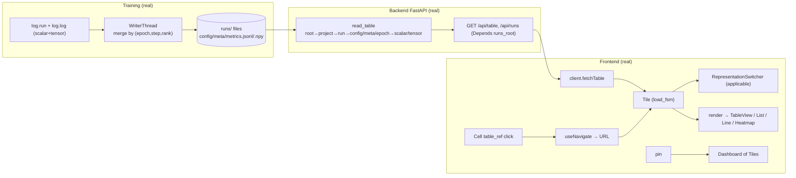

# STATUS — as-built (what actually runs right now)

`SPEC.md` is the target (WHAT to build). This file is the mirror of reality (what IS built). The gap between them is the work remaining. It is updated **every commit**: the diagram and the tables below always describe the code at `HEAD`, and the changelog records what each commit made real.

## As-built data flow (wired today)

## Real / partial / stub (vs SPEC)

| Area | Status | Notes / spec |
|---|---|---|
| `log.run`, `log.log` (scalar+tensor), WriterThread, atomic/jsonl/npy, identity | **real** | §9, §10.1; scalars merged by (epoch,step,rank) |
| Toolkit: `watch/track/distribute/checkpoint/resume_state/schedules/tick/export.figure` | **real** | §9/§10/§13; LR schedules, sample counting, DDP/FSDP (single-rank identity), forward/backward hooks, checkpoint cadence+rotation, resume+RNG restore, matplotlib export. **Zero NotImplementedError in src/.** |
| `read_table` all levels | **real** | §6.2 full ladder |
| `GET /api/runs` (project/status/tag filters), `GET /api/table` | **real** | §9.12, ADR-017 (Depends) |
| `/api/workspaces` (GET list, PUT save, DELETE) | **real** | §9.12; writes `runs/workspaces/<id>.json` (global, cross-run; atomic temp+rename) |
| `/ws` live push: watch `runs/` → `run_updated` | **real** | §10.5; `watchfiles.awatch` inside the handler |
| `/api/series/scalar` (min/max downsample to ~2000) + `/api/series/tensor` | **real** | §9.12, §8 perf seam |
| `/api/views` (GET/PUT/DELETE → `runs/views/<id>.json`) | **real** | §9.12 |
| `/api/tables/eval` + `table_engine` recursive-descent grammar (`table\|select\|filter\|sort\|derive\|agg\|join\|concat`) over `FUNCTIONS` | **real** | §9.13; tokenizer + recursive grammar (replaced the per-op regex); `derive` takes full arithmetic (`loss - mean(loss)`), `join`/`concat` take a nested pipeline |
| `/api/paths` (walk → all drillable dot-paths) | **real** | for search |
| `IndexPort` + `SqliteIndex` (real `runs/.index.sqlite3`, `query`/`upsert`/`rebuild`) wired into `GET /api/runs` via `Depends(get_index)` | **real** | §7.2, §8, ADR-003. Derived, rebuildable from a file scan (deleting the db is safe). `get_index` rebuilds on each request until the `FileWatcher` drives incremental `upsert` (next slice). `api/runs` no longer walks the filesystem (§8 satisfied for this route). |
| `StoragePort`/`LocalFileStorage`, `TransportPort`/`WebSocketTransport`, `FileWatcher` | **partial — SPEC-MANDATED, remaining Stage-3 slices** | §5.2, §7.2, §8, ADR-002. `LocalFileStorage` real but `read_table` still reads files directly (not yet routed through `StoragePort`); `TransportPort`/`FileWatcher` are Stage-0 shells, live still runs `awatch` inline in `/ws`. |
| Frontend: store + 5 slices, makeFsm + 7 FSMs | **real** | §7.3; route slice removed (URL is state via react-router); resize_fsm added |
| `Tile` (load_fsm fetch), `App`, `NavBar`, `render`+`applicable`, `RepresentationSwitcher`, `Button` | **real** | §7.4, §11.1, §11.2a |
| Views: `TableView`, `ListView`, `LineChartView`, `HeatmapView`, `HistogramView` (SVG) | **real** | §11.2b; line/heatmap/histogram hand-drawn |
| `GET /api/runs/{p}/{run}` (folder Table), `DELETE /api/runs/{p}/{run}` | **real** | §9.12 |
| `Cell`: drill on `table_ref` click, double-click edit | **real** | §11.2, §11.3 |
| `TableView`: column/row headers + ＋ add row/column (in-memory) | **real** | §11.3; folders/config/meta now default to `grid` |
| `AddControl`: ＋ button (button_fsm) | **real** | §11.3; two controls labelled `＋ column`/`＋ row` until CSS positions them on edges |
| `Dashboard`: pin/unpin + flex-wrap layout + drag-resize tiles + save/load workspace | **real** | §11.4; tile sizes persist; first functional CSS (flex/size/border/overflow + resize cursor only) |
| Route-backed modal (`Modal`, `?modal=path`) — expand tile to fullscreen, URL-addressable, back-closes | **real** | §11.2a; following a link inside the modal still drills the background (nested-modal-from-link deferred) |
| URL routing (react-router-dom): drill changes URL, back/forward, shareable links | **real** | §11.2; replaced the store route slice |
| `HeaderCell` (editable name/headers, cellEdit_fsm), `DotMenu` (delete row/col, deleteConfirm_fsm two-click) | **real** | §11.3; in-memory edits |
| `Toolbar` | **stub** | §11.3 |
| Live (WebSocket → `liveTick` → Tile refetch), `connection_fsm` wiring | **real** | §10.5; global tick refetches open tiles on any run change |
| Representation switcher: table/visualization mode toggle + chart dropdown | **real** | §11.2a; tile `mode` field, chart picked via a `<select>` in visualization mode |
| Run rename: universal `rename_names` (prefix/suffix/find-replace) + `POST /api/runs/rename` | **real** | §9.12; Finder-style batch; reusable string fn |
| Search: `/api/paths` + NavBar search box → filtered clickable matches | **real** | §11.3 |
| View persistence: `Tile` renders from the store, loads a saved view if present, "save view" persists the edited table | **real** | §11.3; manual save (auto-save-on-edit deferred) |

## Pending (not bugs — deferred by choice or need their own pass)

- **`Toolbar`** — thin action bar; a UI affordance, low value alone (its actions exist as buttons elsewhere).
- **Rename UI** — the `rename_names` fn + endpoint are real; a multi-select Finder-style dialog on top is not wired.
- **Auto-save views on edit** — view persistence works via a manual "save view"; auto-persisting every edit (store subscription) is deferred.
- **Stage 3 remaining slices** (§7.2, §8, ADR-002): route `read_table` through `StoragePort`/`LocalFileStorage`; implement `FileWatcher.run()` → `index.upsert` + `transport.push` and `WebSocketTransport.push`, replacing the inline `awatch` in `/ws` (and dropping the per-request `rebuild` in `get_index`). `IndexPort`/`SqliteIndex` + `GET /api/runs` are done.
- **Row windowing** (§8 structural perf) — the grid renderer must mount only the ~40 visible rows + buffer; verify whether `TableView` does this yet.
- **Ctrl+Z undo/redo** (§13 "UI: editing immutability") — acceptance requires Ctrl+Z to restore a deleted column; verify it is wired.

**Zero `NotImplementedError` anywhere in `src/`.** `IndexPort`/`SqliteIndex` are now real and wired; `StoragePort`/`TransportPort`/`FileWatcher` remain Stage-0 shells — the SPEC-mandated seam (§7.2/§8) awaiting their remaining Stage-3 slices, not dead code. One known silent-swallow: `queue_writer.py:208` `except Exception: pass` on the run-exit meta write — flagged, not yet fixed.

## Changelog (newest first — commit → what became real)

- `HEAD` — **Stage 3 slice 1: real `SqliteIndex` behind `IndexPort`, wired into `GET /api/runs`.** New `RunSummary` model; `SqliteIndex` keeps a derived `runs/.index.sqlite3` (`query`/`upsert`/`rebuild`, rebuildable from a file scan — ADR-003); `get_index` provider injects it via `Depends`; `get_runs` now calls `index.query(project,status,tag)` instead of walking the filesystem (closes the §8 violation for this route). +5 tests incl. a route-level `TestClient` filter test; backend 52 passed.
- `HEAD~` — **Rewrote the DSL parser as a recursive-descent grammar.** Replaced `table_engine`'s per-operator regex with a tokenizer + recursive grammar: `table(...)`'s argument can be a nested pipeline (⇒ `join`/`concat` against a transformed table), and `derive` now evaluates full arithmetic over columns/literals/function-calls (`derive(gap = loss - mean(loss))`). Same public API (`parse`/`evaluate`). +2 tests (arithmetic, nested join). (Note: the `ports/`+`adapters/` files were briefly deleted in error this session — they are SPEC-mandated (§7.2/§8) and were restored.)
- `HEAD~` — **Closed every plug (zero NotImplementedError) + finished the feature set:** full toolkit (schedules/tick/track/distribute/watch/checkpoint+rotation/resume+RNG/export); `table_engine` parser/evaluator + `/api/tables/eval`; `/api/series` scalar+tensor with downsampling; `/api/views` persistence; `/api/runs/rename` (universal `rename_names`); `/api/paths` + NavBar search; view persistence (Tile renders from store, loads saved view, save-view button). Run-exit meta now read-modify-writes (preserves `resume_diff`/`writer_errors`/final `samples_seen`). +30 tests.
- `HEAD~` — Cleared audit pending-v1 items: histogram representation + `HistogramView`; tile mode toggle (table/visualization) + chart dropdown (`tiles_setMode`, `mode` field); `applicable()` now gates line/heatmap/histogram by cell types; `DELETE /api/runs/{p}/{run}`.
- (prev) — Audit drift fixes: `tags` written into `meta.json`; clickable breadcrumb (NavBar); `id` saved on workspace tiles; `GET /api/runs/{p}/{run}` returns the real folder `Table` (read_table + serialize); `/api/series` stub signatures match §9.12; §6.3 representation rule reworded to match `read_table` (folders/key-value/tensor→grid, series→line).
- `be00da1` — Route-backed fullscreen modal (§11.2a): Tile "expand" sets `?modal=path`; Modal renders the tile fullscreen, URL-addressable, closed by the close button or browser back.
- `bb7c1e5` — Real URL routing: react-router-dom replaces the store route slice. Drill changes the URL (`/<dot-path>`), browser back/forward work, links are shareable (§11.2 "URL is state"). routeSlice deleted; Cell/NavBar/App use useNavigate/useLocation.
- `4977966` — Table editing complete (§11.3): editable name/headers (HeaderCell + cellEdit_fsm), delete row/column (DotMenu + deleteConfirm_fsm two-click), tables_removeRow/removeColumn/editName. In-memory.
- `7b96bae` — Dashboard tiles are drag-resizable (ResizeHandle + resize_fsm, hand-rolled), laid out flex-wrap; sizes persist in the workspace. First functional CSS.
- `7ec0afd` — Live updates: `/ws` watches `runs/` (watchfiles) and pushes `run_updated`; frontend `live_bump` → tiles refetch; `connection_event` drives `connection_fsm`.
- `7051550` — Workspace persistence: `/api/workspaces` (list/save/delete → `runs/workspaces/<id>.json`, global cross-run); App saves the dashboard and reloads it on startup (`tiles_loadWorkspace`).
- `f60a077` — TableView renders column/row headers + ＋ add row/column (in-memory edits); folders/config/meta default to `grid`; AddControl real; vitest cleanup setup.
- `1e79987` — Dashboard: pin/unpin tables into a stack of independent Tiles (§11.4, static).
- `eb62146` — extracted `Tile` (load_fsm fetch + switcher + render); `App` went thin.
- `ff01ad1` — `applicable(table)` + live RepresentationSwitcher (flip grid/list/line/heatmap).
- `9de862e` — real representations (SVG line/heatmap, list) + `App` renders via `render(table, representation)`.
- `108631c` — `Cell` table_ref drills on click (browser-navigable tree).
- `d674b22` — `read_table` drills run/config/meta/epoch/scalar/tensor (§6.2).
- `0464508` — project columns per §6.2; writer keys scalars by epoch.
- `6fc1ea8` — function registry folded into `table_engine.py`; comments stripped.
- `2ac4969` — `runs_root` via `Depends` (ADR-017); revived run filters.
- `3ce19b6` — v0 walking skeleton.
