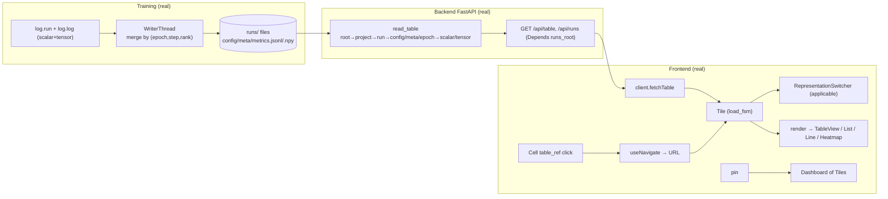

# STATUS — as-built (what actually runs right now)

`SPEC.md` is the target (WHAT to build). This file is the mirror of reality (what IS built). The gap between them is the work remaining. It is updated **every commit**: the diagram and the tables below always describe the code at `HEAD`, and the changelog records what each commit made real.

## As-built data flow (wired today)

## Real / partial / stub (vs SPEC)

| Area | Status | Notes / spec |
|---|---|---|
| `log.run`, `log.log` (scalar+tensor), WriterThread, atomic/jsonl/npy, identity | **real** | §9, §10.1; scalars merged by (epoch,step,rank) |
| Toolkit: `watch/track/distribute/checkpoint/resume_state/schedules/tick/export.figure` | **real** | §9/§10/§13; LR schedules, sample counting, DDP/FSDP (single-rank identity), forward/backward hooks, checkpoint cadence+rotation, resume+RNG restore, matplotlib export. **Zero NotImplementedError in src/.** |
| `read_table` all levels | **real** | §6.2 full ladder |
| `GET /api/runs` (project/status/tag filters), `GET /api/table` | **real** | §9.12, ADR-017 (Depends) |
| `/api/workspaces` (GET list, PUT save, DELETE) | **real** | §9.12; writes `runs/workspaces/<id>.json` (global, cross-run; atomic temp+rename) |
| `/ws` live push: one `FileWatcher` (`awatch`) → `index.upsert` + `WebSocketTransport.push` → `run_updated` (with kind metrics/tensor/checkpoint/meta) | **real** | §10.5, ADR-002. Watcher runs once (app lifespan); `/ws` just registers the socket with the shared `TransportPort` and waits. `run_added`/`run_removed` events deferred (a vanished run triggers an index `rebuild`). |
| `/api/series/scalar` (min/max downsample to ~2000) + `/api/series/tensor` | **real** | §9.12, §8 perf seam; both read run data through `StoragePort` (`read_jsonl` shared with `read_table`; tensor via `read_array`/mmap) |
| `/api/views` (GET/PUT/DELETE → `runs/views/<id>.json`) | **real** | §9.12 |
| `/api/tables/eval` + `table_engine` recursive-descent grammar (`table\|select\|filter\|sort\|derive\|agg\|join\|concat`) over `FUNCTIONS` | **real** | §9.13; tokenizer + recursive grammar (replaced the per-op regex); `derive` takes full arithmetic (`loss - mean(loss)`), `join`/`concat` take a nested pipeline |
| `/api/paths` (walk → all drillable dot-paths) | **real** | for search |
| `IndexPort` + `SqliteIndex` (one shared `runs/.index.sqlite3`, `query`/`upsert`/`rebuild`, thread-safe via one lock) wired into `GET /api/runs` via `Depends(get_index)` | **real** | §7.2, §8, ADR-003. Built once at app lifespan and `rebuild()`-scanned on startup; the `FileWatcher` keeps it fresh with incremental `upsert` (no per-request rebuild). `api/runs` no longer walks the filesystem (§8 satisfied for this route). |
| `TransportPort` + `WebSocketTransport` + `FileWatcher` (live path through the ports) | **real** | §7.2, §8, ADR-002. One watcher → `index.upsert` + `transport.push`; `/ws` registers the socket with the shared transport. |
| `StoragePort` + `LocalFileStorage` routing for `read_table` + `table_engine` | **real** | §7.2, §8. `read_table(path, storage)` and `evaluate(expr, storage)` now do all IO through the port; handlers inject it via `Depends(get_storage)`. The mmap-vs-`bytes` tension is resolved by a `read_array(path)` port method — the adapter does `np.load(root/path, mmap_mode="r")`, so the domain stays Path-free and tensors are still memory-mapped (ADR-016). Port surface: `read`/`read_array`/`list_dir`/`is_dir`/`exists`. |
| Frontend: store + 5 slices, makeFsm + 9 FSMs (button/load/cellEdit/connection/search/resize/menu/player/trail) | **real** | §7.3; route slice removed (URL is state via react-router); deleteConfirm_fsm removed with the dot-menu |
| `Tile` (load_fsm fetch), `App`, `NavBar`, `render`+`applicable`, `RepresentationSwitcher`, `Button` | **real** | §7.4, §11.1, §11.2a |
| Views: `TableView` (`<table>`), `ListView` (`<ul>/<li>`), `LineChartView`/`HeatmapView`/`HistogramView` (Plotly) | **real** | §11.2b; charts via one `chartSpec(table, kind)` → Plotly figure, each view a one-liner `<Plot/>` behind the same `render` dispatch (ADR-006 revised) |
| Design system: `styles/tokens.css` (monochrome) | **real** | ADR-012; design tokens (`--space`/`--radius`/gray scale/`--shadow`) via element selectors + `.modal`/`.tile`; semantic tags (`<table>/<th>/<td>`, `<ul>/<li>`, `<button>`, `<caption>`, `<h3>`); hover/active via CSS pseudo-classes, no animation |
| `GET /api/runs/{p}/{run}` (folder Table), `DELETE /api/runs/{p}/{run}` | **real** | §9.12 |
| `Cell`: drill on `table_ref` click, double-click edit | **real** | §11.2, §11.3 |
| `TableView`: column/row headers + ＋ add row/column (in-memory) | **real** | §11.3; folders/config/meta now default to `grid` |
| `AddControl`: ＋ button (button_fsm) | **real** | §11.3; two controls labelled `＋ column`/`＋ row` until CSS positions them on edges |
| `Dashboard`: pin/unpin + flex-wrap layout + drag-resize tiles + save/load workspace | **real** | §11.4; tile sizes persist; first functional CSS (flex/size/border/overflow + resize cursor only) |
| Route-backed modal (`Modal`, `?modal=path`) — expand tile to fullscreen, URL-addressable, back-closes | **real** | §11.2a; following a link inside the modal still drills the background (nested-modal-from-link deferred) |
| URL routing (react-router-dom): drill changes URL, back/forward, shareable links | **real** | §11.2; replaced the store route slice |
| `HeaderCell` (editable name/headers, cellEdit_fsm), `DotMenu` (delete row/col, deleteConfirm_fsm two-click) | **real** | §11.3; in-memory edits |
| `Toolbar` (formula input → `/api/tables/eval`, result replaces the tile's table as one undoable edit, inline error state via `load_fsm`) | **real** | §11.3/§9.13; `tables_replace` goes through `applyEdit` so Ctrl+Z restores the pre-formula table |
| Right-click context `Menu` (add/delete row/column at the pointer) + the same `Menu` renders the search dropdown | **real** | §11.3; replaced `DotMenu`/`AddControl`/`deleteConfirm_fsm` (deletes apply immediately, Ctrl+Z restores) |
| Cell selection (`focus_setTarget` per cell) + paste TSV / markdown / plain numbers (`parsePaste` → `tables_pasteBlock`, grows the table, one undoable edit) + single-cell copy | **real** | §11.4 #7/#8; cut and range copy pending |
| `Player` + `player_fsm`: timeline over tensor steps — ALL frames prefetched into a local stack, scrubbing instant and local, play/pause + draggable slider | **real** | SPEC frame-player section; not video — stacked data re-rendered per frame; verified live on `encoder.weights` (16×16) and `embeddings.tsne` (32×2) |
| Trajectory: `trail_fsm` toggle in the player stacks frames up to the current step into one `(step, point, x, y)` table; `trajectory` representation draws muted trails + head markers | **real** | §11.2b; scrubbing drags the trails through time; offered only for N×2 point sets |
| `scatter` representation for any numeric N×2 grid + `ScatterView`/`TrajectoryView` behind the same `render` dispatch | **real** | §11.2b; `applicable` gates by shape |
| ƒ catalog in the `Toolbar`: `GET /api/tables/functions` mirrors the `FUNCTIONS` registry; picking a statistic fills the formula input with `derive(fn_col = fn(col[, 20]))` over the last column and applies it | **real** | §11.3; one click = one derived column, expression stays editable; same `Menu` component |
| `FUNCTIONS` registry: `median`/`var`/`norm` (aggregation), `cumsum`/`diff` (transform) added | **real** | §9.13; same one-row Lego shape per statistic |
| Live (WebSocket → `liveTick` → Tile refetch), `connection_fsm` wiring | **real** | §10.5; global tick refetches open tiles on any run change |
| Representation switcher: table/visualization mode toggle + chart dropdown | **real** | §11.2a; tile `mode` field, chart picked via a `<select>` in visualization mode |
| Run rename: universal `rename_names` (prefix/suffix/find-replace) + `POST /api/runs/rename` | **real** | §9.12; Finder-style batch; reusable string fn |
| Search: `/api/paths` + NavBar search box → filtered clickable matches | **real** | §11.3 |
| View persistence: `Tile` renders from the store, loads a saved view if present, "save view" persists the edited table | **real** | §11.3; manual save (auto-save-on-edit deferred); "save view" refreshes the views map, the Tile effect re-runs when the saved view arrives, and a stale in-flight fetch is dropped (last request wins) |
| Undo: `editHistory` snapshot per edit via one `applyEdit` helper + `tables_undo` + global Ctrl/⌘+Z | **real** | §11.3/§13; all six table mutators share `applyEdit` (snapshot → change); Ctrl+Z skipped while typing in an input |
| WS reconnect: exponential backoff 1s→30s in the App socket effect | **real** | §10.5; `connection_fsm` drives status; live path verified across a backend restart |

## Pending (not bugs — deferred by choice or need their own pass)

- **Cut + range copy** (§11.4 #8) — paste and single-cell copy are real; cut and drag-select range copy need range selection first (§11.4 #7 `[v1]`).
- **Rename UI** — the `rename_names` fn + endpoint are real; a multi-select Finder-style dialog on top is not wired.
- **Auto-save views on edit** — view persistence works via a manual "save view"; auto-persisting every edit (store subscription) is deferred.
- **(none for the §8 read path — Stage 3 complete.)** Every read of run data now flows through `StoragePort`. The only direct filesystem access left in `api/` is **writes**: `views.py`/`workspaces.py` (the backend's own JSON config store) and `runs.py` rename/delete (run-dir mutations). The §7.2 `StoragePort` is read-only (`read`/`read_array`/`list_dir`/`is_dir`/`exists`) — it models no write/rename, so these are a different category, not a read-path gap.
- **Row windowing** (§8 structural perf) — the grid renderer must mount only the ~40 visible rows + buffer; `TableView` does NOT do this yet (all rows mount; fine at ≤ a few hundred rows).
- **Redo (Ctrl+Y)** — `[v2]`; undo (Ctrl+Z) is real (see changelog).

**Zero `NotImplementedError` anywhere in `src/`. Stage 3 complete.** All of `IndexPort`/`SqliteIndex`, `TransportPort`/`WebSocketTransport`/`FileWatcher`, and `StoragePort`/`LocalFileStorage` are real and wired — the §8 read seam is in place for every run-data read: `/api/runs`, `/api/table`, `/api/tables/eval`, `/api/runs/{p}/{run}`, `/api/paths`, `/api/series`, and the `/ws` live path. The only direct filesystem access left is writes (views/workspaces config store, run rename/delete), which the read-only `StoragePort` does not model. One known silent-swallow: `queue_writer.py:208` `except Exception: pass` on the run-exit meta write — flagged, not yet fixed.

## Always-on server

`http://localhost:8000` — один процесс: FastAPI отдаёт и API, и собранный фронт (`frontend/dist`, catch-all route → `index.html`, so deep links work). Живёт под launchd (`~/Library/LaunchAgents/com.log.viewer.plist`, `KeepAlive` + `RunAtLoad`): переживает перезагрузку мака и рестартует при падении; лог в `/tmp/com.log.viewer.log`. После изменений фронта: `cd frontend && npx vite build`; после изменений бэка: `launchctl kickstart -k gui/$UID/com.log.viewer`. Vite на `:3000` остаётся только для разработки.

## Changelog (newest first — commit → what became real)

- (uncommitted) — **Always-on localhost.** The dev servers died with each assistant session (child processes). Now FastAPI serves the built frontend itself (`/assets` static mount + catch-all → `index.html`; same-origin, so the hardcoded `:8000` API/WS URLs just work), and the process runs under launchd (`com.log.viewer.plist`, KeepAlive) — survives reboots, auto-restarts on crash (verified: `pkill` → back in 4s). One URL: `http://localhost:8000`.
- `1f2c241` — **Player = timeline over stacked data; trajectories; ƒ catalog.** The owner reframed the player: not video — a draggable timeline under an interactive picture, sliding through data frames stacked in memory. (1) `Player` now prefetches ALL frames once (`Promise.all` over steps) and scrubbing is instant and local, no per-step fetch; play just advances the same index. *(Level-1 trade: memory for instant scrub — noted in SPEC.)* (2) **Trajectories**: a `trail_fsm` toggle (shown only for N×2 point sets) composes frames up to the current step into one `(step, point, x, y)` table — `trajectoryTable` — and the new `trajectory` representation draws a muted per-point trail with head markers at the current frame; scrubbing shortens/extends the trails. New `scatter` representation for any numeric N×2 grid. Both are ordinary rows in `RENDERERS`/`applicable`/`chartSpec` — same dispatch, same one-liner views. (3) **ƒ catalog**: `GET /api/tables/functions` exposes the `FUNCTIONS` registry (name/kind/windowed via `inspect.signature`); an ƒ button in the `Toolbar` opens the same `Menu` listing every statistic; picking one builds `derive(<fn>_<col> = <fn>(<col>[, 20]))` over the last column, fills the formula input (stays editable) and applies it — one click, one derived column, undoable. Fixed a same-click race: the click that opened the catalog bubbled to the window close-listener; the catalog anchor stops propagation and item picks close explicitly. Demo gains 4 drifting `embeddings.tsne` 32×2 frames. `.search` CSS class renamed `.anchor` (it now anchors both the search dropdown and the catalog). tsc clean, vitest 41 (+6: trajectoryTable/applicable/chartSpec/functionExpression), pytest 64 (+1 registry endpoint), build ok, no console errors; scatter, trails, scrub, and catalog-click verified live.
- `4547518` — **Editor pass: context menu, paste, formula bar, frame player.** Four stages, all verified live. (A) **Right-click context menu** replaces the per-header trash icons and the ＋ edge controls (owner: wrong pattern, misaligned): one `Menu` component now renders both the search dropdown and the context menu (add/delete row/column at the pointer, browser menu suppressed; deletes apply immediately — Ctrl+Z is the safety). `DotMenu`/`AddControl`/`deleteConfirm_fsm` deleted. (B) **Cell selection + paste**: click selects a cell (`focused` in the focus slice), paste accepts Excel TSV, markdown tables (divider rows dropped), and whitespace-separated numbers; the block anchors at the selection and grows the table (`tables_pasteBlock` via `applyEdit` — one undoable edit); single-cell copy. (C) **Formula bar**: `Toolbar` is real — an expression input in every tile bar; `derive/filter/select/agg/join` pipelines evaluate on `/api/tables/eval`, the result replaces the tile's table as an undoable edit (`tables_replace`), bad expressions show an inline error; registry gains `median`/`var`/`norm`/`cumsum`/`diff`. (D) **Frame player**: new `GET /api/series/tensor/steps`; a tensor logged at >1 step gets a play/pause + slider bar (`Player` + `player_fsm`), scrubbing fetches that step's frame into the same store key and the same `render` path — the heatmap animates over training time (stale frame replies dropped, last request wins). SPEC amended (§11.3 menu/toolbar, §11.4 #3/#4/#8, §9.12 steps endpoint, §9.13 registry, frame-player section; playback removed from the v2+ list). tsc clean, vitest 35, pytest 63, build ok, no console errors.
- `ee0016f` — **Bug-fix pass: every user flow verified live end-to-end.** Walked drill/charts/pin/resize/modal/search/edit/undo/save-view/save-workspace/live/reconnect in the browser and closed what broke. (1) **Live push was dead**: `get_runs_root()` returned relative `./runs`, `awatch` yields absolute paths, so `changed_runs`'s `relative_to` raised and the `continue` silently dropped every event — root now `.resolve()`d; verified a row appended to `metrics.jsonl` appears without reload. (2) **WS never reconnected**: socket was created once; backend restart killed live updates forever — App effect now reconnects with 1s→30s backoff (§10.5); verified across a backend bounce. (3) **Ctrl+Z undo was a stub**: all six table mutators now go through one `applyEdit` helper (snapshot into `editHistory` → apply); `tables_undo` restores; global Ctrl/⌘+Z listener in App (skipped while typing in an input); verified deleted column restored (§13 acceptance) + 3 new vitest cases. (4) **Saved view lost a race**: the Tile fetch launched before `/api/views` arrived resolved last and clobbered the loaded view — effect now depends on `savedView` and drops stale replies (last request wins); "save view" also refreshes the views map. (5) **Root listed `views`/`workspaces` as projects** (and search offered them): excluded via `DERIVED_STATE_DIRS` — §6.2 says one ref per *project*. (6) Visual: header trash no longer wraps to a second line (`th` nowrap + inline-block cell); charts fill tiles and follow drag-resize (`.tile-body`/`.tile-content` flex chain + Plotly `autosize`, fixed 320px height removed); wide tables scroll inside the tile, not the page; resize handle sits bottom-right (was bottom-left); modal close is a ghost icon in a corner `.bar`, and the pointless `expand` button is hidden inside the modal; a live refetch no longer flashes "Loading…" over an already-rendered table. tsc clean, vitest 30, pytest 59, build ok, no console errors.
- `HEAD` — **Design pass 3 (layout): corner-grouped toolbars + spacing base.** Introduced `.bar` (full-width header, `space-between`, bottom border) and `.group` (button cluster, `gap`). Top app bar: nav arrows + breadcrumb + search on the left, `pin`/`save` in the right corner. Tile header bar: `table↔chart` toggle on the left, `expand`/`save view` in the right corner. Dashboard card: `unpin` in the top-right corner. Search matches render as an absolutely-positioned `.menu` dropdown (was inline). `body` padding → 0; main view wrapped in `.content` (padding `1.5×`). tsc clean, vitest 27, no console errors.
- `HEAD~` — **Design pass 2 (toolbar + representations): toggle, icon actions, removed `list`.** Representation switcher is now a segmented **table ↔ visualization** toggle (icon buttons, `.toggle`); in visualization a styled `<select>` picks the chart (shown only when >1 chart applies). The `Tile` derives its representation from `mode` (table → grid; visualization → chosen chart or first applicable), so a series no longer auto-opens as a chart. Removed the `grid`/`list` buttons and the `list` representation entirely (`Representation.List`, `ListView`, the `applicable` branch, RENDERERS entry) — folders/tables render as the one `<table>`. `pin`/`unpin`/`save`/`expand`/`save view` are ghost icon buttons; added `pin`/`save`/`expand`/`table`/`chart` SVGs. SPEC §3.2/§11.2b catalog + file structure updated (`grid / line / heatmap / histogram`). tsc clean, vitest 27.
- `HEAD~` — **Design pass 1 (elements): icons, ghost buttons, in-cell editing, group spacing.** `Icon` component + swappable SVGs in `assets/icons/` (back/forward/plus/trash). `Button` gains `ghost`/`icon`/`title`. NavBar ← → are ghost icon arrows in a `.toolbar` (gap = 1 unit between, 1.5 at edges). `DotMenu` is now a consistent trash icon (same in header and body, no text → no table shift), two-click via `armed` state. `AddControl` is a ghost `+`: add-column in the top-right header cell, add-row below the table. In-cell editing uses a borderless `.cell-input` matching the cell's padding (no row shift); the whole `.cell` is the edit/drill target, not just the text. tsc clean, vitest 28. (Pending design pass 2: toolbar into hot corners, table/visualization toggle as icons, remove `grid`/`list`, style the chart `<select>`.)
- `HEAD~` — **Lazy-load Plotly (Level-1 optimization).** `PlotlyChart` wraps `React.lazy(() => import("react-plotly.js"))` in `Suspense`; the three chart views render it. Plotly moves out of the main bundle into a chunk loaded only when a chart first renders: main bundle 1.54 MB → **59 KB gz**, Plotly 1.48 MB gz lazy. tsc clean, vitest 28, build ok, chart verified live.
- `HEAD~` — **Charts on Plotly.js + NavBar breadcrumb `<nav>`.** Replaced the three hand-drawn SVG views with Plotly behind the same `render(table, representation)` dispatch: one pure `chartSpec(table, kind)` → `{data, layout}` (monochrome theme), each of `LineChartView`/`HeatmapView`/`HistogramView` a one-liner `<Plot {...chartSpec(table, kind)} />`. `applicable()` and the dispatch unchanged; store/selectors never see Plotly. Added `plotly.js` + `react-plotly.js`. NavBar breadcrumb wrapped in `<nav>`. SPEC amended: ADR-006 hand-drawn-SVG → Plotly, ADR-013 keeps the charting lib, §4.2 deps + catalog/file-structure wording. Verified live: monochrome loss line chart renders. tsc clean.
- `HEAD~` — **Semantic HTML + minimal monochrome design system.** `TableView` renders a real `<table>` (`caption/thead/tbody/tr/th/td`) instead of stacked `
`s — fixing the "table looks like a dotted list" bug; `ListView` → `<ul>/<li>`; `Cell`/`HeaderCell` emit inline `` so the parent supplies the semantic container. New `styles/tokens.css`: one spacing scale / radius / gray scale / shadow as CSS custom properties, applied via element selectors (table borders/padding, button, input, headings) + `.modal`/`.tile` classes; hover/active are CSS pseudo-classes (not FSM — they are ephemeral pointer state). SPEC amended: ADR-012 "plain divs" → semantic HTML (the owner clarified "plain divs" meant "the right tag, unstyled until asked", not "only divs"); §3.1 wording updated. tsc clean, no console errors.
- `HEAD~` — **`/api/series` routed through `StoragePort` — Stage 3 complete.** `get_scalar_series`/`get_tensor_series` now list epochs via `list_dir`/`is_dir`, read `metrics.jsonl`/`tensors/index.jsonl` via the shared `read_jsonl` (promoted from `read_table`'s private helper — one source of truth, no shadow copy), and load tensors via `read_array`/mmap. `_jsonl` → public `read_jsonl`. Backend 59 passed; verified live: scalar (200 pts) and tensor (16×16 float32) serve through the port. The §8 read seam now covers every run-data read.
- `HEAD~` — **`read_table` + `table_engine` routed through `StoragePort` (closes the §8 read-path gap).** `read_table(path, storage)` and `evaluate(expr, storage)` do all IO through the port; handlers inject `LocalFileStorage` via `Depends(get_storage)`. The `bytes`-vs-mmap tension is resolved with a `read_array(path)` port method (adapter does `np.load(..., mmap_mode="r")`), so the domain never touches a `Path` and tensors stay memory-mapped. Port surface grew to `read`/`read_array`/`list_dir`/`is_dir`/`exists`. +4 tests (read_array/is_dir/exists; read_table & eval via the adapter); backend 59 passed. Verified live: epoch folder, 16×16 tensor heatmap, and arithmetic `eval` all render through the storage port. Remaining §8 gap: `/api/series`.
- `HEAD~` — **Stage 3 finished — live path through the ports.** `FileWatcher` runs one `awatch(runs_root)` loop (started in the app lifespan) that classifies each change into `(run, kind)`, `index.upsert`s the changed run, and `WebSocketTransport.push`es `run_updated` to every socket; `/ws` now just registers its socket with the shared `TransportPort` instead of running its own `awatch`. The `SqliteIndex` is built once at lifespan and kept fresh by the watcher (no per-request `rebuild`), shared across the event-loop and threadpool threads (one lock, `check_same_thread=False`). +9 tests (watcher classification, transport broadcast, `/ws` hello); backend 57 passed. Remaining §8 gap: `read_table` still reads files directly (mmap-vs-`bytes` tension — named).
- `HEAD~` — **Stage 3 slice 1: real `SqliteIndex` behind `IndexPort`, wired into `GET /api/runs`.** New `RunSummary` model; `SqliteIndex` keeps a derived `runs/.index.sqlite3` (`query`/`upsert`/`rebuild`, rebuildable from a file scan — ADR-003); `get_index` provider injects it via `Depends`; `get_runs` now calls `index.query(project,status,tag)` instead of walking the filesystem (closes the §8 violation for this route). +5 tests incl. a route-level `TestClient` filter test; backend 52 passed.
- `HEAD~` — **Rewrote the DSL parser as a recursive-descent grammar.** Replaced `table_engine`'s per-operator regex with a tokenizer + recursive grammar: `table(...)`'s argument can be a nested pipeline (⇒ `join`/`concat` against a transformed table), and `derive` now evaluates full arithmetic over columns/literals/function-calls (`derive(gap = loss - mean(loss))`). Same public API (`parse`/`evaluate`). +2 tests (arithmetic, nested join). (Note: the `ports/`+`adapters/` files were briefly deleted in error this session — they are SPEC-mandated (§7.2/§8) and were restored.)
- `HEAD~` — **Closed every plug (zero NotImplementedError) + finished the feature set:** full toolkit (schedules/tick/track/distribute/watch/checkpoint+rotation/resume+RNG/export); `table_engine` parser/evaluator + `/api/tables/eval`; `/api/series` scalar+tensor with downsampling; `/api/views` persistence; `/api/runs/rename` (universal `rename_names`); `/api/paths` + NavBar search; view persistence (Tile renders from store, loads saved view, save-view button). Run-exit meta now read-modify-writes (preserves `resume_diff`/`writer_errors`/final `samples_seen`). +30 tests.
- `HEAD~` — Cleared audit pending-v1 items: histogram representation + `HistogramView`; tile mode toggle (table/visualization) + chart dropdown (`tiles_setMode`, `mode` field); `applicable()` now gates line/heatmap/histogram by cell types; `DELETE /api/runs/{p}/{run}`.
- (prev) — Audit drift fixes: `tags` written into `meta.json`; clickable breadcrumb (NavBar); `id` saved on workspace tiles; `GET /api/runs/{p}/{run}` returns the real folder `Table` (read_table + serialize); `/api/series` stub signatures match §9.12; §6.3 representation rule reworded to match `read_table` (folders/key-value/tensor→grid, series→line).
- `be00da1` — Route-backed fullscreen modal (§11.2a): Tile "expand" sets `?modal=path`; Modal renders the tile fullscreen, URL-addressable, closed by the close button or browser back.
- `bb7c1e5` — Real URL routing: react-router-dom replaces the store route slice. Drill changes the URL (`/<dot-path>`), browser back/forward work, links are shareable (§11.2 "URL is state"). routeSlice deleted; Cell/NavBar/App use useNavigate/useLocation.
- `4977966` — Table editing complete (§11.3): editable name/headers (HeaderCell + cellEdit_fsm), delete row/column (DotMenu + deleteConfirm_fsm two-click), tables_removeRow/removeColumn/editName. In-memory.
- `7b96bae` — Dashboard tiles are drag-resizable (ResizeHandle + resize_fsm, hand-rolled), laid out flex-wrap; sizes persist in the workspace. First functional CSS.
- `7ec0afd` — Live updates: `/ws` watches `runs/` (watchfiles) and pushes `run_updated`; frontend `live_bump` → tiles refetch; `connection_event` drives `connection_fsm`.
- `7051550` — Workspace persistence: `/api/workspaces` (list/save/delete → `runs/workspaces/<id>.json`, global cross-run); App saves the dashboard and reloads it on startup (`tiles_loadWorkspace`).
- `f60a077` — TableView renders column/row headers + ＋ add row/column (in-memory edits); folders/config/meta default to `grid`; AddControl real; vitest cleanup setup.
- `1e79987` — Dashboard: pin/unpin tables into a stack of independent Tiles (§11.4, static).
- `eb62146` — extracted `Tile` (load_fsm fetch + switcher + render); `App` went thin.
- `ff01ad1` — `applicable(table)` + live RepresentationSwitcher (flip grid/list/line/heatmap).
- `9de862e` — real representations (SVG line/heatmap, list) + `App` renders via `render(table, representation)`.
- `108631c` — `Cell` table_ref drills on click (browser-navigable tree).
- `d674b22` — `read_table` drills run/config/meta/epoch/scalar/tensor (§6.2).
- `0464508` — project columns per §6.2; writer keys scalars by epoch.
- `6fc1ea8` — function registry folded into `table_engine.py`; comments stripped.
- `2ac4969` — `runs_root` via `Depends` (ADR-017); revived run filters.
- `3ce19b6` — v0 walking skeleton.
