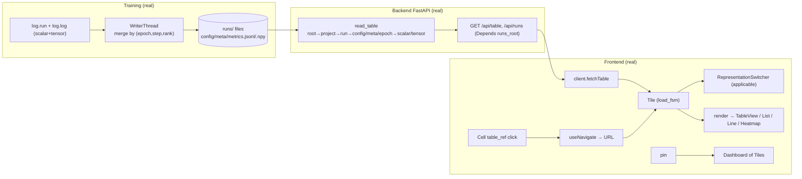

# STATUS — as-built (what actually runs right now)

`SPEC.md` is the target (WHAT to build). This file is the mirror of reality (what IS built). The gap between them is the work remaining. It is updated **every commit**: the diagram and the tables below always describe the code at `HEAD`, and the changelog records what each commit made real.

## As-built data flow (wired today)

## Real / partial / stub (vs SPEC)

| Area | Status | Notes / spec |
|---|---|---|
| `log.run`, `log.log` (scalar+tensor), WriterThread, atomic/jsonl/npy, identity | **real** | §9, §10.1; scalars merged by (epoch,step,rank) |
| Toolkit: `watch/track/distribute/checkpoint/resume_state/schedules/tick/export.figure` | **stub** | NotImplementedError, exact §9 signatures (Stage 2) |
| `read_table` all levels | **real** | §6.2 full ladder |
| `GET /api/runs` (project/status/tag filters), `GET /api/table` | **real** | §9.12, ADR-017 (Depends) |
| `/api/workspaces` (GET list, PUT save, DELETE) | **real** | §9.12; writes `runs/workspaces/<id>.json` (global, cross-run; atomic temp+rename) |
| `/ws` live push: watch `runs/` → `run_updated` | **real** | §10.5; `watchfiles.awatch` inside the handler |
| `/api/series`, `/api/views` | **stub** | endpoints exist, no behavior |
| `table_engine` parser (`evaluate`/`parse`) | **stub** | §9.13; `FUNCTIONS` registry is **real** |
| SqliteIndex, WebSocketTransport adapters | **stub** | §7.2; live runs in the ws handler, not the adapter split yet |
| Frontend: store + 5 slices, makeFsm + 7 FSMs | **real** | §7.3; route slice removed (URL is state via react-router); resize_fsm added |
| `Tile` (load_fsm fetch), `App`, `NavBar`, `render`+`applicable`, `RepresentationSwitcher`, `Button` | **real** | §7.4, §11.1, §11.2a |
| Views: `TableView`, `ListView`, `LineChartView` (SVG), `HeatmapView` (SVG) | **real** | §11.2b; line/heatmap hand-drawn |
| `Cell`: drill on `table_ref` click, double-click edit | **real** | §11.2, §11.3 |
| `TableView`: column/row headers + ＋ add row/column (in-memory) | **real** | §11.3; folders/config/meta now default to `grid` |
| `AddControl`: ＋ button (button_fsm) | **real** | §11.3; two controls labelled `＋ column`/`＋ row` until CSS positions them on edges |
| `Dashboard`: pin/unpin + flex-wrap layout + drag-resize tiles + save/load workspace | **real** | §11.4; tile sizes persist; first functional CSS (flex/size/border/overflow + resize cursor only) |
| Route-backed modal (`Modal`, `?modal=path`) — expand tile to fullscreen, URL-addressable, back-closes | **real** | §11.2a; following a link inside the modal still drills the background (nested-modal-from-link deferred) |
| URL routing (react-router-dom): drill changes URL, back/forward, shareable links | **real** | §11.2; replaced the store route slice |
| `HeaderCell` (editable name/headers, cellEdit_fsm), `DotMenu` (delete row/col, deleteConfirm_fsm two-click) | **real** | §11.3; in-memory edits |
| `Toolbar` | **stub** | §11.3 |
| Live (WebSocket → `liveTick` → Tile refetch), `connection_fsm` wiring | **real** | §10.5; global tick refetches open tiles on any run change |
| Workspace persistence (`workspaces/<id>.json`) | **not built** | §6.3, §11.4 |
| Representation switcher as nested table/viz two-step dropdown | **simplified** | §11.2a; currently a flat row of buttons |

## Changelog (newest first — commit → what became real)

- `be00da1` — Route-backed fullscreen modal (§11.2a): Tile "expand" sets `?modal=path`; Modal renders the tile fullscreen, URL-addressable, closed by the close button or browser back.
- `bb7c1e5` — Real URL routing: react-router-dom replaces the store route slice. Drill changes the URL (`/<dot-path>`), browser back/forward work, links are shareable (§11.2 "URL is state"). routeSlice deleted; Cell/NavBar/App use useNavigate/useLocation.
- `4977966` — Table editing complete (§11.3): editable name/headers (HeaderCell + cellEdit_fsm), delete row/column (DotMenu + deleteConfirm_fsm two-click), tables_removeRow/removeColumn/editName. In-memory.
- `7b96bae` — Dashboard tiles are drag-resizable (ResizeHandle + resize_fsm, hand-rolled), laid out flex-wrap; sizes persist in the workspace. First functional CSS.
- `7ec0afd` — Live updates: `/ws` watches `runs/` (watchfiles) and pushes `run_updated`; frontend `live_bump` → tiles refetch; `connection_event` drives `connection_fsm`.
- `7051550` — Workspace persistence: `/api/workspaces` (list/save/delete → `runs/workspaces/<id>.json`, global cross-run); App saves the dashboard and reloads it on startup (`tiles_loadWorkspace`).
- `f60a077` — TableView renders column/row headers + ＋ add row/column (in-memory edits); folders/config/meta default to `grid`; AddControl real; vitest cleanup setup.
- `1e79987` — Dashboard: pin/unpin tables into a stack of independent Tiles (§11.4, static).
- `eb62146` — extracted `Tile` (load_fsm fetch + switcher + render); `App` went thin.
- `ff01ad1` — `applicable(table)` + live RepresentationSwitcher (flip grid/list/line/heatmap).
- `9de862e` — real representations (SVG line/heatmap, list) + `App` renders via `render(table, representation)`.
- `108631c` — `Cell` table_ref drills on click (browser-navigable tree).
- `d674b22` — `read_table` drills run/config/meta/epoch/scalar/tensor (§6.2).
- `0464508` — project columns per §6.2; writer keys scalars by epoch.
- `6fc1ea8` — function registry folded into `table_engine.py`; comments stripped.
- `2ac4969` — `runs_root` via `Depends` (ADR-017); revived run filters.
- `3ce19b6` — v0 walking skeleton.
