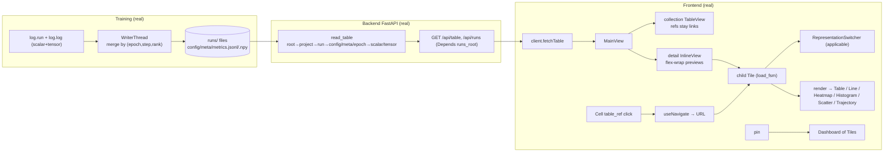

# STATUS — as-built (what actually runs right now)

`SPEC.md` is the target (WHAT to build). This file is the mirror of reality (what IS built). The gap between them is the work remaining. It is updated **every commit**: the diagram and the tables below always describe the code at `HEAD`, and the changelog records what each commit made real.

**2026-07-22 design-system pass.** All 57 images and the video in `design inspiration/` are accounted for in `DESIGN-SYSTEM.md`. `VISUALIZATION-CATALOG.md` now records table shapes, explicit operations, chart families, interpretability/system views, applicability, and renderer ownership. The interactive `/design-system` laboratory implements the run timeline, status strip, dense table encodings, execution lanes, alerts, and six visualization families. The production viewer has shared semantic tokens but has not yet adopted the laboratory's full run composition.

## As-built data flow (wired today)

## Real / partial / stub (vs SPEC)

| Area | Status | Notes / spec |
|---|---|---|
| `log.run`, `log.log` (scalar+tensor), WriterThread, atomic/jsonl/npy, identity | **real** | §9, §10.1; scalars merged by (epoch,step,rank) |
| Toolkit: `watch/track/distribute/checkpoint/resume_state/schedules/tick/export.figure` | **real** | §9/§10/§13; LR schedules, sample counting, DDP/FSDP (single-rank identity), forward/backward hooks, checkpoint cadence+rotation, resume+RNG restore, matplotlib export. **Zero NotImplementedError in src/.** |
| `read_table` all levels | **real** | §6.2 full ladder |
| `GET /api/runs` (project/status/tag filters), `GET /api/table` | **real** | §9.12, ADR-017 (Depends) |
| `/api/workspaces` (GET list, PUT save, DELETE) | **real** | §9.12; writes `runs/workspaces/<id>.json` (global, cross-run; atomic temp+rename) |
| `/ws` live push: one `FileWatcher` (`awatch`) → `index.upsert` + `WebSocketTransport.push` → `run_updated` (with kind metrics/tensor/checkpoint/meta) | **real** | §10.5, ADR-002. Watcher runs once (app lifespan); `/ws` just registers the socket with the shared `TransportPort` and waits. `run_added`/`run_removed` events deferred (a vanished run triggers an index `rebuild`). |
| `/api/series/scalar` (min/max downsample to ~2000) + `/api/series/tensor` | **real** | §9.12, §8 perf seam; both read run data through `StoragePort` (`read_jsonl` shared with `read_table`; tensor via `read_array`/mmap) |
| `/api/views` (GET/PUT/DELETE → `runs/views/<id>.json`) | **real** | §9.12 |
| `/api/tables/eval` + `table_engine` recursive-descent grammar (`table\|select\|filter\|sort\|derive\|agg\|join\|concat`) over `FUNCTIONS` | **real** | §9.13; tokenizer + recursive grammar (replaced the per-op regex); `derive` takes full arithmetic (`loss - mean(loss)`), `join`/`concat` take a nested pipeline |
| `/api/runs/compare` + `RunComparison` | **real** | §11.7; multi-selected run rows → bottom bar → URL-backed derived Table over config/meta, aligned scalar metrics, tensor index metadata and checkpoints; tensor payloads stay unloaded |
| `/api/paths` (walk → all drillable dot-paths) | **real** | for search |
| `IndexPort` + `SqliteIndex` (one shared `runs/.index.sqlite3`, `query`/`upsert`/`rebuild`, thread-safe via one lock) wired into `GET /api/runs` via `Depends(get_index)` | **real** | §7.2, §8, ADR-003. Built once at app lifespan and `rebuild()`-scanned on startup; the `FileWatcher` keeps it fresh with incremental `upsert` (no per-request rebuild). `api/runs` no longer walks the filesystem (§8 satisfied for this route). |
| `TransportPort` + `WebSocketTransport` + `FileWatcher` (live path through the ports) | **real** | §7.2, §8, ADR-002. One watcher → `index.upsert` + `transport.push`; `/ws` registers the socket with the shared transport. |
| `StoragePort` + `LocalFileStorage` routing for `read_table` + `table_engine` | **real** | §7.2, §8. `read_table(path, storage)` and `evaluate(expr, storage)` now do all IO through the port; handlers inject it via `Depends(get_storage)`. The mmap-vs-`bytes` tension is resolved by a `read_array(path)` port method — the adapter does `np.load(root/path, mmap_mode="r")`, so the domain stays Path-free and tensors are still memory-mapped (ADR-016). Port surface: `read`/`read_array`/`list_dir`/`is_dir`/`exists`. |
| Frontend: store + 5 slices, makeFsm + 9 FSMs (button/load/cellEdit/connection/search/resize/menu/player/trail) | **real** | §7.3; route slice removed (URL is state via react-router); deleteConfirm_fsm removed with the dot-menu |
| `Tile` (load_fsm fetch), `App`, `NavBar`, `render`+`applicable`, `RepresentationSwitcher`, `Button` | **real** | §7.4, §11.1, §11.2a |
| Collection/detail composition | **real** | §7.4/§11.4; root/project paths render one full-width table with `table_ref` links, while run/deeper folders render independent flex-wrap preview tiles with switcher/Expand/snap-resize/reorder; no recursive table-in-table DOM |
| Views: `TableView` (`<table>`), `ListView` (`<ul>/<li>`), `LineChartView`/`HeatmapView`/`HistogramView` (Plotly) | **real** | §11.2b; charts via one `chartSpec(table, kind)` → Plotly figure, each view a one-liner `<Plot/>` behind the same `render` dispatch (ADR-006 revised) |
| Design system: `styles/tokens.css` (monochrome) | **real** | ADR-012; design tokens (`--space`/`--radius`/gray scale/`--shadow`) via element selectors + `.modal`/`.tile`; semantic tags (`<table>/<th>/<td>`, `<ul>/<li>`, `<button>`, `<caption>`, `<h3>`); hover/active via CSS pseudo-classes, no animation |
| `GET /api/runs/{p}/{run}` (folder Table), `DELETE /api/runs/{p}/{run}` | **real** | §9.12 |
| `Cell`: drill on `table_ref` click, double-click edit | **real** | §11.2, §11.3 |
| `TableView`: column/row headers + ＋ add row/column (in-memory) | **real** | §11.3; folders/config/meta now default to `grid` |
| Table-local view controls: typed AND filters + chips, ordered Shift multi-sort, row/column resize, column visibility/order/freeze | **real** | §11.3/§11.4; pure selectors over the source `Table`; scoped URL keys preserve each preview/editor independently; frozen offsets derive from measured header geometry |
| `AddControl`: ＋ button (button_fsm) | **real** | §11.3; two controls labelled `＋ column`/`＋ row` until CSS positions them on edges |
| `Dashboard`: pin/unpin + flex-wrap layout + drag-resize tiles + save/load workspace | **real** | §11.4; tile sizes persist; first functional CSS (flex/size/border/overflow + resize cursor only) |
| Route-backed modal (`Modal`, `?modal=path`) — expand tile to fullscreen, URL-addressable, back-closes | **real** | §11.2a; following a link inside the modal still drills the background (nested-modal-from-link deferred) |
| URL routing (react-router-dom): drill changes URL, back/forward, shareable links | **real** | §11.2; replaced the store route slice |
| `HeaderCell` (editable name/headers, cellEdit_fsm), `DotMenu` (delete row/col, deleteConfirm_fsm two-click) | **real** | §11.3; in-memory edits |
| `Toolbar` (formula input → `/api/tables/eval`, result replaces the tile's table as one undoable edit, inline error state via `load_fsm`) | **real** | §11.3/§9.13; `tables_replace` goes through `applyEdit` so Ctrl+Z restores the pre-formula table |
| Right-click context `Menu` (add/delete row/column at the pointer) + the same `Menu` renders the search dropdown | **real** | §11.3; replaced `DotMenu`/`AddControl`/`deleteConfirm_fsm` (deletes apply immediately, Ctrl+Z restores) |
| Range selection (`focused.ranges`) + paste TSV / markdown / plain numbers + range copy/cut | **real** | §11.4 #7/#8; Shift extends, Ctrl/Cmd adds, drag selects; clipboard blocks and cut coordinates are selectors; paste/cut are each one undoable edit |
| `Player` + `player_fsm`: timeline over tensor steps — ALL frames prefetched into a local stack, scrubbing instant and local, play/pause + draggable slider | **real** | SPEC frame-player section; not video — stacked data re-rendered per frame; verified live on `encoder.weights` (16×16) and `embeddings.tsne` (32×2) |
| Trajectory: `trail_fsm` toggle in the player stacks frames up to the current step into one `(step, point, x, y)` table; `trajectory` representation draws muted trails + head markers | **real** | §11.2b; scrubbing drags the trails through time; offered only for N×2 point sets |
| `scatter` representation for any numeric N×2 grid + `ScatterView`/`TrajectoryView` behind the same `render` dispatch | **real** | §11.2b; `applicable` gates by shape |
| ƒ catalog in the `Toolbar`: `GET /api/tables/functions` mirrors the `FUNCTIONS` registry; picking a statistic fills the formula input with `derive(fn_col = fn(col[, 20]))` over the last column and applies it | **real** | §11.3; one click = one derived column, expression stays editable; same `Menu` component |
| `FUNCTIONS` registry: `median`/`var`/`norm` (aggregation), `cumsum`/`diff` (transform) added | **real** | §9.13; same one-row Lego shape per statistic |
| Live (WebSocket → `liveTick` → Tile refetch), `connection_fsm` wiring | **real** | §10.5; global tick refetches open tiles on any run change |
| Representation switcher: table/visualization mode toggle + chart dropdown | **real** | §11.2a; tile `mode` field, chart picked via a `<select>` in visualization mode |
| Run rename: universal `rename_names` (prefix/suffix/find-replace) + `POST /api/runs/rename` | **real** | §9.12; Finder-style batch; reusable string fn |
| Search + formula paths: `/api/paths` feeds NavBar search and `formula_selector` autocomplete | **real** | §11.3; columns, registry functions, and hierarchical table paths share the formula dropdown; path case covered by a selector test |
| View persistence: `Tile` renders from the store, loads a saved view if present, "save view" persists the edited table | **real** | §11.3; manual save (auto-save-on-edit deferred); "save view" refreshes the views map, the Tile effect re-runs when the saved view arrives, and a stale in-flight fetch is dropped (last request wins) |
| Undo/redo: `editHistory`/`editFuture` snapshots per edit via one `applyEdit` helper + `tables_undo`/`tables_redo` + global Ctrl/⌘+Z / Ctrl+Shift+Z / Ctrl+Y | **real** | §11.3/§13/ADR-018; all table mutators share `applyEdit` (snapshot → change); Ctrl+Z skipped while typing in an input; history (last N=20 snapshots) now written into `views/<id>.json` on every autosave so it should survive closing and reopening a view — **write path shipped in `84217a0`, read-back after an actual page reload not yet verified live** (see Pending) |
| WS reconnect: exponential backoff 1s→30s in the App socket effect | **real** | §10.5; `connection_fsm` drives status; live path verified across a backend restart |

## Pending (not bugs — deferred by choice or need their own pass)

What still separates `HEAD` from a finished v1 (SPEC §3.2), in the order it should be built. Three kinds: contract gaps where SPEC promises something the code does not do, product UX the owner asked for, and v1 performance seams. Each item names where it lands.

**A. Contract gaps (SPEC says it, code does not do it)**
1. ~~Visible failure + retry everywhere~~ — done, see changelog.
2–5. ~~`GET /api/runs/{project}/{run}`, WebSocket added/removed/subscribe, export renderers, `watch` hook lifetime~~ — done, see changelog. Still open from §9.4: tied modules firing twice with a `#2` suffix, and `InvalidPathError` for a malformed glob (`fnmatch` accepts every string, so there is no malformed case to detect yet). Still open from §9.11: rendering through the running backend's table engine; `figure` reads scalar series from files only.

**B. Product UX the owner asked for**
6. ~~Production run screen from the design lab~~ — hero chart + status strip done, see changelog. Not moved yet: the overview range slider under the hero, epoch boundary marks on the time axis, and the execution strip / alerts (they need data the toolkit does not log yet: profiler traces, alert rules).
7. ~~Failure surfacing on run actions~~ — done, see changelog.
8. **Multi-run rename dialog** (Finder-style over the selection column), placeholder visual treatment (glow + cursor-attached chip), export dialog with live preview.
9. **Spreadsheet remainder**: find/replace, fill-drag, zoom; keyboard equivalent for tile reorder and real links/buttons for every clickable (accessibility).

**C. v1 performance seams (§8, ADR-016)**
10. **Row windowing** in `TableView` (mount only visible rows + buffer).
11. **Progressive chart fetch on zoom** via the retained `/api/series/scalar`.

The read path is complete: every run-data read goes through `StoragePort`; the only direct filesystem access is the backend's own writes (`json_store` for views/workspaces, run rename/delete).

**Landed in `84217a0` but not yet verified live in-browser** (owner explicitly traded speed for verification, said "я их уже проверю"): menu overflow-flip at the right viewport edge (Export As); fade-scroll mask suppression on the chart-type picker; background-scroll-lock specifically while the pointer is over a modal's toolbar (vs. its content); tile drag-and-drop reorder via real mouse interaction; and undo/redo history surviving an actual page reload (snapshots are written into the view's autosave payload, but nothing has confirmed they're read back correctly after a reload). Snap-resize was fixed and verified live in the current `HEAD` slice.

**Zero `NotImplementedError` anywhere in `src/`. Stage 3 complete.** All of `IndexPort`/`SqliteIndex`, `TransportPort`/`WebSocketTransport`/`FileWatcher`, and `StoragePort`/`LocalFileStorage` are real and wired — the §8 read seam is in place for every run-data read: `/api/runs`, `/api/table`, `/api/tables/eval`, `/api/runs/{p}/{run}`, `/api/paths`, `/api/series`, and the `/ws` live path. The only direct filesystem access left is writes (views/workspaces config store, run rename/delete), which the read-only `StoragePort` does not model.
## Always-on server

`http://localhost:8000` — один процесс: FastAPI отдаёт и API, и собранный фронт (`frontend/dist`, catch-all route → `index.html`, so deep links work). Живёт под launchd (`~/Library/LaunchAgents/com.log.viewer.plist`, `KeepAlive` + `RunAtLoad`): переживает перезагрузку мака и рестартует при падении; лог в `/tmp/com.log.viewer.log`. После изменений фронта: `cd frontend && npx vite build`; после изменений бэка: `launchctl kickstart -k gui/$UID/com.log.viewer`. Vite на `:3000` остаётся только для разработки.

## Changelog (newest first — commit → what became real)

- `HEAD` — **A run page opens with its training curve and its current numbers.** New derived Table `<project>.<run>.metrics` (`step, epoch, <every scalar>` across all epochs, empty cell where a row did not log a scalar) is listed in the run folder and drawn by `RunOverview` as the hero line chart; `run_stats_selector` turns `meta` + `metrics` into the status strip (status, samples_seen, step, latest value of each scalar with a hand-rolled `Sparkline`). Line charts now skip unlogged steps instead of plotting them as zero, label each line end with its current value, and ignore `epoch` as a series. `.stat-strip` / `.stat` / `.sparkline` moved from the lab into `tokens.css`, so the lab and the product draw the strip with the same rules. Tests: backend `metrics` table across two epochs with gaps; `run_stats_selector`; the run page renders the strip above Tables; chart gaps + end labels. Live: `/demo.baseline` shows the hero with end labels `0.9417` / `0.1` and the strip `finished · 0 · 999 · 0.1 · 0.9417`, no console errors.

- `HEAD` — **The backend keeps the promises SPEC §9 made, and the package installs on a clean machine.** `GET /api/runs/{project}/{run}` returns the run's folder Table (404 `RUN_NOT_FOUND`). The watcher reports `run_added` / `run_updated` / `run_removed` (decided against the index: unknown run → added, folder gone → removed), `/ws` accepts `subscribe` and confirms it, and unknown client messages get an `error` reply; the app reloads tables and search paths when runs appear or disappear. `log.watch` matches `paths` as globs, names the root module `model`, and every handle is removed when the run ends. `log.export.figure` returns the absolute path and supports `renderer="nature"` as a matplotlib `rcParams` preset. **`proplot` removed from dependencies:** its last release pins matplotlib < 3.5, so `pip install -e .` failed on a clean Python 3.13 venv (reproduced); after removal the same dry-run resolves. Tests: watcher added→updated→removed against a real SQLite index, `/ws` subscribe through the route, transport scoping, `GET` run route, watch globs + hook removal, nature figure width (the watch/export tests fail on the previous code). Live: a run created while `/demo` was open appeared in the table and in search via `run_added`, without a reload.

- `HEAD` — **One visual vocabulary: the design lab speaks the product's tokens.** The lab had its own palette (`--lab-*`, `--signal`, a warmer gray), its own theme toggle, its own type sizes (9–11 px, 18 px, clamp titles) and five hex colors inside TSX. It now uses `--gray-*`, `--accent`, `--positive`/`--warning`/`--critical`, the `--text-*` roles and the `--space` scale, follows the app theme, and uses `Button` + `.toggle` for its density control. Series colors are defined once as `--series-1…6` in `tokens.css`; the accent setting stores a token name and sets `--accent: var(--series-N)`, charts read the resolved color, the export menu and settings dots list the same tokens. What stays literal on purpose: content geometry of the mock drawings (chart heights, cube size) and 1 px hairlines. Live: accent pick resolved `--accent` from `#e11d1d` to `#3b82f6` and the Plotly line stroke became `rgb(59,130,246)`; the lab renders in the dark theme with the chosen accent; no console errors.

- `HEAD` — **Every failure reaches the screen with its message and a Retry, without moving the layout.** A view whose content fails (`Tile`, `MainView`, run comparison) shows `LoadError` in place of its content; the owner chose this over text inside the button, which would change the button's width. Actions and background jobs (async buttons, view/workspace autosave, boot catalogs, tensor frames, PNG export) go to one fixed `Notices` stack through `attempt(label, work)`, and Retry repeats the same job. Closed on the way: PNG export silently did nothing on a table tile (now says to switch to a chart), and a non-JSON answer (proxy page, crashed server) surfaced as a JSON parser error. Tests: `errors.test.tsx` (fails without the fix for tile, button and non-JSON). Live: `/nope.gone` shows the server message with Retry; an autosave against a broken `views/` showed `saving demo.baseline.config: FileExistsError …` with Retry.

- `HEAD` — **Codex review on PR #1: two claims from the previous commit were true for only part of their class.** (1) "API errors follow one shape" covered only `ApiError`; validation failures (422), wrong methods (405) and crashes (500) still answered `{detail}`, and an unknown `GET /api/...` answered 200 with the app's HTML through the catch-all route. All four error sources now go through one handler, and the catch-all refuses `api/` paths. A parametrized route test covers every source. (2) Moving tensor frames into the store dropped the refresh that remounting used to give, so a reopened tensor tile showed the old last step. `useTensor` now reloads on mount and on every `liveTick`. The test for this exposed a crash my fix introduced (slider index past the shrunken frame list), and the player now has an explicit "follow the newest step" state (`chosenIndex === null`). Verified live: appending a step to an open tensor tile moved it from step 240 to step 280 without a reload. `CLAUDE.md` gains rules 11–16 for the misses reviews keep finding.

- `HEAD` — **A design-system page shows every production component in every state, and the frontend reads as one vocabulary.** `/design-system` (a second Vite entry, `design-system.html`) renders tokens, icons, every `button_fsm` state, menus, inputs, tables, tiles and charts from the real components and `tokens.css`, with the lab mockups kept as section 09 "Proposals"; the app bundle no longer ships the lab CSS. Frontend cleanup: one typed store (`Store` derived from the slices — no `any` left in `src/` outside tests), one `request()` in `client.ts` that surfaces `ApiError` messages (formula errors now show the parser's message), relative URLs with a Vite proxy instead of CORS, one `ChartView` instead of five chart files plus a wrapper, one `TileFrame` for tile size/resize/snap instead of two copies and three hard-coded defaults, one `EditableText` instead of the editing logic in `Cell` and `HeaderCell`, one `MenuButton` instead of six hand-built anchor/toggle/menu blocks, `with_param` for every URL parameter change, and path parsing in `pathSelectors`. Tensor steps and frames load once into the store (`useTensor`) instead of living in `Tile`/`Player` local state. `button_fsm` is rendered (`data-state` drives hover/pressed CSS) and an async `onClick` drives `pending → idle | error`; the dead `search_fsm`, `useMenu`, `run_selector`, unused client calls and FSM events are gone. Fixed: PNG export took the first chart on the page and crashed in the production build on `import("plotly.js")` — it now exports its own tile's chart through the already-loaded Plotly bundle; `/ws` never connected on a clean install because `websockets` was not a dependency. Font sizes, icon and menu sizes are tokens. Verified live on generated `demo` runs: saving an edited view emits no `run_updated`, a real metrics append does, PNG downloads, no console errors.

- `HEAD` — **Saving a view no longer reloads every table; API errors follow the SPEC shape.** The watcher ignored only `workspaces/`, so every autosave of `views/<id>.json` was reported as a run change: a full index rebuild plus `run_updated`, which made every open tile refetch after each edit. It now skips both derived-state folders through the same `DERIVED_STATE_DIRS` set that `read_table` uses. Every route raises one `ApiError(status, code, message)` handled once into `{ "error": { "code", "message" } }` (§9.12 promised this shape while routes returned `{ "detail": code }`), so parser messages such as `no column 'x'` now reach the client. `views` and `workspaces` share one `json_store` adapter; `read_table`, `compare_runs` and `series` share `read_json`/`read_jsonl`/`epochs`; `Table` gets defaults for `row_names` and `representation`. On the training side `meta.json` has one writer while a run is live (`MetaJob`), the writer no longer swallows its own failure with `except: pass`, JSONL reading lives once in `writer/atomic.read_jsonl`, the empty training-side `StoragePort` and unused `read_npy` are gone, and the backend imports without a built `frontend/dist`. Tests for views/workspaces/series/error codes now go through the registered routes.

- `HEAD` — **One table scroll owner and one popup layer.** Preview tiles no longer put `overflow:auto` around both toolbar and table: filter/column controls stay fixed and only `.table-frame` scrolls. Resize hit zones moved inside cell borders, removing the artificial 1–2 px overflow that produced scrollbars on exactly fitting tables. Every `Menu` now portals to `document.body`, uses viewport-fixed placement, flips vertically and clamps to an 8 px margin. Live `demo.baseline` verification measured fixed toolbar `y=223.75` while the meta body moved to `scrollTop=101.5`; fitting config/epoch tables are exactly `318/318` px with no overflow, while the genuinely wide meta table remains scrollable. Frontend 62/62 and production build pass.

- `HEAD` — **Persisted views hydrate once per path.** Refreshing the saved-view catalog after autosave no longer reloads the same view with new object identities, so edit history stops feeding an endless `PUT /api/views` → `GET /api/views` loop.

- `HEAD` — **Full run comparison as one Table.** Project run tables have a dedicated selection column; selecting 2+ rows opens a bottom comparison buffer whose Compare action persists run paths in the URL. `/api/runs/compare` aligns config/meta, scalar metrics by epoch/name/step/rank, tensor shape/dtype from lightweight indexes and checkpoint tags, returning one ordinary Table with empty cells for missing values. The previous one-metric Toolbar join was removed. Frontend 61/61 and backend 64/64 tests pass; production build succeeds.

- `HEAD` — **URL-owned table layout.** The table-local Columns menu now toggles visibility, moves columns in source-index order and freezes a leading prefix. Multiple frozen columns use measured header widths rather than a guessed default. Row and column borders share one resize component and persist `height.<path>`/`width.<path>` with explicit 24px/80px minima. `columns=none` is a valid reversible view. Focused suites pass 16/16 and TypeScript is clean.

- `HEAD` — **Rectangular and additive table selection.** `focused` is now a table-scoped list of ranges: Shift extends the active rectangle, Ctrl/Cmd adds one, and drag moves its endpoint. Cell/row/column highlighting, TSV clipboard blocks and unique Cut coordinates are derived selectors. Copy emits every selected block in order; Cut clears all selected cells as one undoable edit; Paste anchors at the active range. Focused frontend suites pass 20/20 and TypeScript is clean.

- `HEAD` — **Table-owned filters, sort and column width.** Every collection, detail preview and editor table now owns `Filter rows…`, removable clauses, a visible row count, typed text/numeric operators, header filter shortcuts, `↑1`/`↓2` ordered Shift multi-sort and draggable column borders. Each table stores only its view state in scoped URL keys, so filtering `config` does not affect adjacent `meta`, and Expand/Collapse preserves the same view. Invalid filters keep data visible and show the exact error. Global search is labelled `Go to table…`. Frontend 54/54 tests pass and the production build succeeds; live verification covered independent detail filters, modal preservation, multiple filters, ordered sorts, column drag-resize and a collection table filling its full section width.

- `HEAD` — **Normal collection → detail → editor flow.** Home and project pages now render one full-width semantic table whose `table_ref` cells remain links; run/detail folders render a labelled, divided flex-wrap section of independent 320×300 preview tiles. This removes recursive table-in-table rendering, lets tiles sit side by side and reorder, keeps resize/Expand local to each preview, and gives every level a named section with a count. Filter/column-width controls remain the next table-specific slice rather than being confused with global path search.

- `HEAD` — **Invisible parent chrome + stable resize.** `InlineView` remains the semantic parent `Table`, but its composition row/cell has no visible border, hover fill, or child margin, so Projects no longer draws a second full-width box around `demo`. Resize now moves freely from incremental pointer deltas and calls `snapWidth` once on mouse-up; the previous stale-width snap on every mousemove caused the tile to jump back and forth around a snap threshold. The same release-snap contract is used by inline and dashboard tiles. Verified live: a real drag landed cleanly on the half-window width (579.5 px), outer cell border 0/background transparent, no console errors.

- `HEAD` — **Inline tile is the table, not a card containing a small table.** The read-only table now fills the resizable tile below its toolbar. The larger title is the first left-hand toolbar element, so hidden hover-only controls no longer leave it visually centered in empty space; the controls still appear only on tile hover.

- `HEAD` — **Inline viewer + real formula path autocomplete contract.** Folder screens keep their outer semantic table and place each read-only child `Tile` inside its `table_ref` cell with the existing switcher, linked title, Expand, snap-resize and reorder controls. A folder/run-list with a numeric last column can now render as a histogram. Formula suggestions moved from `Toolbar` into `formula_selector`; the existing `/api/paths` behavior is covered by a focused hierarchical-path test. Frontend: 45 tests pass; backend: 62 tests pass; production build succeeds.

- `84217a0` — **Polish pass: overflow-aware menus, modal scroll lock, table breathing room, tile DnD+snap-resize.** Ten fixes the owner filed after actually using the aggregator view, several with an explicit "don't just patch this instance, fix the general case" framing. (1) The owner's complaint: Export As always anchored left while its trigger (the disk icon) sits on the right, so the menu ran off-screen and was unreachable — his ask wasn't a one-off reposition but a standing rule, so `Menu` now measures its own bounding box against the viewport and flips/clamps automatically, no per-menu "which side does this open toward" hardcoding needed ever again. (2) The chart-type picker was showing scroll fade-gradients with nothing underneath to scroll ("как не пришей пизде рукав" — visually pointless); fade-scroll masks (breadcrumbs, chart-type picker) now toggle on only when the container actually overflows (`scrollWidth/Height > clientWidth/Height`). (3) Hovering the modal's toolbar could scroll the page content sitting behind the modal — the owner was explicit that background content must never be interactive while a modal is open, so `Modal` now locks background scroll while open. (4) `Settings` is a modal (`?settings=1` merged into existing search params) instead of a route, and is dropped from the breadcrumb — the owner's framing: breadcrumbs navigate *data*, Settings is auxiliary, it doesn't belong there. (5) Not enough breathing room around the add-row/add-column controls, and scrollbars were overlapping that space because of padding on the table wrapper the owner never asked for; `TableView`'s wrapper padding is gone so scrollbars sit flush with the card edge, and the ghost buttons get real clearance. (6) Mini/compact tiles needed drag-and-drop, not just resize; tiles now support drag-and-drop reordering (`tiles_reorder`, order persisted per parent path) alongside resize. (7) The owner called the existing sizing model backwards — a tile's size should flow from the container down to its content, not the other way around — and wanted resize constrained to fixed snap points rather than freeform, with a visible handle (there wasn't one). Resize now snaps to fixed window fractions (1/3, 1/2, full) via `snapWidth`, with a visible handle; still owes: a minimum size tied to the table's own dimensions, which isn't wired in yet. (8) Card titles are links straight to the child table — closes the owner's "how do I get from Baseline into Epoch_0000 directly, instead of clicking into a child element and walking back out via breadcrumbs" complaint (he called this out as a broken user flow: "это так-то юзерфлоу проверяешь???"). (9) Column headers sort in place on click (client-side, ascending→descending toggle, undoable) — DSL `sort()` already existed, this wires a header-click UI to it, a first answer to his open "what about sorting/filtering" question. (10) Formula bar gains a "picking" mode: inserting a function with no target column drops a `«col»` placeholder, and clicking a column header while picking fills it and runs the formula — a minimal version of the glowing/colored placeholder mechanic he'd specified earlier (full visual treatment — glow/underline/color transfer to the cursor — still owed). Also: `LineChartView` downsamples client-side per zoom window instead of calling `/api/series/scalar` — the owner overruled the earlier server-downsampling approach explicitly: tables must always load in full since they're browsed one after another anyway, and only *visualizations* should start at low resolution and progressively refine as the user zooms in, with downsampling appropriate only at the widest zoom level. Undo/redo history (`editHistory`/`editFuture`) is now persisted into the view's autosave payload — the owner asked for the durable version now rather than the cheaper N=20-snapshot stopgap that had been proposed, specifically because reset-to-source must never be the way to undo a mistake (that's what forward/back is for, and it must still work after closing and reopening a view). Toolbar gained a reset-to-source icon (his answer to "where should it live": "iconкой в тулбаре", deletes the view, refetches from source) and a run-compare menu (picks another run, builds a `join(...)` formula against its metrics table) — a first cut at the MLflow/ClearML-style run-comparison flow he'd asked to discuss (see Pending for what's still missing there). tsc clean, vitest 43/43. **Not manually verified in-browser this session** — the owner's own call: write more code and check only the basics, since mistakes would happen regardless and he'd rather get more functionality per session and verify it himself afterward. Left unverified: the overflow-flip at the right edge, the chart-type-menu fade-mask suppression, background-scroll-lock specifically while hovering the modal's toolbar, snap-resize actually landing on 1/3–1/2–full, drag-and-drop reorder via real mouse interaction, and undo/redo history surviving an actual page reload (write path exists, read-back after reload untested).
- `8ae06d0` — **Aggregator pass: main view = grid of cards, editor lives in the modal.** The owner had described this mental model before and kept seeing it missed: the run hierarchy is correctly folder-like, but every level was rendering as a fully-editable table with all its controls up top, with a separate "Expand" button showing the exact same thing again — so walking from table to table always landed on the same editor screen with no way back except the breadcrumb. His concrete worked example: "projects" should render the way a real service would — one long table with a single row, `demo` — and it's *inside* that row/card that the view-toggle, resize, and expand controls belong; before expanding anything, the app should just be a dashboard of small, read-only table-cards sitting side by side, each a cell of an aggregate view, the way MLflow's Scalars tab shows several small linked plots at once (card = table/chart toggle top-left, expand top-right, resize handle bottom-right). This is the fundamental restructure that answers it: (1) **`MainView`** — a folder path renders as a flex-wrap grid of `.tile` cards, one per child ref (Home → project cards, run → config/meta/epoch cards, epoch → metric cards with charts); each card has the table/chart toggle + name top-left, expand top-right, drag-resize tail bottom-right; a leaf path renders one card. **Editing exists only in the fullscreen modal** (`Tile editor` prop): toolbar, formulas, cell/row/col editing, paste — the main view is read-only (links still drill). One shared **`useTable`** hook (savedView → downsampled series → `/api/table` fallback, last-request-wins) feeds both `MainView` and `Tile` — closes the race where MainView's raw fetch clobbered the series/saved table. (2) **Keyboard menus**: every `Menu` supports ArrowUp/Down + Enter with `scrollIntoView` and an `.active` highlight (search, suggestions, catalog, export, confirm). (3) **Selection**: no more handle column — clicking the table's actual outer edges (±6px) selects the row/column; row = one `tr` outline, column = inset box-shadow rails with top/bottom caps (no per-cell ladders). (4) **Menus**: section rows no longer highlight as a block (item-level hover), sticky section headers fade via gradient, vertical scroll is `fade-scroll-y` (hidden scrollbar + fade mask). Breadcrumbs are one-line `fade-scroll-x` (horizontal scroll, fading edges, no wrap). (5) **Dividers removed** (`.bar` border-bottom gone) and paddings unified (`.content`/`.modal` bars flush left; `.tile` bars keep inner padding). Dark-theme inputs fixed (`color`/`::placeholder` from tokens). (6) **Accent color setting**: `ACCENTS` palette in `settingsSlice` (localStorage), dots in `/settings` and in the export menu's "line color" section; applied as `--accent` on the root, charts read it live. (7) **Export menu**: csv / json / png (Plotly `downloadImage` via dynamic import) + line-color section — two-column mockup menu. (8) **Comparison flow v1**: line charts are multi-series (all non-bookkeeping columns; `_N` join suffixes filtered by base name), so `join(table(<other run>…loss), on = step)` in the editor draws both losses with a legend — verified live: baseline vs high_lr, red + blue, dark theme. Chart type picker is now a `Menu` (`line ▾`) next to the chart icon (mockup second-touch-area), not a `<select>`. Duplicate table caption removed — name lives in the card bar / hero; dims line (`N cols × M rows`) sits outside the table so it isn't clipped by table width. tsc clean, vitest 43, pytest 62, build ok, verified live across Home/run/epoch/leaf/modal in dark theme, no console errors.
- `8ae06d0` — **Mockup pass: Plex Mono + dark theme + toolbar interaction model.** Derived principles from `Attachments/Own mockups` (exaggerated hero scale, one accent, columned rich menus, tile = card with dims subtitle, switcher near chart icon). (1) IBM Plex Mono via `@fontsource` (400/600), `--font` swapped; hero `<h1>` = last path segment above the main tile; table caption gains a `N cols × M rows` subtitle. (2) Dark theme: same tokens, second value set under `:root[data-theme="dark"]`; `settingsSlice` (localStorage-backed) + `/settings` screen (gear in the top bar) with a light/dark toggle; icons invert via CSS filter; `chartSpec` now reads colors from the CSS tokens at call time (charts follow the theme; line series draw in `--accent` red per the mockup). (3) **No context menus**: table headers/handles select whole rows/columns on click (`focused` gained `kind: cell|row|col`, every row has a left handle `th`); per-tile toolbar icons — add row/col, trash (disabled until a line selection; second one-item menu "confirm"; a selected *run* row deletes via `DELETE /api/runs`), rename (enabled on run rows → prefix/suffix/find/replace panel → `POST /api/runs/rename` — both dead endpoints now reachable), ƒ catalog as a **two-column sticky-header menu** (aggregation | transform), formula input appears **only when a selection exists** and targets the selected column, with Google-style autocomplete (columns + function names) as you type; export menu on the save icon (csv/json client-side). (4) **Autosave**: workspace saves on pin/resize (debounced effect), view saves on every edit (store subscription) — both save buttons gone; selection outline centered on the border (`outline-offset: -1px`). (5) `/api/series/scalar` wired: scalar leaf paths load through the downsampled endpoint (≤2000 min/max points) and fall back to `/api/table` for tensors; search moved to the right of the top bar. tsc clean, vitest 43, pytest 62, build ok, dark+light verified live, no console errors.
- `8ae06d0` — **Polish pass: dead endpoint removed + 10 UI fixes.** Removed `GET /api/runs/{p}/{run}` (dead duplicate of `/api/table`, no frontend caller) + its two tests. UI: back arrow disabled at history start (`history.state.idx === 0`); breadcrumb separators `›` instead of `/`; all links underlined (one `.link` class: breadcrumb + table_ref cells); caption left-aligned with the table edge (`padding: var(--space) 0`); cell edit no longer shifts column width (`size={1}` on `.cell-input`); selection outline flush (`outline-offset: 0`); "invalid expression" is an absolute overlay inside `.anchor` (input width verified unchanged); modal lost its dedicated X row — the tile shows a `collapse` icon (inverse of expand, new icon) in place of `expand`, and Escape closes; **redo** (`editFuture` + `tables_redo`, Ctrl+Shift+Z / Ctrl+Y, new edit clears the future) mirrors undo; ＋ add-row/add-column ghost buttons sit outside the table (`.table-frame`), delete stays in the context menu, which now has icons (plus/trash) via `Menu` item `icon`. tsc clean, vitest 42, pytest 62, build ok, verified live (no console errors).
- `2e3f4be` — **Always-on localhost.** The dev servers died with each assistant session (child processes). Now FastAPI serves the built frontend itself (`/assets` static mount + catch-all → `index.html`; same-origin, so the hardcoded `:8000` API/WS URLs just work), and the process runs under launchd (`com.log.viewer.plist`, KeepAlive) — survives reboots, auto-restarts on crash (verified: `pkill` → back in 4s). One URL: `http://localhost:8000`.
- `1f2c241` — **Player = timeline over stacked data; trajectories; ƒ catalog.** The owner reframed the player: not video — a draggable timeline under an interactive picture, sliding through data frames stacked in memory. (1) `Player` now prefetches ALL frames once (`Promise.all` over steps) and scrubbing is instant and local, no per-step fetch; play just advances the same index. *(Level-1 trade: memory for instant scrub — noted in SPEC.)* (2) **Trajectories**: a `trail_fsm` toggle (shown only for N×2 point sets) composes frames up to the current step into one `(step, point, x, y)` table — `trajectoryTable` — and the new `trajectory` representation draws a muted per-point trail with head markers at the current frame; scrubbing shortens/extends the trails. New `scatter` representation for any numeric N×2 grid. Both are ordinary rows in `RENDERERS`/`applicable`/`chartSpec` — same dispatch, same one-liner views. (3) **ƒ catalog**: `GET /api/tables/functions` exposes the `FUNCTIONS` registry (name/kind/windowed via `inspect.signature`); an ƒ button in the `Toolbar` opens the same `Menu` listing every statistic; picking one builds `derive(<fn>_<col> = <fn>(<col>[, 20]))` over the last column, fills the formula input (stays editable) and applies it — one click, one derived column, undoable. Fixed a same-click race: the click that opened the catalog bubbled to the window close-listener; the catalog anchor stops propagation and item picks close explicitly. Demo gains 4 drifting `embeddings.tsne` 32×2 frames. `.search` CSS class renamed `.anchor` (it now anchors both the search dropdown and the catalog). tsc clean, vitest 41 (+6: trajectoryTable/applicable/chartSpec/functionExpression), pytest 64 (+1 registry endpoint), build ok, no console errors; scatter, trails, scrub, and catalog-click verified live.
- `4547518` — **Editor pass: context menu, paste, formula bar, frame player.** Four stages, all verified live. (A) **Right-click context menu** replaces the per-header trash icons and the ＋ edge controls (owner: wrong pattern, misaligned): one `Menu` component now renders both the search dropdown and the context menu (add/delete row/column at the pointer, browser menu suppressed; deletes apply immediately — Ctrl+Z is the safety). `DotMenu`/`AddControl`/`deleteConfirm_fsm` deleted. (B) **Cell selection + paste**: click selects a cell (`focused` in the focus slice), paste accepts Excel TSV, markdown tables (divider rows dropped), and whitespace-separated numbers; the block anchors at the selection and grows the table (`tables_pasteBlock` via `applyEdit` — one undoable edit); single-cell copy. (C) **Formula bar**: `Toolbar` is real — an expression input in every tile bar; `derive/filter/select/agg/join` pipelines evaluate on `/api/tables/eval`, the result replaces the tile's table as an undoable edit (`tables_replace`), bad expressions show an inline error; registry gains `median`/`var`/`norm`/`cumsum`/`diff`. (D) **Frame player**: new `GET /api/series/tensor/steps`; a tensor logged at >1 step gets a play/pause + slider bar (`Player` + `player_fsm`), scrubbing fetches that step's frame into the same store key and the same `render` path — the heatmap animates over training time (stale frame replies dropped, last request wins). SPEC amended (§11.3 menu/toolbar, §11.4 #3/#4/#8, §9.12 steps endpoint, §9.13 registry, frame-player section; playback removed from the v2+ list). tsc clean, vitest 35, pytest 63, build ok, no console errors.
- `ee0016f` — **Bug-fix pass: every user flow verified live end-to-end.** Walked drill/charts/pin/resize/modal/search/edit/undo/save-view/save-workspace/live/reconnect in the browser and closed what broke. (1) **Live push was dead**: `get_runs_root()` returned relative `./runs`, `awatch` yields absolute paths, so `changed_runs`'s `relative_to` raised and the `continue` silently dropped every event — root now `.resolve()`d; verified a row appended to `metrics.jsonl` appears without reload. (2) **WS never reconnected**: socket was created once; backend restart killed live updates forever — App effect now reconnects with 1s→30s backoff (§10.5); verified across a backend bounce. (3) **Ctrl+Z undo was a stub**: all six table mutators now go through one `applyEdit` helper (snapshot into `editHistory` → apply); `tables_undo` restores; global Ctrl/⌘+Z listener in App (skipped while typing in an input); verified deleted column restored (§13 acceptance) + 3 new vitest cases. (4) **Saved view lost a race**: the Tile fetch launched before `/api/views` arrived resolved last and clobbered the loaded view — effect now depends on `savedView` and drops stale replies (last request wins); "save view" also refreshes the views map. (5) **Root listed `views`/`workspaces` as projects** (and search offered them): excluded via `DERIVED_STATE_DIRS` — §6.2 says one ref per *project*. (6) Visual: header trash no longer wraps to a second line (`th` nowrap + inline-block cell); charts fill tiles and follow drag-resize (`.tile-body`/`.tile-content` flex chain + Plotly `autosize`, fixed 320px height removed); wide tables scroll inside the tile, not the page; resize handle sits bottom-right (was bottom-left); modal close is a ghost icon in a corner `.bar`, and the pointless `expand` button is hidden inside the modal; a live refetch no longer flashes "Loading…" over an already-rendered table. tsc clean, vitest 30, pytest 59, build ok, no console errors.
- `HEAD` — **Design pass 3 (layout): corner-grouped toolbars + spacing base.** Introduced `.bar` (full-width header, `space-between`, bottom border) and `.group` (button cluster, `gap`). Top app bar: nav arrows + breadcrumb + search on the left, `pin`/`save` in the right corner. Tile header bar: `table↔chart` toggle on the left, `expand`/`save view` in the right corner. Dashboard card: `unpin` in the top-right corner. Search matches render as an absolutely-positioned `.menu` dropdown (was inline). `body` padding → 0; main view wrapped in `.content` (padding `1.5×`). tsc clean, vitest 27, no console errors.
- `HEAD~` — **Design pass 2 (toolbar + representations): toggle, icon actions, removed `list`.** Representation switcher is now a segmented **table ↔ visualization** toggle (icon buttons, `.toggle`); in visualization a styled `<select>` picks the chart (shown only when >1 chart applies). The `Tile` derives its representation from `mode` (table → grid; visualization → chosen chart or first applicable), so a series no longer auto-opens as a chart. Removed the `grid`/`list` buttons and the `list` representation entirely (`Representation.List`, `ListView`, the `applicable` branch, RENDERERS entry) — folders/tables render as the one `<table>`. `pin`/`unpin`/`save`/`expand`/`save view` are ghost icon buttons; added `pin`/`save`/`expand`/`table`/`chart` SVGs. SPEC §3.2/§11.2b catalog + file structure updated (`grid / line / heatmap / histogram`). tsc clean, vitest 27.
- `HEAD~` — **Design pass 1 (elements): icons, ghost buttons, in-cell editing, group spacing.** `Icon` component + swappable SVGs in `assets/icons/` (back/forward/plus/trash). `Button` gains `ghost`/`icon`/`title`. NavBar ← → are ghost icon arrows in a `.toolbar` (gap = 1 unit between, 1.5 at edges). `DotMenu` is now a consistent trash icon (same in header and body, no text → no table shift), two-click via `armed` state. `AddControl` is a ghost `+`: add-column in the top-right header cell, add-row below the table. In-cell editing uses a borderless `.cell-input` matching the cell's padding (no row shift); the whole `.cell` is the edit/drill target, not just the text. tsc clean, vitest 28. (Pending design pass 2: toolbar into hot corners, table/visualization toggle as icons, remove `grid`/`list`, style the chart `<select>`.)
- `HEAD~` — **Lazy-load Plotly (Level-1 optimization).** `PlotlyChart` wraps `React.lazy(() => import("react-plotly.js"))` in `Suspense`; the three chart views render it. Plotly moves out of the main bundle into a chunk loaded only when a chart first renders: main bundle 1.54 MB → **59 KB gz**, Plotly 1.48 MB gz lazy. tsc clean, vitest 28, build ok, chart verified live.
- `HEAD~` — **Charts on Plotly.js + NavBar breadcrumb `<nav>`.** Replaced the three hand-drawn SVG views with Plotly behind the same `render(table, representation)` dispatch: one pure `chartSpec(table, kind)` → `{data, layout}` (monochrome theme), each of `LineChartView`/`HeatmapView`/`HistogramView` a one-liner `<Plot {...chartSpec(table, kind)} />`. `applicable()` and the dispatch unchanged; store/selectors never see Plotly. Added `plotly.js` + `react-plotly.js`. NavBar breadcrumb wrapped in `<nav>`. SPEC amended: ADR-006 hand-drawn-SVG → Plotly, ADR-013 keeps the charting lib, §4.2 deps + catalog/file-structure wording. Verified live: monochrome loss line chart renders. tsc clean.
- `HEAD~` — **Semantic HTML + minimal monochrome design system.** `TableView` renders a real `<table>` (`caption/thead/tbody/tr/th/td`) instead of stacked `
`s — fixing the "table looks like a dotted list" bug; `ListView` → `<ul>/<li>`; `Cell`/`HeaderCell` emit inline `` so the parent supplies the semantic container. New `styles/tokens.css`: one spacing scale / radius / gray scale / shadow as CSS custom properties, applied via element selectors (table borders/padding, button, input, headings) + `.modal`/`.tile` classes; hover/active are CSS pseudo-classes (not FSM — they are ephemeral pointer state). SPEC amended: ADR-012 "plain divs" → semantic HTML (the owner clarified "plain divs" meant "the right tag, unstyled until asked", not "only divs"); §3.1 wording updated. tsc clean, no console errors.
- `HEAD~` — **`/api/series` routed through `StoragePort` — Stage 3 complete.** `get_scalar_series`/`get_tensor_series` now list epochs via `list_dir`/`is_dir`, read `metrics.jsonl`/`tensors/index.jsonl` via the shared `read_jsonl` (promoted from `read_table`'s private helper — one source of truth, no shadow copy), and load tensors via `read_array`/mmap. `_jsonl` → public `read_jsonl`. Backend 59 passed; verified live: scalar (200 pts) and tensor (16×16 float32) serve through the port. The §8 read seam now covers every run-data read.
- `HEAD~` — **`read_table` + `table_engine` routed through `StoragePort` (closes the §8 read-path gap).** `read_table(path, storage)` and `evaluate(expr, storage)` do all IO through the port; handlers inject `LocalFileStorage` via `Depends(get_storage)`. The `bytes`-vs-mmap tension is resolved with a `read_array(path)` port method (adapter does `np.load(..., mmap_mode="r")`), so the domain never touches a `Path` and tensors stay memory-mapped. Port surface grew to `read`/`read_array`/`list_dir`/`is_dir`/`exists`. +4 tests (read_array/is_dir/exists; read_table & eval via the adapter); backend 59 passed. Verified live: epoch folder, 16×16 tensor heatmap, and arithmetic `eval` all render through the storage port. Remaining §8 gap: `/api/series`.
- `HEAD~` — **Stage 3 finished — live path through the ports.** `FileWatcher` runs one `awatch(runs_root)` loop (started in the app lifespan) that classifies each change into `(run, kind)`, `index.upsert`s the changed run, and `WebSocketTransport.push`es `run_updated` to every socket; `/ws` now just registers its socket with the shared `TransportPort` instead of running its own `awatch`. The `SqliteIndex` is built once at lifespan and kept fresh by the watcher (no per-request `rebuild`), shared across the event-loop and threadpool threads (one lock, `check_same_thread=False`). +9 tests (watcher classification, transport broadcast, `/ws` hello); backend 57 passed. Remaining §8 gap: `read_table` still reads files directly (mmap-vs-`bytes` tension — named).
- `HEAD~` — **Stage 3 slice 1: real `SqliteIndex` behind `IndexPort`, wired into `GET /api/runs`.** New `RunSummary` model; `SqliteIndex` keeps a derived `runs/.index.sqlite3` (`query`/`upsert`/`rebuild`, rebuildable from a file scan — ADR-003); `get_index` provider injects it via `Depends`; `get_runs` now calls `index.query(project,status,tag)` instead of walking the filesystem (closes the §8 violation for this route). +5 tests incl. a route-level `TestClient` filter test; backend 52 passed.
- `HEAD~` — **Rewrote the DSL parser as a recursive-descent grammar.** Replaced `table_engine`'s per-operator regex with a tokenizer + recursive grammar: `table(...)`'s argument can be a nested pipeline (⇒ `join`/`concat` against a transformed table), and `derive` now evaluates full arithmetic over columns/literals/function-calls (`derive(gap = loss - mean(loss))`). Same public API (`parse`/`evaluate`). +2 tests (arithmetic, nested join). (Note: the `ports/`+`adapters/` files were briefly deleted in error this session — they are SPEC-mandated (§7.2/§8) and were restored.)
- `HEAD~` — **Closed every plug (zero NotImplementedError) + finished the feature set:** full toolkit (schedules/tick/track/distribute/watch/checkpoint+rotation/resume+RNG/export); `table_engine` parser/evaluator + `/api/tables/eval`; `/api/series` scalar+tensor with downsampling; `/api/views` persistence; `/api/runs/rename` (universal `rename_names`); `/api/paths` + NavBar search; view persistence (Tile renders from store, loads saved view, save-view button). Run-exit meta now read-modify-writes (preserves `resume_diff`/`writer_errors`/final `samples_seen`). +30 tests.
- `HEAD~` — Cleared audit pending-v1 items: histogram representation + `HistogramView`; tile mode toggle (table/visualization) + chart dropdown (`tiles_setMode`, `mode` field); `applicable()` now gates line/heatmap/histogram by cell types; `DELETE /api/runs/{p}/{run}`.
- (prev) — Audit drift fixes: `tags` written into `meta.json`; clickable breadcrumb (NavBar); `id` saved on workspace tiles; `GET /api/runs/{p}/{run}` returns the real folder `Table` (read_table + serialize); `/api/series` stub signatures match §9.12; §6.3 representation rule reworded to match `read_table` (folders/key-value/tensor→grid, series→line).
- `be00da1` — Route-backed fullscreen modal (§11.2a): Tile "expand" sets `?modal=path`; Modal renders the tile fullscreen, URL-addressable, closed by the close button or browser back.
- `bb7c1e5` — Real URL routing: react-router-dom replaces the store route slice. Drill changes the URL (`/<dot-path>`), browser back/forward work, links are shareable (§11.2 "URL is state"). routeSlice deleted; Cell/NavBar/App use useNavigate/useLocation.
- `4977966` — Table editing complete (§11.3): editable name/headers (HeaderCell + cellEdit_fsm), delete row/column (DotMenu + deleteConfirm_fsm two-click), tables_removeRow/removeColumn/editName. In-memory.
- `7b96bae` — Dashboard tiles are drag-resizable (ResizeHandle + resize_fsm, hand-rolled), laid out flex-wrap; sizes persist in the workspace. First functional CSS.
- `7ec0afd` — Live updates: `/ws` watches `runs/` (watchfiles) and pushes `run_updated`; frontend `live_bump` → tiles refetch; `connection_event` drives `connection_fsm`.
- `7051550` — Workspace persistence: `/api/workspaces` (list/save/delete → `runs/workspaces/<id>.json`, global cross-run); App saves the dashboard and reloads it on startup (`tiles_loadWorkspace`).
- `f60a077` — TableView renders column/row headers + ＋ add row/column (in-memory edits); folders/config/meta default to `grid`; AddControl real; vitest cleanup setup.
- `1e79987` — Dashboard: pin/unpin tables into a stack of independent Tiles (§11.4, static).
- `eb62146` — extracted `Tile` (load_fsm fetch + switcher + render); `App` went thin.
- `ff01ad1` — `applicable(table)` + live RepresentationSwitcher (flip grid/list/line/heatmap).
- `9de862e` — real representations (SVG line/heatmap, list) + `App` renders via `render(table, representation)`.
- `108631c` — `Cell` table_ref drills on click (browser-navigable tree).
- `d674b22` — `read_table` drills run/config/meta/epoch/scalar/tensor (§6.2).
- `0464508` — project columns per §6.2; writer keys scalars by epoch.
- `6fc1ea8` — function registry folded into `table_engine.py`; comments stripped.
- `2ac4969` — `runs_root` via `Depends` (ADR-017); revived run filters.
- `3ce19b6` — v0 walking skeleton.
